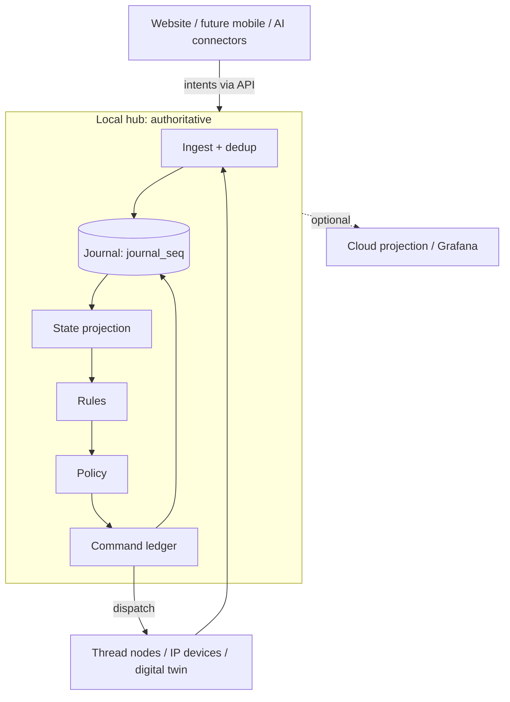

# Architecture overview

Talos is a local-first spatial security and automation platform. Full background is in [`docs/spec/MASTER_SPEC_v0_2.md`](../spec/MASTER_SPEC_v0_2.md). Decisions are in [`docs/decisions/`](../decisions/README.md).

## Authority

The hub owns events, state, rules, commands and audit. Everything else is either a client or an optional, non-critical projection.

## Packages and dependency rules
| Package | Contains | May depend on |
|---|---|---|
| `core/base` | `Result`, `Status` | — |
| `core/time` | `Timestamp`, `IClock`, `VirtualClock` | — |
| `core/domain` | IDs, property/zone/asset/device, ownership validation | base |
| `core/events` | `ObservationEnvelope`, typed payloads, validation | domain, time |
| `core/execution` | `Command`, lifecycle, `CommandLedger` | events |
| `core/journal` | `JournalEntry`, `IJournal`, `InMemoryJournal` | events, execution |
| `core/ingest` | `SourceTracker` (bounded dedup), `Ingestor` | journal, domain |
| `core/state` | pure reducer, replay, `state_at`, freshness | journal, execution |
| `core/policy` | grants, risk classes, `evaluate` | execution |
| `core/rules` | rules → intents → commands | domain, events, execution |
| `core/manifest` | board/module manifests, slot/power validator | domain |
| `core/engine` | `HubEngine`: the production hub loop | all of core |
| `simulation/base` | portable PRNG, geometry | — |
| `simulation/twin` | world, virtual sensors/actuators, virtual transport | core types, sim protos |
| `simulation/runner` | scenario runner, oracle, `talos_sim` CLI, corpus test | engine, twin, codec |
| `server/persistence` | `SqliteJournal` (durable `IJournal`) | journal, codec |
| `server` | `talos_hub`: config, auth, `HubService`, HTTP API v1 + SSE | engine, persistence |
| `packages/contracts` | generated TS types + typed `HubClient` | protos |
| `connectors/supabase_sync` | read-only Supabase copy worker | contracts (HTTP only) |
| `connectors/mcp_server` | MCP tools for AI agents (agent principal) | contracts (HTTP only) |
| `connectors/webhook_notifier`, `connectors/frigate` | out-of-process device adapters | hub device API only |
| `codec` | proto ↔ core mapping, YAML loader | core, generated protos |
| `contracts/proto` | `talos.v1` schemas | — |
| `web` | React website: live, replay, engineering, simulation | `packages/contracts` (HTTP only) |
| `tools/devsim` | virtual devices over the device API (dev/E2E) | HTTP only |
| `common/sha256` | streaming SHA-256 + HMAC (hub tokens, firmware OTA, wire tags) | — |
| `common/coap` | portable CoAP codec (device link + hub ingress) | — |
| `firmware/bridge` | firmware events → observation envelopes | portable, core/events |
| `firmware/portable` | NodeRuntime, drivers, OTA, bounded queue (host + ESP32-H2) | common |
| `firmware/sim` | virtual board + hub bridge (L2 twin) | portable, core (bridge/tests) |
| `firmware/esp_idf` | ESP32-H2 project, HAL adapters (skeleton) | portable, ESP-IDF |

**Hard rule:** `core` never depends on protobuf, SQL, HTTP, simulation, drivers or UI. `simulation` (Phase 2) depends on `core`, never the reverse.

## Data planes (spec §27)
- **Control:** command transitions are journaled. Highest priority.
- **Domain:** observations are journaled and projected to state and replay.
- **Observability:** device diagnostics and health live in a bounded in-memory registry, never the journal; `/metrics` uses bounded labels (ADR 0014).

## What is real vs provisional
- **Real and tested:** everything under `core/`, `codec/`, `contracts/`, `simulation/`, `server/`, `packages/`, `connectors/`, `tools/`, `web/` (browser E2E against the real hub) and `firmware/portable` + `firmware/sim`. The scenario corpus (`simulation/scenarios`) drives the real engine through the L1 twin.
- **Provisional data:** every number in `contracts/manifests/`.
- **Provisional behavior:** sensor and timing parameters in twin sites (ADR 0009).
- **Reserved switches:** Postgres storage, relay role (ADR 0010, 0015).
- **Compile-only:** the ESP-IDF build (no silicon yet; pins provisional).
- **Not started:** real Thread/OTNS, device claim/commissioning, hardware.
