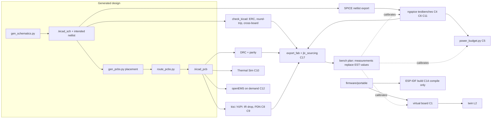

# Hardware verification coverage

What can be wrong with a Rev A board, which tool catches it before the bench, and what only the bench can answer.
Written 2026-11-20, before adding circuit, power-integrity, thermal and EM simulation. Section 4 is the plan;
section 5 records what the experiments showed (filled in as each tool is tried).

Every tool here runs from a command line and writes a machine-readable result, so an AI agent or CI can run it
and read the answer. A result is a model until a bench measurement replaces it (`provisional: true` rule).

## 1. Failure classes and current coverage

| # | Class | Example on our boards | Caught today by | Coverage |
|---|---|---|---|---|
| C1 | Firmware logic | Slot quarantine, mux recovery, SHT40 NACK handling | `firmware/sim` virtual board, `node_test`, `diag_test`, twin L2 (ADR 0018), `bench_node` + `tools/bench`/`tools/hil` | Good, but the chip models are ours (written from datasheets), so a misread datasheet is shared by model and driver |
| C2 | Schematic wiring | Wrong net on a pin, missing pull-up, two outputs on one net | `gen_schematics.py` intended netlist, `check_kicad.py` ERC, netlist round-trip, cross-board, safe defaults | Good for "drawn as intended" |
| C3 | Symbol / footprint pin mapping | Our TPS2553 symbol has pin 3 and 4 swapped versus the datasheet | `datasheet-register.md`, review | **Weak**: our symbols and footprints are generated from our own pin tables; nothing checks them against an independent source |
| C4 | Analog behaviour and component values | Divider ratio, ILIM current, soft-start ramp, power-path switchover, charger input, P-FET reverse block, inrush when a slot powers on | Hand calculations in docs and `power_budget.py` | **Gap**: nothing simulates a circuit |
| C5 | Static energy budget | Deep-sleep current, battery life | `power_budget.py` (model, SRC/EST rows) | Partial. Found stale: SW switches still modelled as TPS22917 (now TPS2553) |
| C6 | Dynamic power | Radio TX burst plus slot power-up sagging the 3V3 rail into brownout; regulator stability | Nothing | **Gap** |
| C7 | Layout connectivity and rules | Unrouted net, clearance, courtyard, schematic parity | `route_pcbs.py` DRC gate, `check_kicad.py` DRC | Good |
| C8 | Copper current capacity / DC IR drop | Thin VBAT neck at the charger, plane via starvation | Netclass widths only | **Gap** |
| C9 | Power distribution network impedance / decoupling | Decap too far from the ESP32 or the regulator | Placer's decap-distance term | **Gap** (no impedance number) |
| C10 | Thermal | Charger (BQ25186) at full charge current, TPS2553 into a fault, SHT40 self-heating from board copper | Nothing | **Gap** |
| C11 | Signal integrity | USB FS D+/D- impedance, I2C rise time with 4 branches + cards, SPI to slots | Nothing (all low speed) | Small gap: impedance and I2C rise time only |
| C12 | RF / antenna / EMC | Copper or parts in the module antenna keepout, enclosure detuning, emissions | Keepout rule area in `gen_pcbs.py` | Gap, mostly bench / chamber |
| C13 | Sensor physics | Magnet distance for the TMAG5273 contact, PIR field of view, humidity response | Twin L1 behavioural models | Partial: no physical field model |
| C14 | Firmware on real silicon | ESP-IDF driver timing, RMT/I2C peripheral quirks, deep-sleep wake | ESP32-H2 build in CI (compiles only) | **Gap**: no ESP32-H2 emulator exists |
| C15 | Thread network behaviour | Partitions, parent switching, sleepy polling | Simulated datagram transport | Gap; OTNS harness is open item P1 in `open-decisions.md` |
| C16 | Mechanical fit | Card in HSEC8 socket, board in enclosure, connector access | Tongue/keepout rules in `gen_pcbs.py`, 3D renders | Gap |
| C17 | Manufacturability | Assembler DFM, part availability | `export_fab.py`, `jlc_sourcing.py` (stock and placement) | Partial: assembler DFM review needs an upload (owner approval) |
| C18 | Environment and reliability | ESD, surge, temperature extremes, battery ageing | Nothing before the bench | Bench / test lab only |

## 2. Candidate tools (researched 2026-11-20)

| Tool | Fills | Why this one | Runs |
|---|---|---|---|
| ngspice CLI | C4, C6, C11 (I2C rise) | KiCad already embeds libngspice; `kicad-cli sch export netlist --format spice` exports our generated schematics | Seconds: CI |
| Vendor SPICE models (TI, AOS, Espressif none) | C4, C6 accuracy | Real device behaviour where a model exists and is not encrypted | With ngspice |
| kisi | C8, C9, C11 (impedance) | Node CLI, reads KiCad 8–10 boards, DC IR drop + PDN + impedance in one tool | Seconds–minutes: CI or local |
| KiPI | C8, C9 | Second opinion on IR drop and PDN; KiCad 9/10 plugin or standalone | Local |
| KiCad Thermal Sim | C10 | Fast heat-spreading estimate on all copper layers from the board file | Local |
| openEMS (+ gerber2ems / kicad2ems) | C11, C12 | Full-wave EM; only open option | Hours; local, on demand |
| magpylib (Python) | C13 | Analytic magnet field: TMAG5273 field versus magnet size and gap | Seconds: CI |
| OTNS / OpenThread POSIX | C15 | Already the plan of record (P1) | Linux CI |

Not adopted: AI-agent wrappers (SPICEBridge, kicad-mcp-pro, kicad-happy). They wrap the same CLIs this repo already
drives, so they add third-party code without new capability. Revisit if other agents need a shared interface.
ESP32-H2 emulation: Espressif's QEMU covers ESP32, -C3 and -C6, not -H2, so C14 stays bench-only.

## 3. How the pieces fit

Ordering rule: cheap, deterministic checks become CI gates with committed results under `hardware/results/`
(today: ngspice). Tools that need a download CI does not have yet (kisi, magpylib) or are slow (Thermal Sim,
openEMS) run on demand and commit their report.

## 4. Gaps left after the new tools

- **C3 pin mapping**: no tool. Plan: a script that checks each Talos symbol and footprint against pin tables
  extracted from the vendor datasheet text (pdftotext), plus human review.
- **Vendor models missing or encrypted** (TPS2553 encrypted PSpice, no BQ25186 model): behavioural models from the
  datasheet, labelled as ours. They test our circuit around the part, not the part.
- **C12 EMC and antenna in the enclosure, C16 mechanical, C18 environment**: bench, chamber or test lab.
- **C14 real silicon** and **C15 radio**: bench; OTNS covers protocol behaviour only.
- **Independent review**: autorouted layout still needs a layout engineer (HW-0005).

## 5. Experiment results (2026-11-20)

### Tool decisions

| Tool | Installed as | Verdict | Workflow place |
|---|---|---|---|
| ngspice 45.2 | KiCad's own `libngspice` via ctypes (`spice_sim.py`); Homebrew needed sudo, so not used | **Adopt.** Behavioural benches run in ~2 s; the KiCad CI image ships the same library | CI gate: `spice_sim.py --check` (verdicts must match `hardware/results/spice.md`) |
| kisi v0.3.3 | `kisi.mjs` release file, pinned by SHA-256 (`pi_report.py`). The npm package named `kisi` is unrelated and was not used | **Adopt.** IR drop, current density and thermal in ~5 s from the routed board and a generated `TL-SN-001.kisi.json` | Local, on demand: `pi_config.py` (CI checks it is current), `pi_report.py` → `hardware/results/pi.md` |
| magpylib 6.3 | Python venv | **Adopt.** Sized the door magnet in 3 s | Local, on demand: `magnet_sim.py` → `hardware/results/magnet.md` |
| KiCad Thermal Sim | Clone + arm64 numpy/scipy for KiCad's Python | **Keep as cross-check only.** Runs headless (~2 min at 0.2 mm), but its runner injects a fixed 2 W at U1; per-part heat needs our own driver. kisi gives per-part Tj from the power tree in seconds | Not in the workflow |
| KiPI | Clone + venv | **Human review only.** GUI-first, extracts boards from a running KiCad; no headless solver command | Owner/reviewer tool |
| openEMS | Not installed: no macOS package (conda-forge or Homebrew), source build is heavy | **Defer.** Module antenna is pre-certified; the board only needs the keepout | Linux Docker image if an RF question comes up |
| Vendor SPICE models | Not used: TPS2553 encrypted PSpice, none for BQ25186; TPS22917/TPS63900 models are PSpice-only | Behavioural models from datasheet numbers instead, sources in `spice_sim.py` | — |

### Findings

| # | Found by | Finding | Proposed action | Status |
|---|---|---|---|---|
| S-1 | ngspice B1 | Powering a slot with a 10 µF card (TL-MOD-003) draws a 0.5 A inrush through the TPS22917 (CT open, 44 mV/µs). With the TPS63900 at its guaranteed 0.4 A and a radio burst at the same time, V3V3_CORE dips to 2.80 V, below the ESP32-H2's 3.0 V minimum; radio idle leaves 15 mV of margin. A brownout here would also make the firmware quarantine a healthy card | Populate C27–C30 (CT) with 1 nF: inrush 26 mA, V3V3_CORE ≥ 3.29 V in every case. tON becomes ~3.8 ms, inside `kSlotPowerSettleMs` = 5 ms | **Owner decision** (board change) |
| S-2 | kisi power | Firmware admits module load up to `usb_sustained_mw` = 2500 mW on USB (generic default in `hal.h`), but the TPS63900 delivers 0.4 A × 3.3 V ≈ 1.3 W, of which the MCU's TX burst uses ~0.5 W. kisi: "U5 delivers 0.78 A, rated 0.40 A" with every slot at its SW budget | Set TL-SN-001's `usb_sustained_mw` (and the solar/battery budgets) from the regulator, ~800 mW provisional, in `board_tl_sn_001.h` | Proposed |
| S-3 | kisi power | `sensor_edge_v1` promises 150 mA SW per slot; four slots at once is 600 mA, more than the regulator. Admission control is what makes it safe | State in `sensor_edge_v1.md` that the SW budget is per slot, shared within the board's admission budget | Proposed |
| S-4 | ngspice B3 | Two SW rails shorted at once, radio transmitting, regulator at its 0.4 A minimum: V3V3_CORE collapses before the 7.5 ms FAULT deglitch. One short holds (≥ 3.26 V) | Accept as a double fault; a brownout resets the node with every SW switch off (EN pull-downs) | Accepted, noted |
| S-5 | magpylib | With the firmware's 3 / 1.5 mT thresholds a typical 20 × 5 × 3 mm N35 door magnet reads closed up to 24 mm and open only beyond 31 mm; every candidate saturates the ±40 mT range at 2 mm | Choose the magnet and raise the thresholds together (e.g. 20 / 10 mT: closed within ~10 mm, open beyond ~14 mm); consider the TMAG5273's ±80 mT range | **Owner decision** (magnet + firmware) |
| S-6 | ngspice B5 | USB priority threshold is 3.92 V typ (3.68–4.13 V with 1 % resistors); the generator's comment said ~3.7 V from a 1.0 V reference | Comment corrected (VREF 1.06 V, SLVSEA3F). Margin to a drooping 4.4 V VBUS holds | Fixed |
| S-7 | gap review | `power_budget.py` still modelled the SW switches as TPS22917 | Row now TPS2553-1 IIN_off 0.1 µA × 4 (sleep 27.1 → 27.5 µA, still < 40 µA) | Fixed |
| S-8 | kisi power | Power nets are 0.3 mm (Power class) with short 0.18–0.225 mm necks at pads; peak density 205 A/mm² at a neck on USB_VBUS, 30 mV drop at 0.9 A | Acceptable (IPC-2221: 0.3 mm 1 oz outer ≈ 1 A at 10 °C rise); widening USB_VBUS/CHG_IN/SYS_PATH to 0.5 mm is cheap margin | Optional |
| S-9 | kisi thermal | BQ25186 at 5 V / 300 mA (0.42 W) is the hottest part: Tj ≈ 58 °C at 25 °C ambient, 82 °C at 50 °C; board ≤ 73 °C at 50 °C | Fine below the 125 °C limit and TREG; θ values are package defaults until datasheet `PI_THERMAL` rows are added | Noted |
| S-10 | kisi gaps | USB D+/D- have no impedance target (Default class, 0.2 mm) | Full-speed USB (12 Mbit/s) tolerates it over 44–72 mm; no change | Noted |

### What is still not covered

Section 4 stands. In addition: the behavioural models are only as good as the datasheet numbers in them (a wrong
EST changes a verdict), kisi's θ values are package defaults, and none of this replaces measuring S-1 and S-2 on
the bench (bench plan stage 4).
