# Open-Source Spatial Security & Physical Automation Platform
## Comprehensive conversation-derived architecture, hardware, firmware, simulation, manufacturing, and implementation handoff

**Document version:** `0.1-draft`  
**Prepared:** 2026-11-15  
**Audience:** Claude or another coding assistant; project maintainers; future open-source contributors; electrical/firmware engineers; manufacturing partners  
**Format:** Implementation-oriented synthesis of the complete design conversation, **not** a verbatim transcript  
**Status:** Architecture synthesis; **not** an approved electrical schematic, frozen BOM, audited threat model, or guarantee of security reliability.

> **Reading instructions for an implementing agent:** Read this document completely. Part I explains the conversation and the way decisions evolved; Parts II–VI establish the current intended design. **Later decisions supersede earlier proposals.** Do not mistake conceptual diagrams, example YAML, candidate chips, electrical budgets, or suggested GPIO mappings for validated production engineering. Resolve items marked **OPEN / VERIFY** before schematic release or safety-critical use. Implement in small vertical slices with tests and decision records. If a conflict exists, the **Current Decision Register** and **Open Questions** take priority over the historical discussion.

---

<!-- AUTO_TOC_START -->
## Contents

- [Part I — Chronological conversation outline and design evolution](#part-i--chronological-conversation-outline-and-design-evolution)
  - [1. Project inception: an open-source full-stack home-security and sensing platform](#1-project-inception-an-open-source-full-stack-home-security-and-sensing-platform)
  - [2. CI/CD and digital twins become foundational, not optional](#2-cicd-and-digital-twins-become-foundational-not-optional)
  - [3. The twin's depth: decide what is modeled and what is covered by tests](#3-the-twins-depth-decide-what-is-modeled-and-what-is-covered-by-tests)
  - [4. Generalize beyond sensors: physical actuation and external AI connectors](#4-generalize-beyond-sensors-physical-actuation-and-external-ai-connectors)
  - [5. Data planes, telemetry, Grafana and the user/engineering boundary](#5-data-planes-telemetry-grafana-and-the-userengineering-boundary)
  - [6. Plan the hardware interfaces before a physical PCB](#6-plan-the-hardware-interfaces-before-a-physical-pcb)
  - [7. One-socket stacked cartridge concept (historical; rejected)](#7-one-socket-stacked-cartridge-concept-historical-rejected)
  - [8. Four coplanar sensor modules; cameras force intelligent-module support](#8-four-coplanar-sensor-modules-cameras-force-intelligent-module-support)
  - [9. Initially proposed modular power cartridges (historical; rejected)](#9-initially-proposed-modular-power-cartridges-historical-rejected)
  - [10. Integrated battery/USB-C/solar power on main controller (current direction)](#10-integrated-batteryusb-csolar-power-on-main-controller-current-direction)
  - [11. Solar should plug in like USB-C; final feasibility discussion](#11-solar-should-plug-in-like-usb-c-final-feasibility-discussion)
  - [12. Decide when implementation can start](#12-decide-when-implementation-can-start)
  - [13. PCB fabrication, turnkey assembly, factory firmware, provisioning and OTA](#13-pcb-fabrication-turnkey-assembly-factory-firmware-provisioning-and-ota)
  - [14. Transcript request and project naming (context, not core spec)](#14-transcript-request-and-project-naming-context-not-core-spec)
  - [15. Current request: comprehensive handoff for implementation in Claude](#15-current-request-comprehensive-handoff-for-implementation-in-claude)
- [Part II — Current product requirements and decisions](#part-ii--current-product-requirements-and-decisions)
  - [16. Mission, product scope, non-goals, and constraints](#16-mission-product-scope-non-goals-and-constraints)
  - [17. Current Decision Register (supersedes earlier conversation proposals)](#17-current-decision-register-supersedes-earlier-conversation-proposals)
- [Part III — Software and information architecture](#part-iii--software-and-information-architecture)
  - [18. Top-level system and three execution environments](#18-top-level-system-and-three-execution-environments)
  - [19. Property hub and Thread network roles](#19-property-hub-and-thread-network-roles)
  - [20. Domain entities, ownership, and relationships](#20-domain-entities-ownership-and-relationships)
  - [21. Spatial representation, nominal behavior and full replay](#21-spatial-representation-nominal-behavior-and-full-replay)
  - [22. Event, device and telemetry contracts](#22-event-device-and-telemetry-contracts)
  - [23. Actuation, authorization, command lifecycle and safety](#23-actuation-authorization-command-lifecycle-and-safety)
  - [24. Integration framework and extension strategy](#24-integration-framework-and-extension-strategy)
  - [25. Sensor families: semantic and electrical taxonomy](#25-sensor-families-semantic-and-electrical-taxonomy)
  - [26. Actuation families and future hardware generality](#26-actuation-families-and-future-hardware-generality)
  - [27. Control, domain, and observability streams](#27-control-domain-and-observability-streams)
  - [28. Website experience, configuration, debugging, and future mobile](#28-website-experience-configuration-debugging-and-future-mobile)
  - [29. Databases, deployment and optional Supabase/Railway](#29-databases-deployment-and-optional-supabaserailway)
- [Part IV — Hardware, firmware, power, cameras and physical modularity](#part-iv--hardware-firmware-power-cameras-and-physical-modularity)
  - [30. Physical product architecture: one controller, four coplanar modules](#30-physical-product-architecture-one-controller-four-coplanar-modules)
  - [31. Proposed sensor-slot electrical interface, pin budget and constraints](#31-proposed-sensor-slot-electrical-interface-pin-budget-and-constraints)
  - [32. Board support packages, module manifests and device configuration](#32-board-support-packages-module-manifests-and-device-configuration)
  - [33. Cameras: board-mountable options, power and protocol limits](#33-cameras-board-mountable-options-power-and-protocol-limits)
  - [34. Integrated power schematic and plug-in solar concept](#34-integrated-power-schematic-and-plug-in-solar-concept)
  - [35. Firmware runtime, low-power scheduling and sleep](#35-firmware-runtime-low-power-scheduling-and-sleep)
  - [36. OTA pipeline, signed releases, rollback and recovery](#36-ota-pipeline-signed-releases-rollback-and-recovery)
  - [37. Device onboarding, factory identity, owner claims and transfers](#37-device-onboarding-factory-identity-owner-claims-and-transfers)
  - [38. Practical component and resource verification checklist](#38-practical-component-and-resource-verification-checklist)
- [Part V — Digital twin, testing, build system, and security](#part-v--digital-twin-testing-build-system-and-security)
  - [39. Digital twin design philosophy and fidelity boundaries](#39-digital-twin-design-philosophy-and-fidelity-boundaries)
  - [40. World model, actors, sensor physics and closed-loop actuators](#40-world-model-actors-sensor-physics-and-closed-loop-actuators)
  - [41. Virtual PCB and device simulation architecture](#41-virtual-pcb-and-device-simulation-architecture)
  - [42. Scenario fixtures, assertions, and regression methodology](#42-scenario-fixtures-assertions-and-regression-methodology)
  - [43. CI/CD strategy, release gates and test artifact retention](#43-cicd-strategy-release-gates-and-test-artifact-retention)
  - [44. Monorepo, build tools and implementation conventions](#44-monorepo-build-tools-and-implementation-conventions)
  - [45. Security, privacy, reliability and safety model](#45-security-privacy-reliability-and-safety-model)
- [Part VI — Manufacturing, assembly, programming and ordering](#part-vi--manufacturing-assembly-programming-and-ordering)
  - [46. Manufacturer shortlist and selection criteria](#46-manufacturer-shortlist-and-selection-criteria)
  - [47. Manufacturer handoff package and traceable hardware releases](#47-manufacturer-handoff-package-and-traceable-hardware-releases)
  - [48. Factory flashing, test modes, secure provisioning and first boot](#48-factory-flashing-test-modes-secure-provisioning-and-first-boot)
  - [49. Prototype procurement, pilot batch and manufacturing timeline gates](#49-prototype-procurement-pilot-batch-and-manufacturing-timeline-gates)
  - [50. Hardware design handoff and ordering checklist](#50-hardware-design-handoff-and-ordering-checklist)
- [Part VII — Implementation roadmap and Claude handoff](#part-vii--implementation-roadmap-and-claude-handoff)
  - [51. Software-first roadmap, milestones and dependencies](#51-software-first-roadmap-milestones-and-dependencies)
  - [52. First complete vertical slice and acceptance criteria](#52-first-complete-vertical-slice-and-acceptance-criteria)
  - [53. Deliverables Claude should implement first, with acceptance tests](#53-deliverables-claude-should-implement-first-with-acceptance-tests)
  - [54. Acceptance criteria by subsystem](#54-acceptance-criteria-by-subsystem)
  - [55. Open decisions and risk register: what still needs discussion or verification](#55-open-decisions-and-risk-register-what-still-needs-discussion-or-verification)
  - [56. Requirements traceability and a living design process](#56-requirements-traceability-and-a-living-design-process)
  - [57. Suggested kickoff instructions to give Claude](#57-suggested-kickoff-instructions-to-give-claude)
  - [58. Reference test matrix covering the entire project](#58-reference-test-matrix-covering-the-entire-project)
- [Part VIII — Reference reading, terminology and final guardrails](#part-viii--reference-reading-terminology-and-final-guardrails)
  - [59. Official documentation and useful starting references](#59-official-documentation-and-useful-starting-references)
  - [60. Terms and meanings](#60-terms-and-meanings)
  - [61. Final summary and implementation mandate](#61-final-summary-and-implementation-mandate)
<!-- AUTO_TOC_END -->


**Figure Guide (added for implementation clarity).** This edition includes lightweight architecture and flow figures throughout the document. They are intentionally simple and implementation-oriented. Figures are labeled inline as **Figure 1**, **Figure 2**, and so on, and are meant to be read together with the surrounding sections rather than as standalone formal diagrams.


---

# Part I — Chronological conversation outline and design evolution

## 1. Project inception: an open-source full-stack home-security and sensing platform

**User's initial request.** Build a full-stack, self-hostable/open-source home-security platform, covering both interior and exterior of a property. Survey the customary security-sensor landscape: cameras, glass vibration, door/window open/closed, PIR/motion, and any other useful categories. Represent a property's floor plan and placements of sensors, learn nominal sensing periods and ordinary behavior, expose an authenticated application for setup and debugging, and execute notifications or speaker warnings. The user specifically wants spatial activity heatmaps and replay of multiple days of activity. Hardware should be inexpensive and modular, using one or at most two small custom PCB families, perhaps inexpensive commercial compute boards, with printable housings. Explore BLE or other low-power communication, a central node/hub, energy-aware scheduling, and graceful degradation when battery energy is insufficient. Keep the abstractions first-principles and simple; consider bus-like vehicle electronics as conceptual inspiration. Users should host their own infrastructure instead of the project maintainer paying for a shared cloud, and a website should precede a mobile app.

**Assistant's first response and agreed direction.** Recast the project as a **local-first, distributed, spatial sensing and automation platform**, not a conventional alarm panel. Six initial abstractions: **Space, Device, Signal, Event, State, Action**. Separate low-bandwidth sensor nodes from high-bandwidth cameras. Use an always-on property hub as the logical authority, small battery-powered wireless nodes for sensors, and IP/Ethernet/Wi-Fi for cameras and powered equipment. Normalize device observations into event envelopes, maintain current and inferred state, retain event history, and expose user/engineering interfaces. Use a property graph, time-indexed replay, statistical baselines, rule-based actions, and simulation. Suggested Thread/IEEE 802.15.4 for sensors; BLE as a commissioning/proximity option; Wi-Fi/Ethernet for video; MQTT internal to the hub. A provisional ESP32-H2 low-power MCU was proposed. Cameras should initially be commercial RTSP/ONVIF sources rather than fully custom video PCBs.

**Key features enumerated:** perimeter/entry/indoor coverage, motion/PIR/mmWave, impacts/glass-break, openings, cameras/IR/thermal, environmental sensing, tamper, presence/access, infrastructure health, sirens/speakers/relays, notifications, spatial activity and replay. Safety alerts (smoke/CO/gas) should be integrated through appropriate certified devices rather than replacing life-safety equipment with DIY printed hardware.

## 2. CI/CD and digital twins become foundational, not optional

**User's refinement.** Add rigorous CI/CD with simulated arrays of houses, rooms, sensor arrangements, movement, failure cases, and expected outcomes; support low-level firmware testing too. Consider Bazel because much of the code will be C++, with Python and frontend languages elsewhere. Build the website first, then reuse a common backend when a mobile application is ready. Ask for broad framework and diagrams.

**Assistant's response.** Propose one monorepo and a **shared C++ production core**; the digital twin should be a parallel implementation of the physical world, **not a second copy of application logic**. Five conceptual layers: physical, communication, intelligence, application, experience. Stack suggestions: C++20, Bazel/Bzlmod for host C++/simulation, ESP-IDF/CMake for embedded firmware, Protocol Buffers, Python/pytest scenario orchestration, React/TypeScript/Vite for website, SQLite locally, MQTT, Docker Compose, GitHub Actions. Use a modular monolith rather than prematurely splitting server microservices. Digital twin with three scopes: (1) behavioral house and sensor model, (2) communication and energy model, (3) hardware-in-loop. Prefer deterministic discrete-event spatial simulation over photorealistic 3D. Run actual production ingestion, state, rules, database, and website against simulated devices. Use OpenThread POSIX/OTNS for actual Thread networking tests; pytest-embedded/physical fixtures for real MCU behavior. Design automated OTA pipeline, signed images, dual partitions, rollback; reserve a final first-power-on user experience that needs no reflashing.

**Initial vertical slice:** simulated nighttime backyard intrusion -> virtual PIR interrupt/report -> production state engine -> policy -> speaker action -> verified execution -> persisted history -> website replay -> CI assertions.

## 3. The twin's depth: decide what is modeled and what is covered by tests

**User's refinement.** Almost all software could be built before physical hardware. How to get very close to a configuration swap? Go deeper into twins, their relationship to custom PCBs, actual sensor physics and electrical inputs, and where simulation stops in favor of unit/integration/HIL testing.

**Assistant's response.** Two execution environments: **virtual hardware + real portable firmware** and **physical hardware + the same portable firmware**, producing the same serialized messages to the **same production backend**. Fidelity layers: (1) property/world, (2) sensor behavior/noise/latency/coverage, (3) device firmware/power/queue/OTA states, (4) network/retry/partition/sleepy routing, (5) actual electronics/silicon. Main twin extends through layer 4; layer 5 uses driver tests, targeted circuit models when needed, and HIL/measurement. Simulate door opening -> magnet/reed state -> electrical transition/bounce -> GPIO/wake -> actual firmware debounce/classification -> transport -> hub. Do not spend months simulating transistor-level power networks or precise antenna fields.

**Hardware-aware modeling introduced:** virtual board manifest specifying available GPIO, wake-capable pins, buses, power rails, nonvolatile storage, battery, current and OTA capabilities. Virtual sensor behavior (reed/Hall, accelerometer, PIR, temperature, mmWave, camera, tamper), calibrated later against real performance. Use HAL/ports-and-adapters in C++; compile portable logic for host and ESP-IDF target. Device configuration can be a runtime swap in the hub; for embedded code a different **build target/BSP** is normally still needed. Keep distinct **ground truth** in simulator versus inferred **system belief**; assertions can compare the two. Simulate energy per operating state, reset injection, power failures, signed OTA, test conditions and trace reproducibility. Build the website's property editor so it can also author/replay scenarios.

## 4. Generalize beyond sensors: physical actuation and external AI connectors

**User's refinement.** The project may grow to locks, speakers that announce arbitrary written statements, gates, lights, robots, and external AI agents (Grok connector, etc.). Discuss general integration before cloud backend choices.

**Assistant's response.** Broaden the domain to **Asset, Device, Capability, Observation, Intent, Policy**, plus Adapter, State, Diagnostic, Trace. Separate a physical asset (door) from the devices observing or controlling it (contact, camera, lock). Every capability declares **typed observations, commands, constraints, permissions, execution semantics, and health**. Three adapter boundaries: **device adapters** (Thread, Matter, cameras, vendor APIs, custom boards), **service adapters** (TTS, notifications, analytics), **client connectors** (web/mobile/AI/MCP). A physical output must use intent -> authorization -> preconditions -> durable command -> dispatch -> response -> observed-state verification. Avoid toggle commands that are hard to retry; use idempotent desired-state operations and command expiration to prevent stale unlock commands. AI agents act as scoped planners/requesters, not privileged controllers, and sensitive operations require stronger human authorization. A future separate **powered I/O/actuator PCB** can expose protected relays, MOSFETs, dry-contact/gate interfaces, feedback and interlocks. Locks/gates should use properly rated/certified mechanisms and independent safety protections. Model actuators as closed-loop virtual physical devices; their actions should actually change the simulated world.

## 5. Data planes, telemetry, Grafana and the user/engineering boundary

**User's refinement.** Fold expanded integrations back into the original system and decide how raw telemetry is streamed, stored, visualized with Grafana or similar, and converted into useful end-user information.

**Assistant's response.** Separate **control plane** (commands, authorizations and results), **domain/event plane** (observations, state transitions, alarms and replay), and **observability plane** (voltage, RSSI, packet loss, firmware logs, CPU/memory, detailed traces). Use common identity/correlation/time fields across planes but different retention/priority and storage. The hub remains authoritative; Grafana must never become a controller or critical dependency. OpenTelemetry from hub, optional Collector/Prometheus/Loki/Tempo/Grafana; tiny MCUs emit compact low-rate diagnostic records rather than running a heavy telemetry exporter. Health Projection Engine maps telemetry into user-actionable states: healthy, degraded, offline, low power, faulted, maintenance. Homeowner/advanced/engineering UI views disclose increasing depth; authorization remains distinct from UI complexity. Event IDs, command IDs, correlation and causation chains make it possible to go from “motion detected; speaker played” to packet retry and firmware diagnostic. Normal sensor reporting event-driven; transient debug bursts allowed with explicit duration, rate and power bounds. Long-lived security/audit records versus short-lived diagnostic detail and media retention. Avoid metrics cardinality blowups from unbounded labels.

**Cloud revisited, still provisional:** Supabase/Postgres for hosted application/read models and auth; Railway for optional API/relay; local hub with transactional event journal and rules; outbox/replication for optional remote experience. A cloud row change must never directly unlock a door; hub re-authorizes commands. No forced cloud costs for every installation.

## 6. Plan the hardware interfaces before a physical PCB

**User's refinement.** The next sensible discussion is component types, sensor electrical connections, software abstractions for swappable chips/modules, and how a production PCB could be fully manufactured/assembled by PCBWay or similar. No manual PCB soldering. Future actuation should be considered conceptually now, not fully specified.

**Assistant's response.** Introduced **board support packages, HAL/device drivers, device-tree-like board/module manifests**. Electrical sensor categories include binary GPIO/interrupt, Hall, digital I²C/SPI, analog ADC/comparator/piezo, PIR/IR-beam digital, UART radar/intelligent module, and high-bandwidth camera/audio. Candidate chips: ESP32-H2-MINI-1, DRV5032 low-power Hall, LIS2DW12 accelerometer, Panasonic EKMB PIR, Sensirion SHT40, preassembled radar (e.g., LD2410) for mostly external-power use. Board definitions are compile-time wiring/resources; module definitions say which chip and requirements; runtime configuration controls thresholds and sampling. The original plan used a reusable wireless controller plus sensor plug-ins; a separate powered output board would come later. PCBWay turnkey SMT/through-hole assembly, test pads, firmware flashing, prepared BOM/placement/test packages; factory-assembled modules throughout. Printed housings remain the user's DIY mechanical portion.

## 7. One-socket stacked cartridge concept (historical; rejected)

**User's refinement.** Wanted a distinct main non-sensing board that physically snaps to sensor boards without wires. Asked whether all nodes are slaves to a house master and what the central role should be.

**Assistant's response.** Explained three roles: property hub = logical authority; Thread border router = connects IPv6 Thread network to house IP; battery sensor controller = local MCU reading sensor cartridges. Thread is not a star of permanently connected slave sensors: powered Thread routers relay mesh traffic and battery sleepy end devices attach to parents; a Thread leader is not the property application's hub. Suggested low-profile board-to-board/mezzanine connector (e.g., Hirose DF40, Molex SlimStack) and an initial **one socket per node, potentially multiple sensors on the same card**, with a ~16-contact signal list. Hardware module ID via EEPROM or resistor, firmware capability discovery.

**Supersession:** The user subsequently rejected stacked, single-socket design. Keep the *logical separation* and *Thread topology*, but **do not build one stacked socket**.

## 8. Four coplanar sensor modules; cameras force intelligent-module support

**User's correction.** Stacking is expensive or awkward, and side-by-side assembly is preferable. Want up to **four separately insertable modules** into the central controller, potentially PIR + vibration + camera all in one node. Boards should occupy the same plane, with the FDM enclosure managing guidance and retention. Explicitly requested camera research, including small board-mounted cameras and connector impact.

**Assistant's revised design.** Four independent, **coplanar, side-entry** module sockets around the main controller; top-side-only component assembly where possible. **Two copper layers != two-sided component placement**—two-layer PCBs can have only one component-placement side, avoiding double-sided SMT process cost. Evaluate horizontal mating connector families or keyed **card-edge** socket/gold fingers; final selection open pending cost, footprints, retention and mating durability. Sensor buses: I²C (possibly four-channel mux for address conflicts), SPI shared with CS control, UART via switching/mux for intelligent peripherals, GPIO/interrupt/wake lines, module ID, reset and power rails; initial expanded connector ~18–20 contacts. The MCU has finite wake GPIOs and bus pins; a slot/resource manager and hardware manifest must enforce compatibility. Camera options investigated: inexpensive OV2640/ESP32-S3 camera; smart Arducam SPI 5MP buffered still module; Raspberry Pi Camera Module 3 12MP high-quality module needing MIPI CSI compatible host; ESP32-P4 vision processor with separate radio. **ESP32-H2 cannot directly operate standard DVP/MIPI CSI cameras or Wi-Fi video**, so an intelligent camera cartridge with its own ESP32-S3/vision processor and Wi-Fi is preferred for snapshots/basic video while ordinary sensors continue on the H2/Thread node. Full-time, security-grade video likely best served by IP cameras/PoE and NVR/Frigate; camera behavior and pretrigger buffering need real validation. A smart module has its own processor, Wi-Fi, firmware and OTA state, but is logically grouped with the controller in the device model. High-power modules cannot assume battery energy supports continuous video.

## 9. Initially proposed modular power cartridges (historical; rejected)

**User's refinement.** Compare battery lifetime, solar, rechargeable battery, wall plug; make power swappable too if sensible.

**Assistant's intermediate design.** Proposed a fifth separate power-module slot with primary AA, rechargeable 18650, solar + rechargeable, or USB-only cartridges. Explored watt-hour/average-current battery life, power-domain targets, individual switched sensor rails, 2W camera load scenarios, solar average-energy budgets and power-aware firmware. Battery only fits low-power sensing; camera active minutes/day radically lowers runtime; solar needs charging electronics and a reservoir. Separate power chemistry manifests, energy admission control and low-power policies.

**Supersession:** User explicitly decided this is over-modularization. **No separate swappable power board in current base design.** Keep energy/power abstractions and source telemetry; integrate power management in controller.

## 10. Integrated battery/USB-C/solar power on main controller (current direction)

**User's correction.** Put battery charging, solar and wall-power female connectors into the mainboard, keeping only sensing modules interchangeable.

**Assistant's response.** Adopt **one non-sensing central controller PCB** with four sensor sockets, removable protected rechargeable battery (provisionally 1S 18650), integrated safe charger/power path, USB-C 5V input, dedicated solar PV input, 3.3V MCU rail, independently managed low-power and high-power slot rails. USB-C alone, battery alone, solar + battery, USB + battery, or both external inputs should be handled safely if designed for them. Battery removable from printed housing, but mainboard always contains battery/power logic. Avoid sharing charging hardware with disposable AA batteries in a way that could charge primary cells. TI BQ25186 selected as **candidate** charger, not frozen. Potentially different population options on same PCB for low-cost variants. A hypothetical GPIO/resource and energy budget was discussed; later specification must verify details.

## 11. Solar should plug in like USB-C; final feasibility discussion

**User's refinement.** Research if solar can be an external plug-and-play module; whether controller must contain integrated solar circuitry; then proceed to resource budget.

**Assistant's response.** **Yes:** external solar hardware may provide a regulated 5V USB-like output or a raw nominal-6V photovoltaic source fed to a dedicated controller input/solar-aware charger. Either way, power conversion/charge control must exist *somewhere*. Preferred product experience: **plug in an ordinary compatible small panel to the dedicated weather-resistant PV input; onboard charger handles battery and input limits**, while a regulated solar-USB product can use the USB input as another option. Battery buffers clouds, dawn/dusk and load transients. USB and PV inputs cannot be simply shorted; need source selection, reverse-current protection, voltage limits and charging thermal constraints. Solar dynamic input regulation is not automatically a fully efficient MPPT tracker. An illustrative design used BQ25186, protected 1S lithium, regulator(s) and high-power switched rail; verify actual current/voltage/temperature. Example PV sizing: panel rating x full-sun-equivalent hours x system yield; example 1W->1 Wh/day, 2W->2 Wh/day under hypothetical 2hr x 50% yield; continuously powered 2W camera costs ~48 Wh/day before overhead. Camera power significantly exceeds contact/PIR power.

**Preliminary 4-slot resource budget.** Candidate H2 pins were allocated across main I²C, SPI, four direct wake inputs, power status, UART and USB/JTAG, with TCA9546A four-way I²C switch and TCA9535 16-line expander suggested. The candidate 20-contact connector provided grounds, always-on/switched 3.3V, switched 5V, I²C, wake, fault, SPI, UART, reset and ID. Aggregate rail and per-slot targets were rough. **Explicitly flagged as feasibility sketch, not validated pin map or schematic.** Four populated examples: PIR, vibration IMU, smart camera, environmental sensor. Board resource checks and power admission should be driven from the same manifests as simulation and CI.

## 12. Decide when implementation can start

**User's question.** Is anything else left to discuss before code?

**Assistant's answer.** Broad architecture is sufficiently settled for an initial implementation. Create an Architecture & Interface Specification v0.1, resolve data contracts, board/module manifests, event semantics, security invariants and development workflow, then implement the first full simulated vertical slice. Deferred choices: exact GPIO/MCU, connector, components, final PV/charger/rail electrical details, Wi-Fi camera capability and physical enclosure tolerances. Build software before ordering custom boards, but eventually validate on assembled dev hardware before factory PCB release.

## 13. PCB fabrication, turnkey assembly, factory firmware, provisioning and OTA

**User's refinement.** Consider PCBWay versus JLCPCB or other manufacturers, and have the company assemble and flash chips/boards so deliveries work immediately. Could factory-preconfigure Wi-Fi/networking and then OTA forever? Avoid manual soldering or programming. Not committed to a vendor.

**Assistant's response.** Shortlist **JLCPCB, PCBWay, Seeed Fusion, MacroFab**; Espressif module-level pre-programming could be considered at scale. Begin with turnkey PCBA + **post-assembly** firmware flash and factory verification; module-maker preprogramming does not replace final-board tests. Manufacture with Gerbers, drill, KiCad sources, BOM with MPNs and supply status, centroid/placement, assembly drawings, firmware/test image, serial/identity provisioning and fixture/test instructions. Add pogo-pin pads and testable boot/reset/power/slot/radio access. Factory programs known image, writes unique device identity, tests supply rails, four ports, radio and charge path, labels unit with QR/serial, returns test report; final boards should be **ready to pair and OTA**, not shipped with loose unassembled electronic components. Production credentials versus owner network credentials: **do not preload the buyer's Wi-Fi/Thread secret at factory by default**. ESP32-H2 lacks Wi-Fi; Thread nodes should arrive unclaimed and securely join via QR/commissioning workflow; Wi-Fi camera cartridges get their own secure setup. OTA dual application partitions, signed images, rollback, physical recovery, self-hosted signing/key management and care around irreversible security eFuses. Option for factory or service-provider box-build when the user later wants batteries and housing installed; lithium shipping requirements separately. Initial first quotes: JLCPCB and PCBWay, compare Seeed too; full cost including functional test and fixture, not just bare boards.

## 14. Transcript request and project naming (context, not core spec)

**User's earlier request.** Asked for an exact downloadable transcript; later decided a curated implementation handoff was more useful. The prior assistant explained that it could not directly access an exact raw chat export and supplied an extractor; **this current document is intentionally a comprehensive synthesis instead of a transcript**.

**User's naming request.** Asked for sci-fi, philosophy, mythology or language names. Suggestions were **Talos** (mythological automaton guarding Crete), **Limen** (Latin threshold), **Argus** (many-eyed guardian), **Eidolon** (image/likeness, fitting a digital twin), **Noema**, **Vesper**, **Janus**, **Aegis**, **Ansible**, **Sensus**. Talos and Limen were favored by the assistant, but **no project name was selected by the user**. Keep repo/package names neutral and configurable until chosen; check trademarks/repository availability before committing.

## 15. Current request: comprehensive handoff for implementation in Claude

**User's present decision.** The full transcript is too long and poorly structured to hand to an implementing model. Instead, produce a **very long, extremely thorough, navigable document** with table of contents, chronological exchange outline and then every design detail: software, hardware, firmware, manufacturing/ordering, digital twin, future generality, security, cloud, test strategy and milestones. This document is that handoff. Its purpose is to preserve architectural intent, decision history, open engineering choices and enough acceptance criteria to begin implementation without rehashing the conversation.

---

# Part II — Current product requirements and decisions

## 16. Mission, product scope, non-goals, and constraints

### Mission

Build an **open-source, local-first, modular, spatially aware security and physical automation platform** for houses and other properties. Hardware nodes detect physical phenomena; a property hub ingests and reasons about them; authenticated web/mobile and optional AI clients inspect the property and submit policy-checked actions; users can replay histories, debug from high-level experiences to firmware traces, and deploy their own data infrastructure. A deterministic digital twin and CI validate behavior before hardware exists.

### Primary capabilities

1. Model property floors, rooms, exterior areas, walls, openings, portals, camera fields of view and sensor coverage.
2. Register, pair, configure and supervise physical/simulated nodes with one or more capabilities each.
3. Detect openings, glass impacts, PIR motion, environmental conditions, tamper, infrastructure faults and selected camera detections.
4. Ingest and store authoritative observations/events; derive best-known current state and uncertain occupancy/movement.
5. Live property UI, floor-plan editing, sensor positioning and visualizations, timelines, heatmaps, synchronized replay and camera links.
6. User-defined rules: triggers, conditions/schedules, arming modes, actions, safe command execution and result verification.
7. Local notifications, sirens, speakers, lights, and future lock/gate/motor/smart-home actuation.
8. Power-aware firmware: event-driven low-power sampling, battery and charger health, energy reserve and temporary detailed debug capture.
9. Secure onboarding, local autonomy without internet, OTA and factory-ready first boot.
10. Deterministic digital twin of the system, from property and sensors through firmware state to network and closed-loop actuator behavior.
11. Strong engineering diagnostics with optional OpenTelemetry/Grafana and user-friendly health projection.
12. Open-source self-hosting with low deployment friction, optional Supabase/Railway and future app/agent integrations.
13. Mass-manufacturable, modular electronics, with no soldering or board-level hand assembly by the owner.

### Non-goals for initial release

- No professionally monitored or certified UL/EN alarm-system claim without independent validation/certification.
- No DIY replacement for certified smoke, CO, gas or life-safety sensors; integrate certified hardware where appropriate.
- No bespoke high-quality 24/7 PoE security-video stack in a tiny battery node; integrate standard IP cameras/NVR first.
- No direct uncontrolled AI access to locks, alarms, cameras or database infrastructure.
- No cloud requirement for critical local decisions; no centralized paid multi-tenant service required for all installations.
- No photorealistic digital twin or transistor-accurate MCU simulation for v0.
- No universal motor/power driver that claims to safely operate arbitrary locks or gates.
- No requirement that any sensor plug-in alone routes Thread packets or maintains independent network credentials.

### Hard product constraints

- **Four** separate **coplanar, side-entry, physically retained** sensor-module positions on each main controller; user rejected stacking.
- **One non-sensing main controller PCB** with processor/radio/power management, plus interchangeable sensor modules; intelligent module may have its own processor.
- Integrated **rechargeable battery, USB-C wall, and optional plug-in solar** path on mainboard; separate fifth power cartridge rejected.
- PCB fab/assembly/flashing/testing by manufacturing partner; no manual soldering at home.
- FDM-printed housings designed by user; printed guides/latches absorb load rather than relying on connector alone.
- Portability of firmware/hardware abstractions, not rigidity around one sensor brand or one MCU forever.
- Local-first, privacy-conscious operation, standalone website, accessible development setup, and self-hostability.

### Reliability priority ordering

1. Life safety and electrical protection constraints always override automation.
2. Critical detection, tamper supervision and local alarm response are protected from optional workloads.
3. User authorization and security policy apply to all command paths.
4. Record accepted events/commands durably; avoid destructive/unbounded replay, storage and log behavior.
5. Optional streaming, AI inference, elaborate diagnostics, cloud sync and nonessential camera activity degrade first.

## 17. Current Decision Register (supersedes earlier conversation proposals)


**Figure 1. Current architecture stack at a glance.** See this figure before reading the decision register.

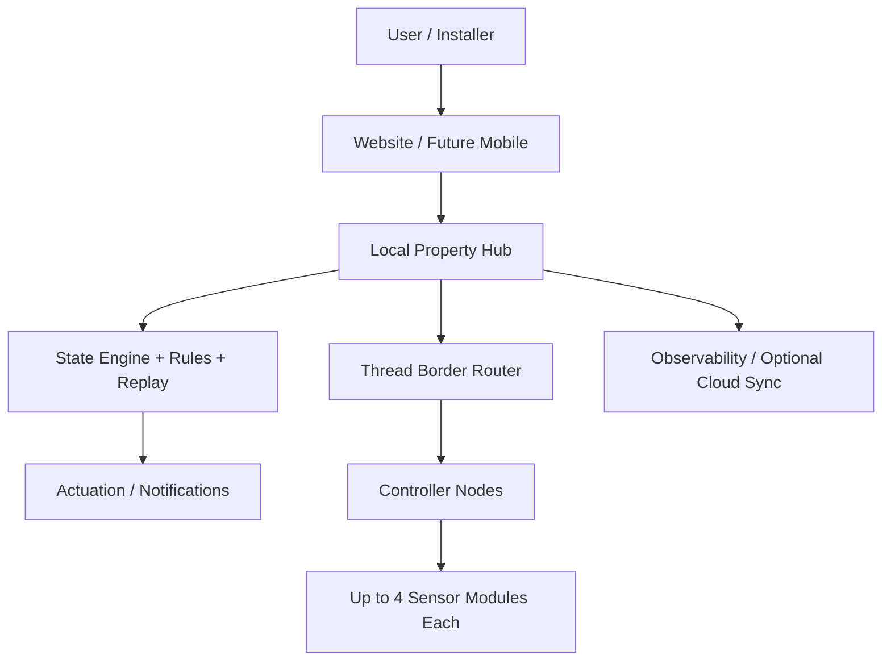

This is the simplest picture of the current direction: a local-first property hub, Thread-connected controller nodes, modular sensors, and optional cloud/observability services around the outside rather than in the critical loop.


| ID | Topic | Current position | Status |
|---|---|---|---|
| D01 | Product identity | Capability-based spatial security/automation platform | Decided conceptually |
| D02 | Authority | Local property hub owns critical state/rules/commands | Decided |
| D03 | Network | Thread/802.15.4 for low-power nodes; IP for high-bandwidth/powered devices | Strong provisional |
| D04 | Battery nodes | ESP32-H2-MINI-1 family candidate; sleepy Thread end devices | Candidate, verify |
| D05 | Sensors | **Four coplanar slide-in module ports**, no stacking | Decided mechanically |
| D06 | Module PCB assembly | One-face populated PCBA when feasible; two copper layers allowed | Decided preference |
| D07 | Module connector | ~18–20-contact horizontal/card-edge system | OPEN / select & verify |
| D08 | Power | Battery/USB-C/raw solar input/charger integrated on main PCB | Decided conceptually |
| D09 | Battery | Protected removable 1-cell rechargeable pack, 18650 candidate | Provisional |
| D10 | Solar | Plug-in compatible external panel, onboard compatible charging; regulated USB solar alternative | Decided conceptually |
| D11 | Camera | Smart, powered intelligent cartridge for modest use; standard IP/PoE for serious video | Strong provisional |
| D12 | Firmware | ESP-IDF, C++ portable logic, HAL/BSP, board+module manifests | Decided |
| D13 | Core server | C++20 modular monolith, typed events/commands, deterministic core | Decided |
| D14 | Build | Bazel/Bzlmod on host; native ESP-IDF/CMake for MCU; pnpm/Vite frontend | Strong provisional |
| D15 | API/contract | Versioned protobuf/domain schema, typed HTTP/WebSocket API | Strong provisional |
| D16 | Database | Durable local store (SQLite candidate); optional Supabase Postgres remote projection | Local authority decided; provider still provisional |
| D17 | Cloud | Railway/Supabase optional; no cloud dependency for alarm function | Decided principle |
| D18 | Frontend | Website/PWA first; native mobile later | Decided |
| D19 | Simulation | Deterministic discrete-event twin, real logic, ground truth and failure injection | Decided |
| D20 | Observability | Control/domain/diagnostic separation; optional OTel/Grafana | Decided |
| D21 | Actions | Typed capability-based commands; policy/ack/verification | Decided |
| D22 | AI integration | Future MCP/agent connector, least privilege, authorization on hub | Planned future |
| D23 | Manufacturing | Turnkey PCBA + factory flashing and testing; quote multiple vendors | Decided requirement; vendor open |
| D24 | Device ownership | Unique factory identity + owner-side secure pairing, not factory-installed home network secrets | Decided preference |
| D25 | Name | Talos/Limen/Eidolon/etc. suggested; no user-selected name | OPEN |

### Explicitly retired alternatives

- Generic Raspberry Pi Zero in **every** battery sensor: inefficient and costly compared to MCU.
- One stacked sensor daughterboard only: rejected in favor of four coplanar ports.
- Dedicated modular power PCB/fifth connector: rejected in favor of integrated mainboard power.
- Assuming all cameras run on ESP32-H2 or stream over Thread: technically unsuitable.
- Solely using BLE as the property network: Thread currently preferred because low-power IP mesh and existing tools.
- Making Supabase/Grafana/Railway necessary for local alarms: rejected.
- Simulating every silicon transistor and RF waveform: rejected as inefficient.
- Factory preloading home Wi-Fi credentials universally: rejected as poor security/multi-property practice.


# Part III — Software and information architecture

## 18. Top-level system and three execution environments


**Figure 2. Three execution environments sharing one conceptual system.**

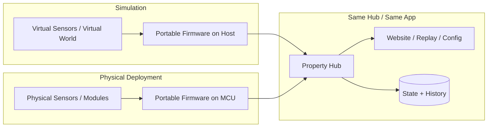

The intention is that the application/backend side is the same whether events come from simulated nodes or physical nodes.


**The same logical contracts should be exercised by: (A) in-process simulated nodes, (B) real protocol/network simulators, and (C) physical nodes.** The authoritative local server should not have branches like `if simulated then simplified_alarm_logic()`. Only adapters and time sources change.

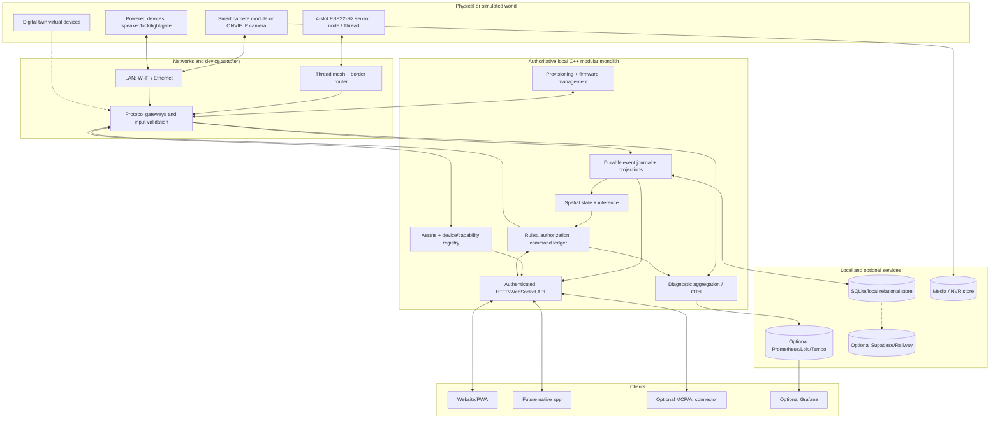

**Three execution contexts:**

- **Embedded MCU:** hard real-time-ish wake and sensing, low-memory firmware, local queue, communication stack, device identity, power protection policies, OTA. Local firmware is autonomous for immediate essential behavior but does *not* own cross-property policies.
- **Property hub:** authoritative identity, configuration, event journal, state engine, rules, authorization, spatial models, commands and audit, diagnostics and optional remote synchronization. Runs without internet.
- **Optional remote hosting:** browser/static site, Supabase identity/read projection, Railway relay/API, backups, permitted remote notifications, AI tool proxy; never a hard dependency for critical alarms.

**Core rule:** physical access to capabilities is only through typed ports/adapters, with security enforcement before high-risk outbound action. An integration cannot bypass authorization by writing to MQTT or a cloud table. The hub may use an internal message bus but it is not the source of authority by itself.

## 19. Property hub and Thread network roles


**Figure 3. Logical authority versus network roles.**

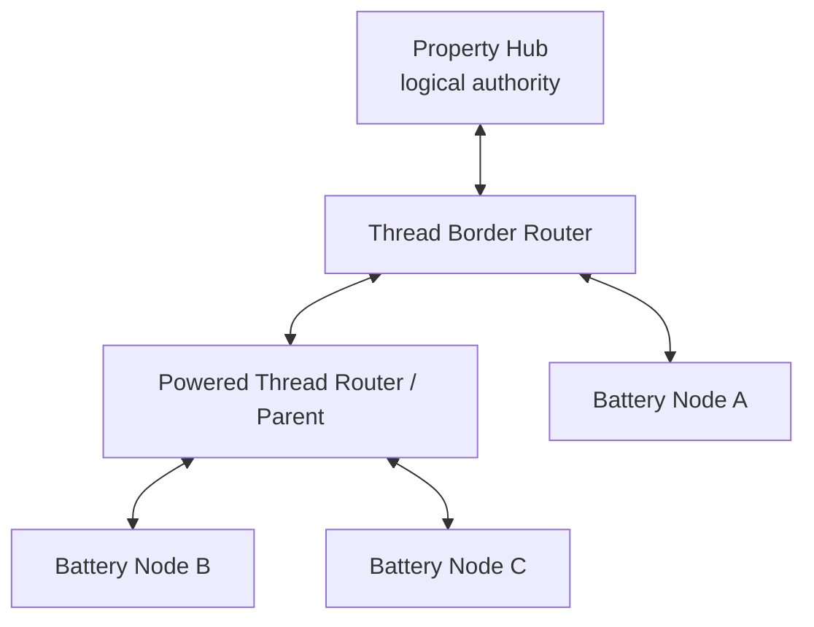

The property hub is the application brain. The border router is the IP-to-Thread gateway. Battery nodes are not directly equivalent to the hub's logical authority.


Do not call every device a “slave.” Separate the following:

- **Property hub / logical coordinator:** local computer executing the C++ application, event and rules engine and authenticated API. A low-cost Raspberry Pi or small mini PC is plausible; exact CPU/RAM/storage requirements should be benchmarked. For cameras plus NVR, choose more capable host and dedicated storage.
- **Thread border router:** network function connecting Thread IPv6 low-power mesh to ordinary IPv6/LAN. Could be colocated on a Pi/Linux gateway, using an 802.15.4 radio co-processor (nRF52840 example). Logical separation matters even on same physical host.
- **Thread routers:** powered mesh devices forwarding traffic, with automatic parent/topology maintenance. Can include separately powered controller boards when hardware/firmware supports routing.
- **Sleepy Thread end devices:** battery-powered ESP32-H2 nodes with one to four sensor cartridges, sleeping and receiving downlink via a Thread parent on their own schedule. **They do not forward mesh traffic.**
- **Thread network leader:** elected Thread protocol responsibility, not the property application's controller.
- **Wi-Fi/Ethernet camera/speaker/actuator:** separate IP endpoint(s) and high-throughput channel(s).

**Recommended data path:** compact device events/command acknowledgments over CoAP/UDP/IPv6/Thread (provisional) -> hub CoAP ingress -> normalized domain event stream / transactional journal -> rules and read model. MQTT is an internal/hub integration bus, not necessarily the embedded node transport. Camera video streams direct over Wi-Fi/Ethernet to NVR/storage. BLE helps owner-assisted commissioning when supported; BLE-only topology is not currently the default. External Matter/Zigbee/Z-Wave adapters can be added without changing the capability model.

**Practical resilience:** a single border router may suffice for a small home but is a possible single point of failure. Design supervision for missing parent/router and consider redundant borders/backhaul later. Avoid assuming a topology guarantees delivery or fixed latency. Node onboarding and OTA must handle sleeping receive schedules, long transfers, and partitions.

## 20. Domain entities, ownership, and relationships


**Figure 4. Core domain objects and how they relate.**

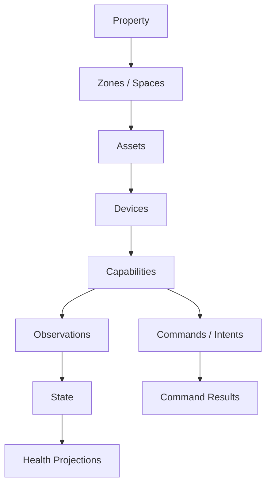

This is the conceptual object model the rest of the platform keeps returning to.


Formalize the product around the following objects (suggested fields; all IDs stable and scoped to owner/property):

| Entity | Typical fields / relationships | Important distinction |
|---|---|---|
| `Owner / Organization` | tenant ID, users, billing/deployment context | Owns authorization boundary, not necessarily cloud tenant |
| `Property` | ID, timezone, levels, modes, settings, retention, hub identity | Top-level domain and data boundary |
| `Level` | ID, elevation, floor-plan scale/transform | Supports multi-floor geometry |
| `Space / Zone` | polygon/volume, indoor/outdoor kind, adjacent portals | Room/yard, can overlap security zone |
| `Boundary / Portal` | wall, door, window, gate, connection, open/closed geometry | Asset location and transition graph |
| `Asset` | door/window/gate/speaker location, relationships | Physical thing separate from controllers |
| `Device` | ID, controller UUID, board rev, network endpoints, installed modules, health | A node, camera, lock or virtual device |
| `Slot` | 0–3, connector rev, power capabilities, module presence | Physical interface, not “sensor” |
| `Module` | type, serial/rev, optional smart processor, manifest, calibration | Board attached to slot; may expose many capabilities |
| `Capability` | type+version, observations, commands, limits, permission class | Stable product interface |
| `Observation` | source, capability, typed data, provenance, quality, timestamps | Evidence, not necessarily truth |
| `Event` | stable event identity, normalized occurrence, causation | Durable domain journal entry |
| `CurrentState` | projected observed/inferred statuses with freshness | Derived from events, not raw hardware |
| `Intent` | requested behavior by human/agent/rule | Not yet an authorized physical command |
| `Command` | typed action, identity, policy, TTL, status, ACKs, verification | Durable lifecycle |
| `Rule / Schedule` | trigger, conditions, policy context, actions, revisions | User and system automations |
| `MediaRef` | camera, timestamp/clip, retention, access control | Video stored outside event DB |
| `Health` | current user-actionable status + evidence | Projection of device/telemetry |
| `Diagnostic` | firmware errors, RSSI, retransmits, currents, heap etc. | Engineering observability, not automatically historical event |
| `Trace / Causation` | linked event/command IDs, durations and logs | Full end-to-end debug chain |
| `FirmwareRelease` | signed manifest, target board/module, version, hashes, policies | OTA orchestration and audit |
| `SimulationScenario` | layout, actors, faults, seed, timeline, assertions | Test fixture and website demo |

### Rules for separation

- A single **device** may contain four **modules**, and each module may expose several **capabilities**. Do not assume one device == one sensor.
- One **asset** (front door) may be associated with opening contact, vibration module, camera coverage and an electronic lock; capabilities could reside on different devices.
- `observed_state` is last defensible fact (and freshness), `inferred_state` is best estimate with uncertainty. Both can be `unknown`, `stale`, or `conflicted`.
- The simulator's **ground truth** is never ingested as a privileged property observation into the production state engine. Only virtual sensor outputs are ingested.
- A `command_sent` record is not a `command_verified` record. For physical actions, prefer independent state/feedback when available.
- A “module” can be a dumb sensor circuit or a smart processor/camera with independent network/firmware/OTA; registry must support both.

### Example asset association

```yaml
property_id: p1
assets:
  - id: front_door
    type: portal.door
    connects: [outside, hallway]
    attached_capabilities:
      - device: node_12
        module_slot: 0
        capability: contact.open_state
      - device: node_12
        module_slot: 1
        capability: impact.detect
      - device: smart_lock_3
        capability: access.lock
      - device: camera_entrance
        capability: video.observe_zone
```

## 21. Spatial representation, nominal behavior and full replay


**Figure 5. Spatial data and replay flow.**

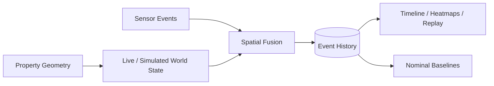

The replay system is not a bolt-on UI feature; it is an outgrowth of the event history and spatial model.


### Geometry and coverage

- User imports floor plan image or PDF as scale reference, traces room polygons and outer footprint, floors, walls, openings, gates/portals; property graph records adjacency and traversable paths.
- Sensors get a location, mounting orientation, coverage polygon or volume, nominal field of view/range, measurement uncertainty, occlusion/refractory behavior, and temporal parameters.
- Opening contacts attach to a particular portal; glass vibration to a particular pane/frame; PIR to a coverage wedge/region; camera to optical FOV plus detection zones; mmWave to zones/ranges.
- Thermal/IR/camera placement and privacy zones should be carefully exposed in UI; actual sensing geometry must be calibrated and not inferred solely from nominal datasheet drawings.
- Physical layout revisions should be versioned so an event at a given time refers to the sensor placement/coverage at that time. Do not rewrite event history after correcting a floor plan.

### Real-time inference

- Start with deterministic/fused evidence: last motion timestamps, portal transitions, camera detection metadata, presence duration; confidence and freshness decay appropriately.
- A PIR detects activity in a region, **not exact XY coordinates**. Avoid unjustified pixel-precise human traces; heatmaps should accumulate uncertain regional evidence.
- A state graph models likely movement through adjacent spaces, not certainty of individual identity. Camera detections and radar may refine localization when available.
- User-facing state should explain whether an area is *detected active*, *possibly occupied*, *clear under a stated model*, or *unknown*.

### Event sourcing, replay, snapshots

Treat normalized domain observations, accepted commands, acknowledgments and audited policy decisions as append-only records. Projections derive current state:

\[
S(t) = \mathrm{Reduce}(S_0, \{E_i : t_i \le t\})
\]

- Record source observation time, hub receipt time, logical per-device sequence, boot epoch, schema revision, calibration/version context and timestamp uncertainty.
- Maintain materialized latest-state and room/zone read models for UI; periodically snapshot for efficient multi-day rewind/replay.
- Deterministic reducers should be able to rebuild exactly from the same ordered event journal and configuration revisions.
- UI provides time scrubber, playback speed, device/zone filters, events, camera segment references, correlated rules and actions, and possible activity heatmaps.
- Video bytes live in NVR/media storage; event rows reference clips/timestamps and permission/retention metadata.
- Baseline “what is normal” by time of day, weekday, room, arming mode and household schedule; maintain false-positive review signals. Initially statistical and advisory; learned models should **not silently disable explicit intrusion rules**.
- Retention and privacy configurable by owner and data class. Delete/archive video independently of the security event ledger while reporting missing media gracefully.

## 22. Event, device and telemetry contracts


**Figure 6. Contract layers for incoming data.**

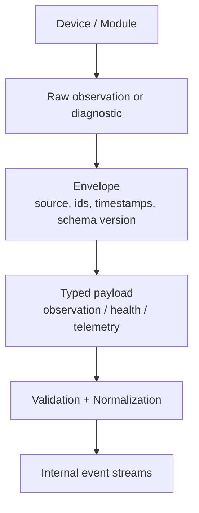

Every signal enters through a common envelope and then fans into the appropriate domain, control, or observability pipeline.


A normalized observation envelope should be versioned, stable, auditable and friendly to retry/deduplication. Suggested protobuf schemas for actual implementation; human examples below are JSON-like.

```json
{
  "schema_version": 1,
  "property_id": "house-01",
  "device_id": "node-07",
  "module_id": "vibration-card-02",
  "capability_id": "window.impact",
  "kind": "observation",
  "event_type": "impact.detected",
  "event_id": "node07:boot42:seq1092",
  "device_boot_id": "boot42",
  "sequence": 1092,
  "observed_at": "2026-11-15T02:04:16Z",
  "received_at": "2026-11-15T02:04:17Z",
  "payload": {"accel_peak_mg": 840, "duration_ms": 12},
  "quality": {"calibration_rev": "v2", "battery_percent_estimate": 78},
  "causation_id": null
}
```

**Required semantic protections:**

- `event_id` survives transport retries; stable unique key may include hardware identity + persistent boot epoch + monotonic sequence. An event with the same ID may arrive twice; effects must not duplicate.
- `observed_at` from MCU may be inaccurate; keep hub `received_at`, sample clock origin, sequence and uncertainty. Do not make clock synchronization a prerequisite for every alarm.
- Domain events are *different* from raw diagnostics. A high-frequency accelerometer trace or RSSI sample should be stored/streamed under a diagnostic data contract, subject to rate limits.
- Device payload types and units must be explicit (mg, mV, °C, W, dBm, milliseconds, etc.) and reviewed for integer overflow/floating precision and protocol sizes.
- Schema compatibility tests: old firmware <-> new hub, new firmware <-> old supported hub; unknown capability/field behavior specified.
- Per-device event ordering should be stable where causal; unrelated devices can be concurrent. No global “happened-before” guarantee from wall timestamps alone.
- Security: cryptographic device identity, authenticated transport/session/network, replay protection, ownership, and malformed-packet quotas must be designed.

### Suggested logical topic/RPC names (illustrative)

```text
property/{property_id}/device/{device_id}/event
property/{property_id}/device/{device_id}/health
property/{property_id}/device/{device_id}/desired
property/{property_id}/device/{device_id}/reported
property/{property_id}/command/{command_id}/result
```

This naming is appropriate as an internal MQTT projection; **do not assume the embedded Thread transport must speak MQTT**. The CoAP (or other approved Thread application) adapter converts to the common contract. Most device/firmware code should know only the typed transport interface, not database or topic names.

## 23. Actuation, authorization, command lifecycle and safety


**Figure 7. Command lifecycle.**

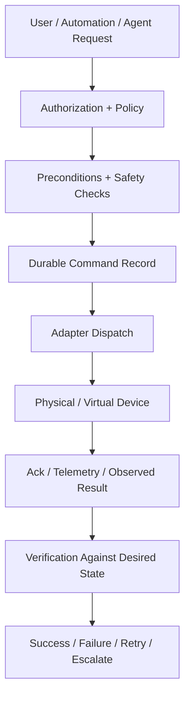

This is the flow to preserve for locks, speakers, gates, lights, and any future actuator.


The execution model for any action (lock, light, speaker, siren, gate, camera capture, reboot, firmware update) is:

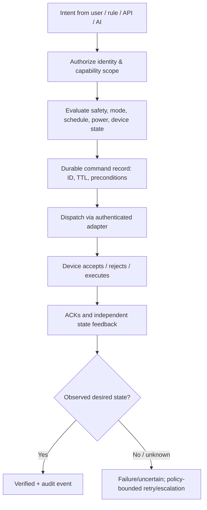

Example command fields:

```yaml
command_id: cmd-a24b
idempotency_key: "user-33:door-front:lock:true:revision4"
principal: user-33
property_id: house-01
asset_id: front_door
capability: access.lock
operation: set_locked
arguments: {locked: true}
created_at: "2026-11-15T02:04:16Z"
expires_at: "2026-11-15T02:04:21Z"
preconditions:
  policy_revision: 9
  device_freshness_max_seconds: 30
  required_power_mode: operational
verification: observed_state
risk_class: security_critical
```

**Commands have lifecycle states** such as `requested`, `denied`, `accepted`, `queued`, `dispatched`, `device_acknowledged`, `completed_unverified`, `verified`, `rejected`, `timed_out`, `expired`, `canceled`, `unknown_result`. Accepted/queued are not completed. Result processing must be idempotent and handle out-of-order ACKs.

**Operational requirements:**

- Idempotent *set state* versus ambiguous `toggle` whenever possible.
- Outbound physical command should expire; never unlock hours later upon reconnect. A “current approval” must be time-/scope-bound and be rechecked locally if needed.
- Different safety classes: informational reads; occupancy/camera sensitive reads; benign reversible outputs; disruptive audio/siren/motion; security-critical lock/disarm/user changes.
- Per-principal access, permissions, approval prompts, audit logs; homeowner UI and engineering UI access are not synonymous with authority to unlock.
- Some critical responses may be local to the hardware device (e.g., stop unsafe motor movement). Do not entrust emergency hardware safety to the cloud or general-purpose C++ hub.
- A speaker `speak` should support text, source, priority, volume cap, quiet hours, cooldown, cancellation, success/failure and local TTS if desired.
- A siren should have bounded duration, manual cancel controls, tamper/safety handling, independent power where needed, and rules for recurrence during reconnect.
- Smart locks/gates use certified actuator mechanisms/controllers; no software-only assumption of mechanical egress, stall detection or entrapment prevention.
- Cloud/AI cannot bypass hub policy; arbitrary MQTT publishing or SQL row writing must not be a privileged shortcut.

### Automation DSL outline

```yaml
name: backyard_motion_warning
trigger:
  event: motion.detected
  zone: backyard
conditions:
  armed_mode: away
  schedule: sunset_to_sunrise
actions:
  - operation: camera.capture_or_record
    target: camera_backyard
    duration_seconds: 60
  - operation: notify
    recipient_role: owner
  - operation: audio.speak
    target: patio_speaker
    text: "This property is monitored."
    volume_percent: 65
    cooldown_seconds: 300
```

Support **dry-run simulation** against historical/synthetic events, preview of policy decisions, trace of every decision and actual device outcome, conflict priority and power admission. Rule revisions and user identities persist as audit records. Sun events require location/timezone handled at property scope, with correct daylight-saving behavior.

## 24. Integration framework and extension strategy


**Figure 8. Integration categories.**

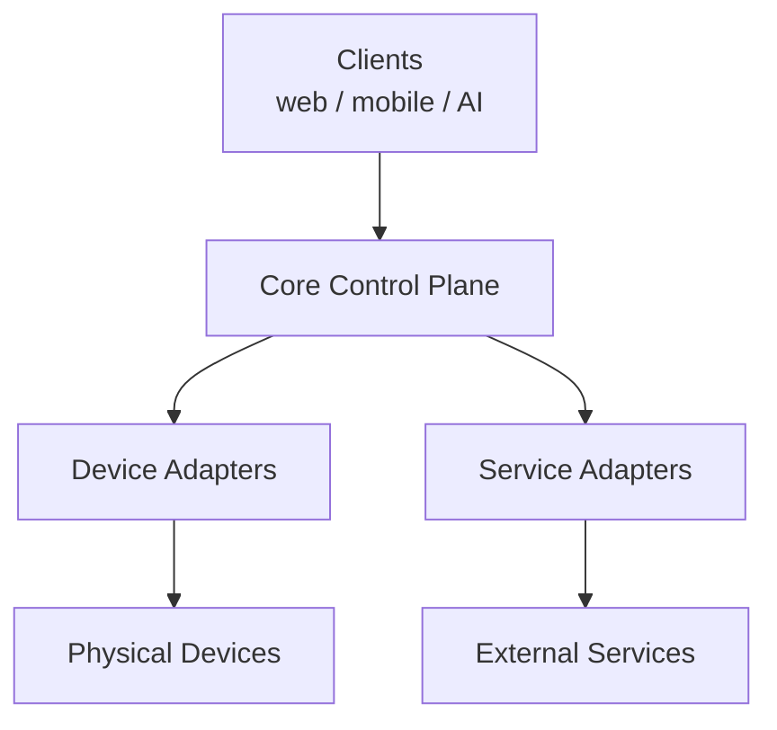

The project should not collapse device integrations, external services, and AI clients into one plugin type.


Distinguish three adapter families:

1. **Device adapters:** Thread, BLE commissioning, Matter/Zigbee/Z-Wave, vendor cameras, RTSP/ONVIF, locks, smart speakers, controller PCBs, simulation. Translate typed observations, execute typed commands, report health.
2. **Service adapters:** TTS engines, push notifications, analytics, video object detection, optional forecasting/agent services. May be local or external.
3. **Client connectors:** website, future mobile app, MCP server exposing safe resources/tools to Grok/ChatGPT/custom agents, third-party webhook/API clients. These request data/actions through authenticated API; do not touch radio or event store directly.

**Device-adapter contract sketch:**

```cpp
struct DeviceManifest;
struct Command;
struct CommandResult;
struct DeviceHealth;
struct ObservationSink;

class IDeviceAdapter {
public:
    virtual ~IDeviceAdapter() = default;
    virtual DeviceManifest describe() const = 0;
    virtual void subscribe(ObservationSink&) = 0;
    virtual Task<CommandResult> execute(const Command&) = 0;
    virtual DeviceHealth health() const = 0;
};
```

Use trusted in-process C++ adapters for selected core integrations, but allow out-of-process third-party adapters behind an authenticated bounded API (gRPC/protobuf or equivalent), so unknown plugin code cannot compromise the whole hub. Capabilities are **typed domain behaviors**, not generic `set_value(1)`. The registry carries `type`, `version`, allowed observations/commands/params, power needs, permission class, availability/health and simulation model name.

**Adapter lifecycle:** discovery -> installation (possibly explicit user approval) -> pairing/credentials -> capability registration -> ongoing health -> configuration -> updates -> revocation/deletion. A misbehaving integration should not crash the whole event engine. Conformance tests validate event forms, command ACK/status, timeouts, idempotency, diagnostics, permissions and degradation. Extension manifests need stable schema, versioning, safe defaults and error handling.

**Future AI/MCP integration:** resources such as `list_properties`, `get_room_state`, `search_activity`, `get_clip_metadata`, and tools such as `simulate_rule`, `propose_rule`, `request_notification`, `request_speaker`, `request_disarm` (subject to strong human authorization). Agent is planner/requester, not trusted authority. Recorded audio/video descriptions are untrusted data and may contain prompt-injection instructions; never elevate them into control-plane commands. Implementation must verify current APIs supported by any target Grok/AI client before claiming native compatibility.

## 25. Sensor families: semantic and electrical taxonomy

First identify **what is measured**, and separately **how it electrically connects**, **what wakes it**, **what power it needs**, and **what coverage/false-positive behavior** it has. Every module may implement several capabilities.

| Category | Example sensing modalities | Electrical interface | Characteristics / modeling |
|---|---|---|---|
| Door/window | Reed, Hall magnetic, tilt, latch/hinge, garage position | GPIO or I²C, interrupt | Contact bounce, polarity, magnet gap, stuck switch, tamper |
| Glass/frame impact | Piezo, MEMS accelerometer, shock detector | ADC+analog front end or I²C/SPI+INT | Impact amplitude/duration, mount coupling, noise, false positives |
| Acoustic glass break | Audio mic + classification, certified detector output | Analog, digital/I²S on capable processor, GPIO alarm | Glass acoustics vs household sounds; privacy and compute costs |
| Interior motion | PIR, dual-tech PIR/microwave, IR beam | GPIO or UART | Optical coverage, warmup, motion velocity, refractory period, pets |
| Stationary presence | mmWave radar, occupancy radar | UART/I²C/other | Continuous higher draw, zoning/distance, false triggers |
| Exterior | Outdoor PIR, radar, IR beam, driveway sensor | Digital/UART, external protection | Rain, sun, vegetation, pets, weatherproofing, condensation |
| Optical/video | Visible, NoIR, thermal, wide-angle, PTZ, depth | Smart IP camera or camera processor | FOV, night vision, encoding, video retention, compute/power |
| Environment | Temperature, humidity, frost, water leak, water level | I²C/GPIO/ADC | Slow polling, calibration, condensation, physical exposure |
| Life safety integration | Smoke/heat/CO/gas listed detectors | Certified device interface | Not DIY substitution; independent device operation |
| Physical integrity | Enclosure tamper, cable cut, displacement | GPIO, supervised loop, accelerometer | Tamper during sleep, protected sensors, long-term supervision |
| Access/presence | NFC/RFID/keypad/BLE presence, lock state | UART/SPI/I²C/BLE | Credential security; presence isn't identity certainty |
| Infrastructure | Battery, charge current, PV input, RSSI, packet loss, flash, CPU | MCU/PMIC/diagnostics | Low rate normally; bounded high-detail debugging |

Candidate reference chips/modules from the discussion (all require datasheet/availability/cost validation):

- **ESP32-H2-MINI-1-N4:** main low-power Thread/802.15.4/BLE module with secure firmware features; integrated RF module reduces bare-chip antenna design complexity.
- **TI DRV5032:** very-low-power Hall switch for magnetic open/close; variants differ in output polarity, supply, sensitivity and hysteresis.
- **Reed switch:** cheaper passive magnet input in some configurations; requires appropriate pull-up/pull-down/supervision and debounce.
- **ST LIS2DW12:** low-power 3-axis accelerometer, hardware motion/wakeup interrupt; useful for vibration/impact and orientation, with real glass mounting validation.
- **Panasonic EKMB PIR series:** very-low-current motion sensor modules with built-in electronics, lens/geometry; specific model to choose for detection area and installation.
- **Sensirion SHT40:** low-energy I²C temperature/humidity readings, sensor must be placed away from heat and given ventilation.
- **Hi-Link LD2410 radar family:** UART intelligent radar presence, significantly more power than sleepy Hall/PIR; use external power or larger energy budget.
- **Piezo transducer + analog front end:** possible alternative vibration card; requires protection, amplifier/comparator/filter, characterization and wake strategy.
- **Enclosure tamper:** SMT tactile/leaf/reed switch input; should remain monitored even when other modules power down.

**Critical physical constraint:** a combination must make *mounting sense*, not merely fit electrically. A window accelerometer needs good glass/frame mechanical coupling; a PIR needs correct Fresnel lens/orientation; a temperature sensor needs ventilation; camera needs optical clearance/night-vision strategy. Allow multi-function modules when mounting requirements align, while retaining four independent plug-ins for disparate orientations.

### Four-slot example installation

- Slot 0: PIR module with digital output and lens facing hallway or yard.
- Slot 1: vibration accelerometer module attached where mechanical coupling is appropriate.
- Slot 2: intelligent camera module with its own processor and Wi-Fi; may be enabled only with adequate power.
- Slot 3: humidity/temperature, magnetic contact, additional radar, etc.

These slots are **interchangeable** and not tied to particular capability types. Any module may itself offer multiple capabilities (e.g. contact+vibration+tamper).

## 26. Actuation families and future hardware generality

The second optional custom PCB family may be a **powered protected I/O controller**, not a battery sensor. It should use the same capability/command architecture but likely a different electrical connector/power domain.

| Actuator | Contract | Hardware/transport direction | Special safety |
|---|---|---|---|
| Speaker | `audio.speak`, `audio.stop`, volume | Local/IP speaker, Wi-Fi/Ethernet, optional local TTS | Volume/time limits, cooldown, privacy |
| Siren/strobe | `alarm.activate/deactivate` | Protected driver and separate power where needed | Current/thermal protection, bounded duration |
| Light | `light.set_on`, brightness | Matter/vendor controller or relay | Electrical safety, state verification |
| Smart lock | `access.lock/unlock` | Certified lock through supported authenticated integration | Strong authorization, no delayed unlock, preserve egress |
| Gate/shutter | `gate.open/stop/close` | Supported motor-controller input, limit contacts | Hardware interlock, entrapment prevention |
| Relay/contact | `output.set`, `output.pulse` | Isolated/protected output board | Explicit permissible load envelope |
| Camera | `capture`, `record`, `ptz`, `configure` | ONVIF/vendor or intelligent module | Media privacy, camera FOV limitations |
| Robot | High-level motion/mission request | Separate controller/service | Robot-local safety and stop logic |
| HVAC/valve | Setpoint/valve command | Certified supported integrations | Fail-safe default and resource limits |

The proposed **Board B** (later, not v0 priority) would have external regulated supply, protected output circuits, optional isolated inputs, feedback, watchdogs, health, fault and tamper reporting, no claim to safely power arbitrary mains devices/motors. A controller can expose many output channels, and each belongs to an asset/capability with typed constraints.

**Digital twin for actuation:** simulated action changes world state (lock becomes locked after transition, speaker makes acoustic output, gate actually changes passage, light affects simulated illumination). Include latency, power availability, jam/limit/feedback loss, collisions, duplicate commands and policy denial. This is closed-loop simulation, not merely confirming commands were published.

## 27. Control, domain, and observability streams


**Figure 9. Three data planes.**

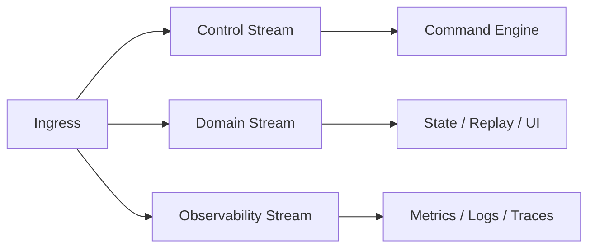

A major design principle is that engineering telemetry must not overload or semantically blur the user-facing domain history.


### Three logical planes

| Plane | Examples | Durable truth | Failure priority |
|---|---|---|---|
| Control | authorization decisions, command request/accept/ACK/verification | Durable command ledger/audit | Highest for safety/secure state |
| Domain | motion, opening, impact, detection, current property state, replay | Durable event journal + read models | High for actionable events |
| Observability | RSSI, retries, queue depth, current, heap, raw IMU debug, firmware logs, tracing | Shorter retention/aggregation | Best effort, drop first |

These need not use separate physical brokers. One internal bus can partition topics/queues and priorities; an alarm event must not queue behind 1000 raw accelerometer debug samples. Distinguish P0 critical, P1 state change, P2 device health, P3 debug. Bounded queues/backpressure, logging rate limits, device per-priority byte budgets and energy budgets must be explicit. Delivery is not guaranteed in every topology; record that limitation.

### OTel and Grafana placement

- Instrument hub/services with OpenTelemetry; collector optional. Basic endpoint metrics can be published via a Prometheus-compatible scrape or OTLP adapter. Loki logs and Tempo traces can be added for engineering deployment.
- **Do not run a heavy OTel stack on tiny ESP32-H2 nodes.** Firmware emits compact diagnostic frames tagged with stable device IDs and event/command correlation IDs, sampled and transformed at hub.
- Grafana is **read-only engineering observability** for default architecture. Do not make a Grafana dashboard or alert controller necessary to fire a physical alarm.
- Default install uses built-in health UI, structured local logs and event journal. Optional `observability` Docker Compose profile adds collector, Prometheus, Grafana, then optionally Loki/Tempo.
- Metrics labels must remain bounded: subsystem, sensor kind, deployment, outcome; avoid unique event ID or unbounded UUID labels. Put exact IDs in logs/traces/domain records.

### Streaming frequencies and modes

- Reed/contact: send meaningful transitions immediately (interrupt); periodic supervision heartbeat with sleep-aware policy.
- PIR: onset/clear event, low periodic health; raw timing only in debug.
- Vibration: low-power hardware threshold interrupt; send classified impact and optional short raw buffered sample **only when enabled and power permits**.
- Temperature/humidity: sample every minutes/variable, aggregate; no constant high-rate stream.
- Battery and link: periodic samples and threshold events; frequencies decrease as energy drops.
- Camera: media directly to local NVR over IP; event metadata into domain bus; video/recording policy and retention independent.
- Hub resources: periodic CPU, RAM, disk, queue depth, rules latency, protocol ingress, error counters, tracing sampling.

The discussed illustrative heartbeats included 15 minutes and battery hourly in some contexts, but **none are yet calibrated engineering requirements**. Make configurable per device/role, adapt to energy/radio conditions and retention.

### Health projection

`HealthProjection(telemetry + last_report + expected_interval + device_capabilities) -> healthy/degraded/offline/low_power/faulted/maintenance` plus evidence and recommended action. Homeowner sees “Window sensor disconnected / battery low,” advanced user sees last seen and estimated battery, engineer can inspect wake cause, link retries and raw traces. **UI disclosure level is separate from permission level.**

### End-to-end correlation

Source events have IDs and causation; hub creates correlated policy/action traces; e.g., backyard PIR event -> CoAP receive -> validation -> spatial state -> nighttime rule -> speaker command -> ACK -> playback status. The device need not run a continuous distributed trace; use linked event IDs and hub spans. Failed observability backend must not lose critical domain events.

## 28. Website experience, configuration, debugging, and future mobile


**Figure 10. Product surfaces for different user depths.**

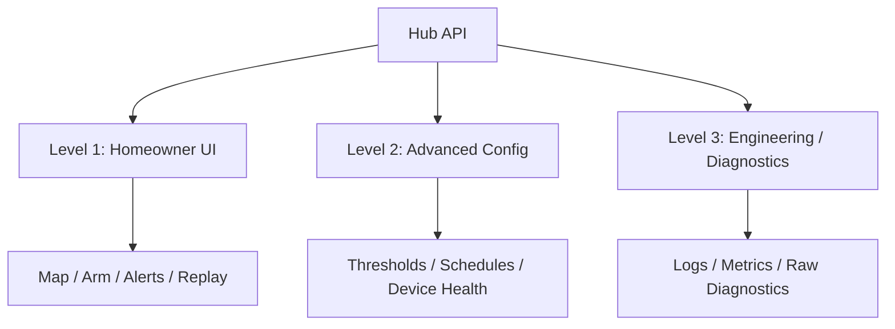

The same underlying system exposes different depths of information and control.


### Website-first principle

- Build a **React/TypeScript web application** (Vite candidate), usable as a PWA for mobile browser/home-screen use. Use the same API for future native app. Website is a client, not the authority.
- Public project site: docs, installer, source links, sample/demo property and simulator. Separately, the owner's actual local web dashboard is served from/authenticates to the local hub or an explicitly configured remote endpoint.
- A native iOS/Android app can later use React Native/Expo or another framework. TestFlight was discussed as beta distribution, but is not a permanent universal open-source install mechanism. Native app adoption should not require changing core backend.

### Key screens / user stories

1. **Onboarding:** create/select property, connect to local hub, secure ownership, scan device pairing QR, discover board and attached modules, assign asset/room, name device, verify online/health.
2. **Property editor:** upload floor plan (image/PDF), establish known length/scale, draw levels/rooms/walls/doors/windows/yard/gates, add sensor/module placements, edit coverage geometry and privacy boundaries, preview signal limitations.
3. **Live view:** map/color zones by observed/inferred state, arm/disarm with explicit secure action, last detections, health, camera clips, quick filter and notifications.
4. **History & replay:** event timeline, time scrub, controlled playback speeds, overlays/heatmaps, sensor coverage, uncertainties and associated video clips, rule/action trace.
5. **Automation editor:** typed triggers/conditions/modes/schedules/actions, preview, consent to security-critical changes, simulate against historical/twin data, explain why a rule fired.
6. **Module settings:** auto-generated parameters from capability manifests, requested vs applied revision, debug capture budget, firmware/power policy/thresholds, cartridge compatibility and per-slot mapping.
7. **Engineering view:** raw events, current/desired state, identity/firmware/board revision, power rails, wake reasons, packet stats, sequence gaps, serial/raw debug, diagnostic traces, optional Grafana link.
8. **Simulation mode:** choose example house, place virtual actors, inject failures, replay ground truth vs belief, examine policy, export test fixture to repository.
9. **Multi-property and users:** per-property roles, privacy boundaries, revoked access, device ownership transfers, audit and retention settings.
10. **Deployment health:** disk/video retention status, backup, hub clock, internet/cloud sync connectivity, missing modules, unsupported camera availability.

### API boundary

Suggest versioned authenticated HTTP APIs for property CRUD, asset/slot/module, events/query, snapshots, rules, firmware releases, commands, health and user roles; server-driven WebSocket/Server-Sent Events for live state and command status. APIs must enforce rate limiting, pagination, replay window sizes, access scopes and privacy; generated TS client from OpenAPI or protobuf contracts when practical. The website must not directly query device GPIO or the authoritative database without going through the API.

## 29. Databases, deployment and optional Supabase/Railway


**Figure 11. Local-first deployment with optional cloud sync.**

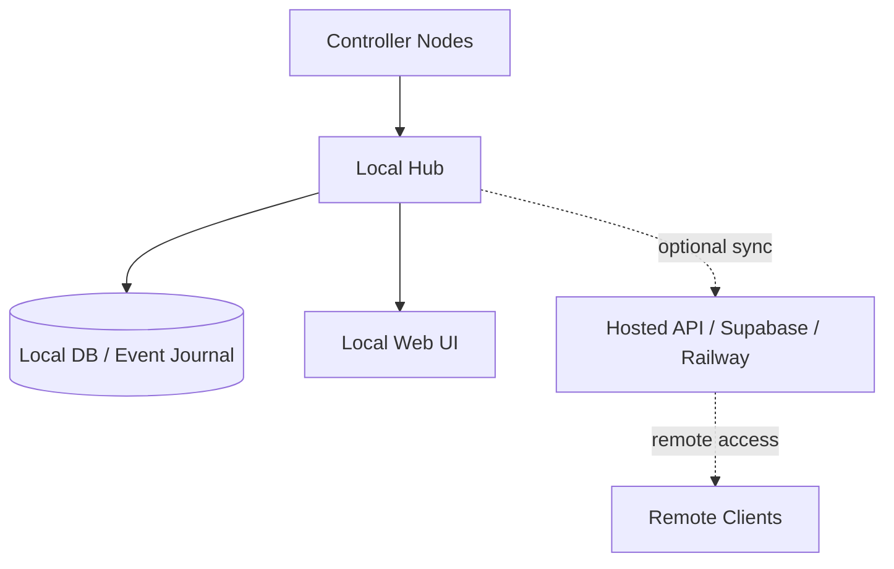

The cloud side is optional and should synchronize selected projections rather than replacing the local control plane.


### Local default

- Docker Compose: C++ hub service + SQLite or an otherwise small local SQL data store + optional MQTT adapter/broker + optional camera NVR/media process + static frontend. Include health checks, persistent volume paths, upgrade scripts, schema migrations and backup/restore.
- SQLite is a strong initial option for modest telemetry volume and easiest self-hosting. Durable journaling, transaction boundaries, concurrency/writer policy, migration strategy and corruption recovery need explicit tests. Video belongs on separate storage.
- Property command ledger and full local event journal remain authoritative when WAN is disconnected.

### Hosted advanced option

- **Supabase**: the user's preferred developer-friendly hosted identity/PostgreSQL/realtime option. It could host user accounts, property metadata projections, selected events/read models, remote notification state and customer-defined services. This is a **preference with architectural constraints**, not a commitment to move critical command execution to Postgres.
- **Railway**: optional hosted gateway/relay/API or worker runtime, convenient deployment templates. Should be swappable with VPS or local-only usage; users pay their own hosting costs.
- Remote state replication: local transactional outbox and idempotent sync; store source-of-truth ownership for each field. Reconcile config revisions and unacknowledged cloud-to-hub command intents carefully; reauthorize locally with TTL/preconditions.
- Supabase Postgres Realtime may be used to push read-model updates to remote clients; do not subscribe directly to every raw sensor packet as the core architectural transport.
- Supabase Auth/cloud service outages must not prevent an already authorized local operator from performing permitted local operations, subject to chosen offline auth policy.
- Self-hosting should support users who do **not** have accounts with Supabase or Railway. Document internet/backup/push limitations when offline.
- Sensitive camera/occupancy data should be local by default. Remote exposure only through explicit owner configuration, encryption and fine-grained permissions.

### Data ownership and synchronization table

| Data | Authority | Optional cloud copy? | Notes |
|---|---|---|---|
| Device identity/binding | Local hub, owner claims | Metadata only | Do not move factory private signing/root keys to public cloud |
| Current critical sensor state | Local projection | Yes, derived | Cloud may lag; show freshness |
| Commands and policy decisions | Local hub ledger | Audited summary | Remote intents not automatically executable |
| Property geometry | Owner-configured, versioned | Yes | Define revision/conflict policy |
| Historical events | Local event journal | Owner opt-in | Privacy and retention |
| Firmware release manifest | Signed release authority | Yes | Validate signature on node/hub |
| Video recordings | Local NVR | Optional with explicit policy | Potentially expensive/very sensitive |
| Health diagnostics | Local metrics/projection | Optional aggregates | Never block alarms on exporter |
| Users/auth | Local authorization; optional identity federation | Optional | Offline sessions and account revocation need careful design |


# Part IV — Hardware, firmware, power, cameras and physical modularity

## 30. Physical product architecture: one controller, four coplanar modules


**Figure 12. Physical product architecture.**

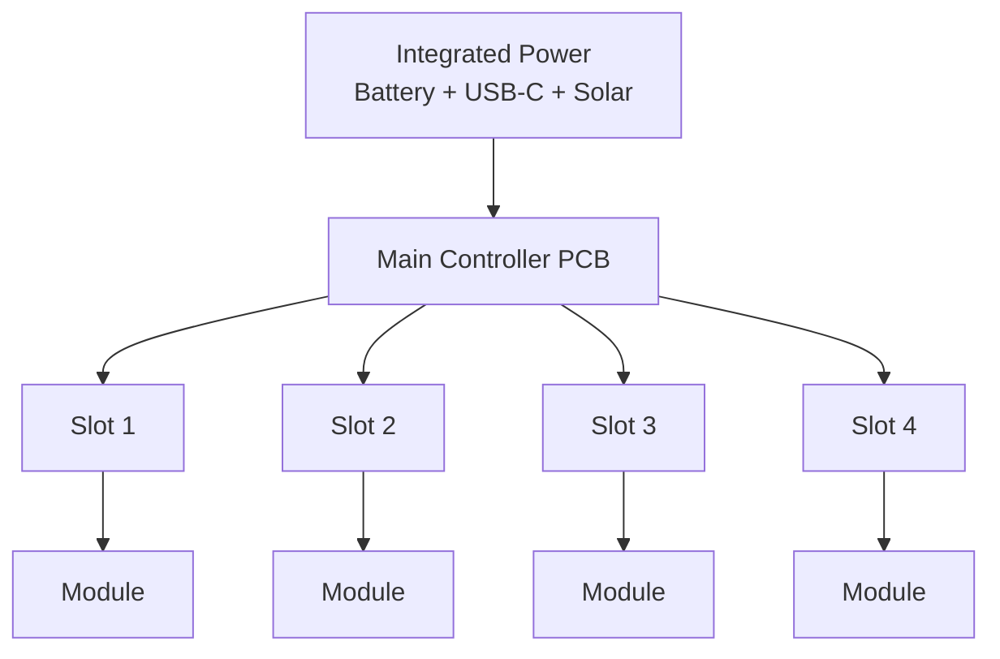

The main controller is not itself a sensor board; it is a reusable compute, radio, and power platform into which up to four modules are inserted.


### Final preferred mechanical concept

```
                              [ SLOT 0: PIR / sensor card ]
                                          ||
[ SLOT 1: vibration card ] == [ NON-SENSING CONTROLLER PCB ] == [ SLOT 2: smart camera ]
                                          ||
                            [ SLOT 3: contact/environment ]

Controller PCB carries:
  * ESP32-H2 radio/MCU module + antenna keep-out
  * board-specific power-management/charger/regulation
  * USB-C and raw solar/PV input connections
  * battery contacts / protected battery pack connection
  * shared serial buses, per-slot control/mux/interrupt/power protection
  * 4 coplanar side-entry sockets
  * debug/recovery/test pads + identification
```

Above is **conceptual geometry**, not a final orthogonal mechanical mandate. Four side-entry modular positions could be on four edges or another convenient perimeter distribution. Adjacent board faces remain roughly in one plane (not vertically stacked). Printed housings position cards so their sensing surfaces, lens and antenna have appropriate exposure; the mechanical latch/guide absorbs stress.

### PCB assembly economics

The user wanted to avoid expensive “two-sided boards.” Clarify in CAD and manufacturer quote: **two-layer copper routing is different from SMT components on both faces.** Mainboard and daughtercards should be designed for **single-side component population** where practical; 2-layer PCB may be a cost-effective baseline for routing, while 4 layers may still become necessary for RF, power, ground and signal integrity. Do not reduce layer count solely to meet an unverified price assumption; compare DFM/EMC, cost and assembly quotes.

### Side-entry connector research path

Candidate families from discussion: horizontal/coplanar board-to-board connectors, or socket/card-edge arrangement (possibly lower cost at volume since daughtercard needs only plated fingers). Actual part series, part numbers, footprints, insertion direction, mating height, durability, gold plating/ENIG vs hard gold, current per contact, pullout force, board thickness tolerance, bevel, insertion cycle rating, and failure behavior are **not yet finalized**. Do not copy vertical-stack Hirose DF40/Molex SlimStack sketches into production design without validating suitability for coplanar insertion. Identify a **keyed**, mechanically secure, small, manufacturable connector where all contacts and module-PCB stack-up are compatible with 3D-printed guide tolerances.

Potential risk in relying on FDM for precision: dimensional tolerances, warp, thermal expansion, screw/clip creep, contacts sliding under vibration. Prototyping must measure insertion/removal and contact resistance. Outdoor enclosure requires UV/heat/humidity protection, seals, antenna clearance, condensation management, and suitable PIR/radar/optical windows. Suggested materials: PETG or equivalent indoor, ASA/outdoor UV-resistant where appropriate, with gaskets and stainless fasteners if necessary.

### Module mechanics and no user wiring

- Every plug-in sensor card is its own factory-assembled PCB, not bare chip + flying wires.
- Cards physically snap/slide into mainboard edge connector and enclosure retention. A sensor card may hold multiple ICs.
- User manually slides boards and installs housings; **manual board soldering and assembly of loose electronic components are nonstarters**.
- The camera cartridge may contain an optical FPC internally assembled by vendor, but the user-facing module must remain a single cartridge with no loose FPC hookup.
- Sensors needing physical location separate from controller (glass vibration strongly coupled to pane, contact near magnet) may require alternate housing orientation or cabled commercial modules in later revisions; don't claim physically impossible mounting is solved only by firmware.
- Avoid hot plugging in v1: power off when swapping cards; future hot-swap requires connector sequencing and isolation.

## 31. Proposed sensor-slot electrical interface, pin budget and constraints


**Figure 13. Shared-bus resource model for the four slots.**

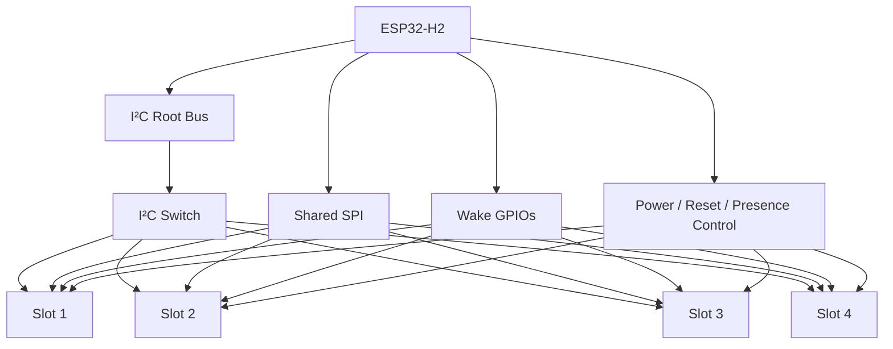

This figure explains why the design needs shared buses and a small amount of expansion logic rather than naive one-to-one wiring from every slot to the MCU.


### Tentative 20-contact functional pinout from the conversation

**Not schematic-ready; purpose is allocation and manifest validation.** The candidate layout below was the most detailed proposed design:

| Contact | Provisional signal | Behavior / design note |
|---:|---|---|
| 1,2,3 | GND | Reference/current return; placement and impedance to be optimized |
| 4 | `3V3_AON` | Tiny always-on load / wake-capable sensors; current limited |
| 5 | `3V3_SW` | Switchable low-power sensor rail; no backfeed when off |
| 6 | `5V_SW` | Only for qualified intelligent/high-power cards; current/power limits |
| 7 | `I2C_SDA` | Isolated per slot via mux/switch |
| 8 | `I2C_SCL` | Isolated per slot via mux/switch |
| 9 | `WAKE` | Dedicated wake-capable MCU path when possible |
| 10 | `ALERT/FAULT` | Open-drain shared/managed fault status, design carefully |
| 11 | `SPI_SCK` | Shared clock, signal-integrity budget needed |
| 12 | `SPI_MOSI` | Host to module |
| 13 | `SPI_MISO` | Module to host; tristate when deselected |
| 14 | `SPI_CS` | Per-slot chip select assigned via MCU or expander |
| 15 | `UART_TX` | Optional multiplexed serial output |
| 16 | `UART_RX` | Optional multiplexed serial input |
| 17 | `MODULE_RESET` | Per-slot reset or power sequencing |
| 18 | `MODULE_ID/PRESENT` | Identification / attachment sense; EEPROM on I²C is alternative |
| 19,20 | GND | Return and isolation considerations |

Possible future improvements: different distribution of ground contacts near SPI/high-current supply, separate `INT_2`, extra ground guard, dedicated power enable or one-wire ID. The literal 20-pin array is **not frozen**. Evaluate actual camera data/control and actuation requirements without violating low-power sensor compatibility. A slot-level configurable “UART vs SPI” pin mux needs explicit mutually-exclusive constraints and electronics.

### Slot requirements for specific sensors

| Module | Lines normally needed | Notes |
|---|---|---|
| Reed contact | GND, GPIO/WAKE, optional bias | Interrupt/debounce; resistor supervision possible |
| DRV5032 Hall contact | AON power, GND, wake | Correct output type and hysteresis; reverse magnetic orientation |
| LIS2DW12 vibration | I²C SDA/SCL + power + interrupt | Interrupt remains active while MCU sleeps; impact calibration |
| Panasonic PIR | power + digital wake + ground | Warmup and lens/orientation, quiescent current |
| SHT40 environment | switched power + I²C + ground | May share bus if no address conflict; thermal isolation |
| Piezo shock | analog ADC/comparator + ground + protection | **An ADC-capable path is not in the above proposed 20-contact allocation**; add an analog path or make module intelligent and publish digital interrupt/data |
| LD2410-style radar | UART + suitable power | Power and readout protocol must be validated; UART mux as required |
| Smart camera | control (I²C/UART/SPI), power, reset; own Wi-Fi | High data stream bypasses Thread; 5V peak budget and OTA |
| Tamper | wake/GPIO + ground | May be built into controller housing rather than module |

**Important design issue:** A pure 20-pin digital-centric slot does **not** necessarily support raw analog sensors. Decide whether the standard will support a protected `ADC_IN` pin, or require **analog front-end/comparator on cartridge**. For zero-assembly modularity, a sensor card with onboard analog conditioning may be preferable, but verify component count/cost and low-power behavior. This is a key outstanding specification decision.

### Shared bus support and expander candidates

- **I²C:** an I²C mux/switch such as TI TCA9546A divides main I²C into four branches, allowing the same sensor chip address on multiple slots. Ensure mux power/backfeeding behavior in sleep and isolation of stuck bus branches.
- **GPIO expansion:** TCA9535 class 16-bit I²C expander or equivalent for slot reset, power enable, chip selects, presence and faults, but do not assume an expander interrupt produces deep-sleep wake without verification.
- **SPI:** shared signals with unique chip-select per active module, appropriate tri-state, trace length and voltage; count actual CS resources.
- **UART:** one MCU UART cannot simultaneously directly drive four independent smart modules; choose UART switching, independent coprocessors or distinct bus availability, and declare conflicts.
- **Direct wake:** four slot wake signals on actual supported deep-sleep/RTC-capable pins or a correctly designed low-leakage wired-OR/latched wake circuit. One slot with multiple wake sensors may need onboard aggregation and per-cause status registers.
- **Power:** separately controllable AON/SW/high-power rails with allowed current/load. A physical 5V contact doesn't mean the pack can support 3W on every slot.
- **EEPROM/device-ID:** optional ID EEPROM on each muxed I²C branch or hardware ID resistor. Must not assume generic third-party Qwiic breakout auto-identifies.
- **Connector signal protection:** ESD, pull-ups, series resistors, logic-high compatibility, leakage and powered-off state across replaceable cards.

### ESP32-H2 physical GPIO sanity check

The discussion proposed **ESP32-H2-MINI-1** as controller. Espressif's current GPIO reference describes accessible GPIO as `0–5`, `8–14`, and `22–27` for relevant SiP-flash H2 variants, while `15–21` are usually consumed by flash, `26/27` default to USB-JTAG, and `7–14` belong to RTC wake group but GPIO7 is not externally brought out. Therefore the broad statement “19 accessible GPIOs” is plausible; **exact pins vary with module/chip/flash and toolchain**. See [Espressif ESP32-H2 GPIO reference](https://docs.espressif.com/projects/esp-idf/en/stable/esp32h2/api-reference/peripherals/gpio.html) and [Hardware schematic checklist](https://docs.espressif.com/projects/esp-hardware-design-guidelines/en/latest/esp32h2/schematic-checklist.html).

**Earlier tentative pin assignment (do not route without revalidation):**

| Candidate GPIO | Proposed purpose in conversation |
|---|---|
| 2,3 | Main I²C (PMIC, I²C mux, I/O expander) |
| 4,5,22 | Shared SPI SCK/MOSI/MISO |
| 10,11,12,13 | Four direct wake inputs |
| 14 | Power/aggregate fault wake |
| 23,24 | UART mux TX/RX |
| 26,27 | USB Serial/JTAG |
| 0,1 | I²C mux reset / expansion control |
| 8,9,25 | Reserved/boot-strapping caution |

**VERIFY BEFORE SCHEMATIC:** boot-strap behavior, specific module pad routing, RTC wake pins and allowed deep-sleep wake types, SPI flash interference, USB use versus GPIO, external low-speed clock choice (GPIO13/14), interrupt polarity/retention, output drive and energy in deep sleep. Then implement a machine-readable pin-budget checker in CI. The previous mapping is a **discussion sketch** and must not be treated as a design approved by Espressif.

### Resource allocation algorithm

At boot and whenever a module changes (while powered off):

1. Load compile-time board profile and check board revision.
2. Discover populated slots and read module IDs/manifests; unrecognized card defaults to **disabled/not powered** until safe identification.
3. Construct a demand set: I²C branch, address, wake pins, AON current, switched current, SPI/CS, UART availability, reset, special power/boot requirements.
4. Validate against electrical budgets and runtime power source; explicitly report incompatibilities.
5. Bind compatible hardware drivers and publish capability availability; forbid conflicting modes.
6. Apply versioned runtime configuration (thresholds, schedules) only after safety and capability checks.
7. Preserve `desired_configuration` vs `applied_configuration` and ACK/rejection trace; sleeping node may defer application.

## 32. Board support packages, module manifests and device configuration


**Figure 14. Three layers of configuration.**

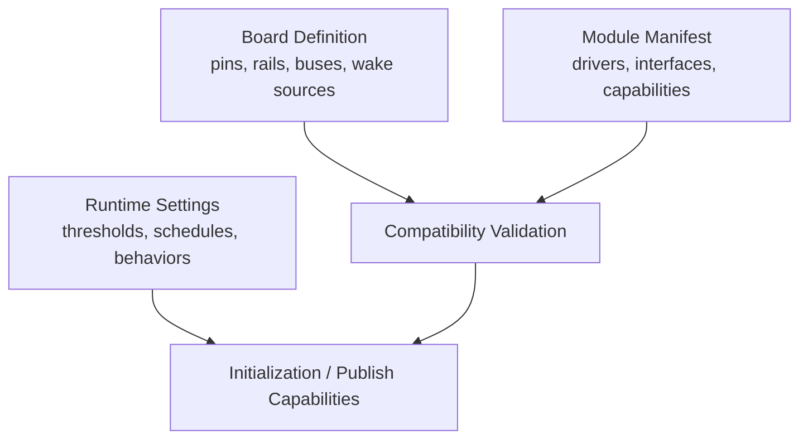

A recurring design choice is to keep board constraints, module identity, and user configuration distinct.


### Three configuration layers

1. **Board/BSP definition** — hardware version, MCU variant, pin mapping, connector topology, bus muxes, rails/regulators, power states, battery/charger, flash partitions, USB/test access, RF profile. Mostly compile-time or signed release data.
2. **Module profile** — each card's MPN/revision and actual devices, required drivers, bus addresses, interrupts, power states, max loads, startup times, calibration schema, sensing capabilities, constraints and simulator model. Could be stored in hub catalog and encoded by per-module ID EEPROM; remote untrusted modules cannot arbitrarily request unsafe pin modes.
3. **Runtime device configuration** — user-assigned slots/assets/rooms, sensitivity, intervals, sleep/health policy, installed firmware revision, action thresholds and schedules; validated and signed/authorized where required.

This resembles Zephyr Devicetree+Kconfig/BSP patterns. Even if ESP-IDF is chosen, use a declarative source of truth and generated validated tables. Avoid arbitrary runtime writing to MCU pin muxes based only on a network JSON configuration.

**Example manifest (illustrative, NOT final pin values):**

```yaml
board:
  id: universal_controller_v1
  rev: proto-a
  mcu: esp32_h2_mini_1
  radio: thread
  firmware_profile: universal_node
  slots: 4
  connectors: {protocol: sensor_edge_v1, contacts: 20}
  i2c:
    bus: I2C_MAIN
    mux: tca9546a
    branches: [0, 1, 2, 3]
  power:
    battery: 1s_rechargeable
    charging: bq25186_candidate
    input_sources: [usb_c_5v, external_pv]
    rails: [v3v3_core, v3v3_aon, v3v3_sw, v5_sw]
  wake_resources:
    per_slot: [WAKE_PORT0, WAKE_PORT1, WAKE_PORT2, WAKE_PORT3]
  flash:
    dual_app_ota: true
    partition_table: TBD

modules:
  - slot: 0
    module_id: pir_ekmb_v1
    requirements: {digital_wake: 1, always_on_current_uA: TBD}
  - slot: 1
    module_id: vibration_lis2dw12_v1
    requirements: {i2c_branch: 1, wake: 1}
  - slot: 2
    module_id: smart_camera_s3_v1
    requirements: {switched_5v_watts: TBD, control: uart_or_spi, own_wifi: true}
  - slot: 3
    module_id: environment_sht40_v1
    requirements: {i2c_branch: 3, switched_sensor_power: true}
```

### Firmware class boundaries

```cpp
struct IClock { virtual MonotonicTime now() = 0; };
struct IInterrupts { virtual void register_wake(SourceId) = 0; };
struct ISensorBus { /* typed transaction interface */ };
struct IPower { /* measure, reserve, enable/disable rail */ };
struct ITransport { /* send, receive, ACK, retry contract */ };
struct IPersistentStore { /* bounded atomic state */ };

struct NodePlatform {
  IClock& clock;
  IInterrupts& interrupts;
  ISensorBus& bus;
  IPower& power;
  ITransport& transport;
  IPersistentStore& storage;
};

class NodeRuntime {
public:
  explicit NodeRuntime(NodePlatform&);
  void boot();
  void on_sensor_interrupt(SourceId);
  void on_command(const Command&);
  void process_queued_events();
  void prepare_sleep();
};
```

The embedded implementation should favor static bounded allocations for early/high-priority paths, no uncontrolled heap churn while sleeping/waking, strict errors and watchdog timeouts. C++ type erasure/virtual methods are architectural examples, not mandatory inside tiny ISR hot paths. Low-level chip drivers are **specific** (e.g., LIS2DW12 register programming) but export generic capability observations at a higher layer.

### Source of truth and build compatibility

- Central schema files (protobuf/JSON schema/typed manifests) generate C++ and TS bindings.
- A board revision fixes electrical wiring; **module profile** explains chip usage; runtime config tunes behavior.
- CI checks module combinations against constraints, builds supported driver targets and replays tests.
- Future MCU migration (e.g. different 802.15.4 radio) should primarily require BSP/HAL, transport changes and new validated manifests—not rewrite of property engine or web.

## 33. Cameras: board-mountable options, power and protocol limits


**Figure 15. Smart camera module architecture.**

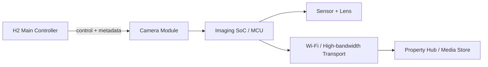

The current direction is not to force raw camera transport through the H2 controller or Thread mesh.


Cameras were initially overlooked in the “universal sensor card” framing; the user explicitly made them first-class, including smart cartridges in the same four-slot node. This design choice deserves separation from all other low-power I²C sensors.

### Candidate imaging options discussed

| Option | Characteristics | Appropriate use | Limitations |
|---|---|---|---|
| OV2640 with ESP32-S3 | 2MP DVP sensor; low-cost camera MCU ecosystem | Snapshots, development, moderate MJPEG | Not comparable to professional H.264/265 security NVR |
| Arducam Mini 5MP SPI-class intelligent camera | On-module buffered JPEG; SPI transfer to host | Occasional still images from generic SPI port | Data throughput and power too limiting for high-quality constant video |
| Raspberry Pi Camera Module 3 | 12MP, autofocus/HDR variants, Raspberry Pi CSI interface | Good image capture with Pi-class host | MIPI CSI cannot directly attach to H2 sensor socket |
| ESP32-P4 or vision SoC | More capable DVP/MIPI and compute, separate radio if needed | More advanced future smart cartridge | Extra cost/size/firmware/RF implementation |
| Standard IP/PoE camera | ONVIF/RTSP, IR/night, high bitrate, codecs, mature NVR | Continuous serious security coverage | Not a tiny low-power cartridge; wired or powered |

**Preferred initial architecture:** H2 handles low-power sensor/Thread/critical alerts. Camera smart cartridge has its **own camera processor + Wi-Fi**, connected to controller via low-bandwidth commands and power/reset/status. Camera media goes **directly via IP** to local NVR/hub; control/availability/physical device grouping goes through common capability registry. OTA and provisioning exist for **both** processors when present; parent and camera form a logical device group with separate cryptographic identities/endpoints if practical.

### Camera-specific specification issues to validate

- Snapshot only versus pre-trigger burst versus continuous streaming; waking a totally off camera after PIR trigger loses the pre-trigger event.
- Need for H.264/H.265 rather than JPEG/MJPEG, resolution and frame rate, IR sensitivity, low-light/sensor/lens selection, field of view, depth/focus, autofocus and image distortion.
- Power: boot peak, active/Wi-Fi load, IR LEDs/night illumination, thermal rise inside FDM enclosure, battery energy budget, optional PoE/wall.
- Camera processor boot time, image save latency, storage buffer, media retry, channel security, firmware update mode and recovery.
- RF: camera Wi-Fi and H2 Thread radios share crowded 2.4GHz bands; coexistence/interference may affect Thread delivery even when different chips; validate with real prototypes.
- Smart cartridge manufacturing: lens/optics may be preassembled with short FPC; contract manufacturer must deliver a **finished cartridge without user-visible loose assembly**. Optical focal alignment, dust ingress and factory optical test matter.
- Privacy: opt-in recording and masks; indoor camera video especially sensitive; cryptographic access and retention independent of raw metadata events.

### Capability-level model

```text
Module smart_camera_v1
  internal processor: ESP32-S3 candidate
  endpoints: local control link, Wi-Fi media
  observations: online/offline, motion/person/vehicle detection (as supported), image ready
  commands: capture, start/stop recording, configure, diagnostics
  power: high-load, switchable, source/energy admission
  firmware: separate signed image and update result
  asset linkage: room, field of view, privacy zones
```

## 34. Integrated power schematic and plug-in solar concept


**Figure 16. Integrated power architecture with plug-in solar.**

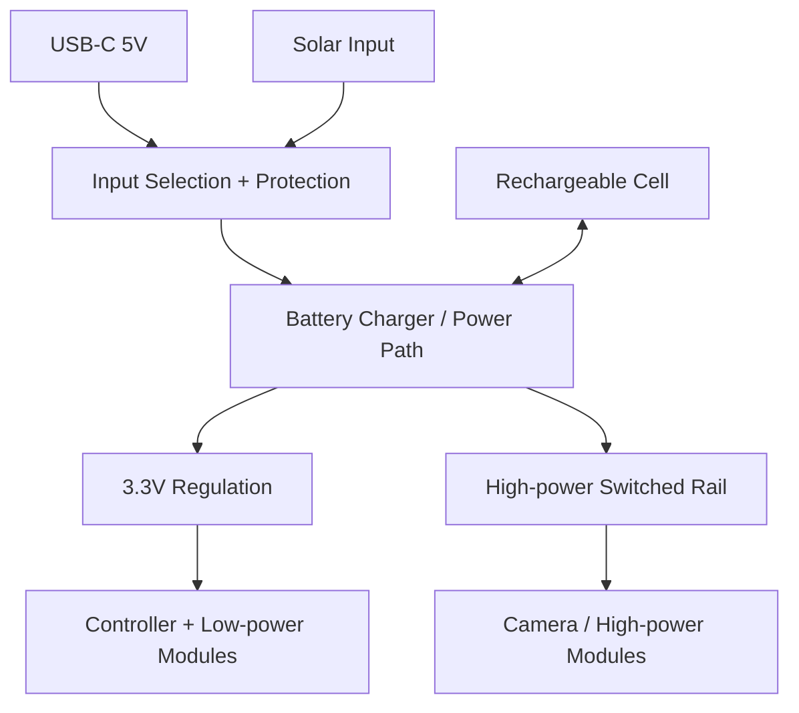

This captures the user's preferred outcome: solar plugs in as an input option, while the board still contains the required charging and power-management logic.


### Current integrated-mainboard power concept

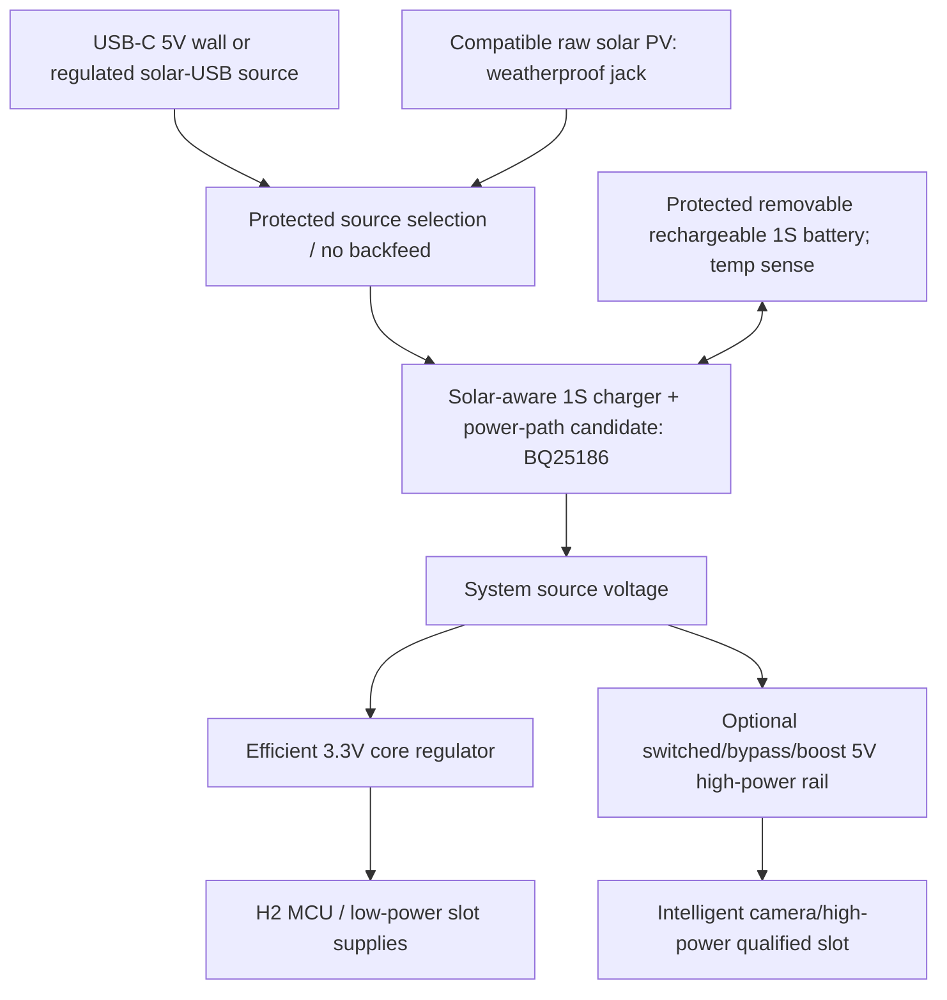

The charger and battery interface are integrated on the *main controller PCB*, not a fifth module. User supplies an external certified 5V USB-C adapter, compatible solar PV panel, or a panel that outputs regulated 5V via USB. USB-C with solar regulator can behave like USB-C wall power; a raw PV source needs proper solar-aware input charging. Nothing requires all PV components to be inside the detachable panel. **Power-management electronics must exist somewhere and safe source selection is required.**

### Candidate integrated power components

- TI **BQ25186** single-cell charger with power path/solar/high-impedance input support and I²C control, input operating range 3–18V, VINDPM, 1A charging limit, relevant cell chemistry/NTC monitoring; **candidate only**. See official source: https://www.ti.com/product/BQ25186 . Current datasheet details such as peak supply support, real charge current, system regulation, thermal dissipation and USB/PV source selection must be evaluated, not guessed.
- Efficient low-quiescent-current 3.3V buck-boost such as **TPS63802** (mentioned as a candidate); evaluate 1S input/camera peak transient, quiescent load, battery over-discharge cutoff, EMI and startup.
- Protected, removable **1S Li-ion 18650** pack (roughly 12Wh nominal example), correct cell profile/NTC/protection and mechanical keying; LiFePO4 an alternative only with correct charge voltage/profile and energy density expectations.
- Board-mounted USB-C *sink* interface with correct CC resistors or USB-PD behavior if required. Initially plain 5V sink; do not promise USB-PD negotiated higher voltages.
- Weather-sealed, mechanically strain-relieved PV input with defined panel voltage/current/connector polarity, open-circuit max, cold condition and backfeed protection. Outdoor power jack design is an environmental requirement, not merely electrical.
- Current-limited per-slot AON 3.3V, switched 3.3V, optional regulated/bypassed 5V switched rail. Keep critical sensing powered while turning off optional high draw.

### Solar design options and preference

**A — regulated solar-USB power:** panel with its own switching regulator/USB output plugs into regular USB-C power input. Simplifies motherboard PV-specific circuit, but can behave poorly under low irradiance and may add regulator loss; battery remains buffer. Compatible only with a *proper* 5V regulator and USB-C connector/power arrangements.

**B — raw solar PV:** inexpensive nominal panel plugs into dedicated PV input on motherboard. Integrated BQ25186-class charger handles high-impedance source, battery buffer, input regulation and charge control. This was assistant's **preferred final experience**. Input selection must handle simultaneously attached wall USB and PV, battery, output power and source priorities; input cannot be simply wired together. A charger with VINDPM is not necessarily a full dynamically optimized MPPT algorithm.

### Source policy examples

| Sources connected | Expected state |
|---|---|
| Battery only | Sensor operation, lower camera duty cycle, warning before reserve |
| Wall USB-C only | Continues without battery if power path supports, camera eligible with adequately rated supply |
| USB-C + battery | Wall source operates node and charges cell; battery backs up outage |
| PV + battery | Charges when available, draws battery when harvest insufficient |
| PV + USB-C + battery | Hardware-selected safe source priority, separate input limit and charge policies |
| No input / depleted pack | Graceful shutdown/critical fault history when possible; hub indicates offline |

**Failure semantics:** a depleted battery is not the same as an intentionally disabled sensor. Critical event reserves and low-power warnings. Solar PV collapse during cloud/low sun should not repeatedly reset device. Full charger thermal protection works independently of firmware logic.

### Battery/rail budgets — explicitly not measured

Earlier provisional **electrical** allocations:

| Domain | Illustrative target | Status |
|---|---:|---|
| MCU regulated 3.3V | 500mA peak capable | Candidate, verify H2 radio and board transients |
| Always-on module rail | 10mA allowance per slot (normal far lower) | Candidate |
| Switched 3.3V rail | 50mA per slot | Candidate |
| High-power switched 5V rail | ~600mA per enabled slot | Candidate; use common aggregate cap |
| Aggregate high-power | Initially only one active 2–3W camera | Runtime policy and electrical budget |
| Board sleep | 30–100µA battery-input design target | Ambitious, unverified |
| H2 chip deep sleep | ~7µA was cited earlier | Chip-only, not module+PMIC+radio network average |

Peak/current ratings should be sized for combined boot/radio/flash/charger activity and battery voltage sag, not average sensor draw. High-current camera power supply on an ultra-low-leakage battery board is a real thermal, PCB-layout and regulator challenge. Consider controlled separate rails and whether maintaining 5V from a 1S pack via boost makes economic sense for all boards; a factory “sensor-only population” variant may omit expensive high-power components while preserving functional connector compatibility (and advertising capability limits).

### Worked energy examples from previous discussion

**Planning numbers, not battery-life guarantees:** one nominal 3.6V x 3350mAh 18650 ~12Wh; assumed *usable* energy ~8.4Wh after derating. Two hypothetical lithium primary AAs were evaluated earlier (~9Wh nominal, ~5.9Wh usable) but the final integrated design favors rechargeable 1S lithium, not mixed primary/charging in same holder.

Average sensor current of `0.4 mA` at regulated `3.3V` yields `0.00132W`, `0.03168Wh/day`, and idealized `8.4 / 0.03168 = 265 days` before self-discharge and real derating. At `0.1 mA`, the same budget suggests ~1061 days (not a promise). At `1.5 mA`, ~71 days.

Camera illustrative **2W active**:

| Camera activity | Wh/day camera alone | Estimated total 18650 life incl. 0.4mA sensor load |
|---|---:|---:|
| Disabled | 0 | 265 days |
| 1 minute/day | 0.0333 | 129 days |
| 5 minutes/day | 0.1667 | 42 days |
| 30 minutes/day | 1.0 | ~8 days |
| Continuous | 48Wh/day | ~4.2 hours |

The naive model assumes near-zero off-camera current, fixed 8.4Wh usable, no extra capture compute, no cold-temperature loss, no unexpected restart, no unmodeled regulator leakage. Real duty-cycle measurements and panel/weather distributions must replace these.

**Solar planning example:** harvested `Wh/day ≈ panel_W × equivalent_full_sun_hours × net_efficiency`. At 2 equivalent full-sun hours/day and 50% net derate, 1W produces ~1Wh/day; 2W ~2Wh/day; 5W ~5Wh/day; 10W ~10Wh/day under those hypothetical conditions. Continuous 2W camera uses ~48Wh/day, implying ~48W PV rating even *before reliability margin* under that illustrative yield. Estimate several consecutive no-sun days and enclosure orientation/shading. Solar panel placement should be independent of PIR/camera viewing angle.

### Energy-aware firmware admission control

Each module advertises current/frequency/power modes, active duration, setup/boot latency and reserve class. Each power source reports charger/input availability, battery state/voltage/temperature/estimated energy, and rail limits. Scheduler grants or rejects actions:

- Critical contact/PIR/wake/alert/reserve first.
- Operational node supervision/heartbeat next, variable timing.
- Camera capture, raw debug, frequent reports and OTA last.
- Reconfigure power modes and sampling when charge drops; do not claim operations that hardware currently cannot perform.
- Commands have explicit `rejected_insufficient_power` or `deferred_energy` status; never silently ignore a rule.
- Node/Hub state distinguishes physically available capability, configured enabled, currently usable, requested and applied.

## 35. Firmware runtime, low-power scheduling and sleep


**Figure 17. Firmware runtime loop.**

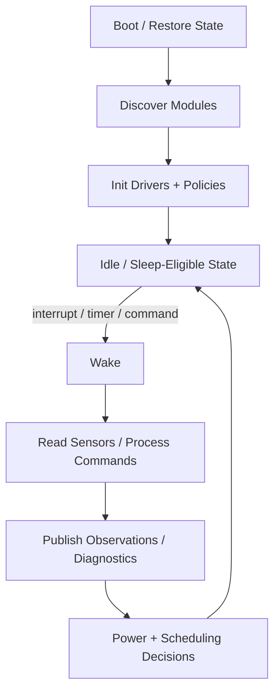

This runtime pattern should hold both in simulation and on the physical MCU target.


### Embedded core responsibilities

- Boot and verify firmware/partitions/signature; identify board rev and safe power state.
- Establish device identity and network/commissioning state.
- Enumerate four slots and module IDs, check power/bus/wake resources, activate appropriate driver set.
- Configure sensor interrupts/polling, wake sources and low-power scheduling.
- Use interrupt -> debounced/classified observation -> persistent/bounded queue -> authenticated serialized event -> hub ACK -> retry/backoff -> sleep.
- Maintain secure local configuration and pending revisions; distinguish requested/applied config.
- Publish health, charged-source status, battery and link diagnostics with adaptive rates.
- Perform OTA under energy/security/compatibility policy, preserve rollback/recovery.
- Support manufacturing test mode and owner-initiated recovery/reset without destroying critical security guarantees.

### Example node state machine

```text
FACTORY_UNCLAIMED
  -> OWNER_COMMISSIONING
  -> NETWORK_JOINED
  -> NORMAL_SLEEP
       -> WAKE_INTERRUPT -> READ_SENSOR -> CLASSIFY -> QUEUE -> TRANSMIT -> RECEIVE_DOWNLINK -> NORMAL_SLEEP
       -> WAKE_TIMER     -> MEASURE_HEALTH -> TRANSMIT_IF_NEEDED -> NORMAL_SLEEP
       -> PENDING_CONFIG -> APPLY_AND_ACK -> NORMAL_SLEEP
       -> OTA_ALLOWED    -> RECEIVE/VERIFY_IMAGE -> BOOT_PENDING_VERIFY -> CONFIRM_OR_ROLLBACK
  -> LOW_POWER_CRITICAL -> PRESERVE_ALARM_ONLY -> NORMAL_SLEEP / SHUTDOWN
  -> FAULT / RECOVERY
```

**Deep-sleep nuance:** communication responsiveness and retained state vary between ESP32-H2 sleep modes; deeply sleeping sensor may not immediately hear configuration or OTA commands. Thread sleepy-end-device parent polling and deep/light sleep must be measured against battery life and alert latency. The wake source may need always-on sensor rail and correct RTC GPIO. Sensor de-bounce and refractory rules should be tested through transitions including reboot and brownout. The UART/USB debug configuration should not force high standby current in release mode.

### Design for bounded queues and reliability

- Define per-priority queues/caps and loss policy; persist important not-yet-acknowledged domain events if power budget/flash endurance permits.
- Timeouts/backoffs must avoid draining battery during unreachable network; avoid permanent TX/rejoin loops.
- Sequence and boot IDs support deduplication/clock reconciliation; messages must be size-bounded and schema validated.
- Secure keys in platform-appropriate storage. Never log credentials, private keys or network secrets.
- Avoid hard-coded SSID/Thread secrets in public firmware repo; commissioning details belong to device/owner.
- OTA and telemetry may be deferred under low-power, but do not block interrupt-driven critical sensing indefinitely.

## 36. OTA pipeline, signed releases, rollback and recovery


**Figure 18. OTA lifecycle.**

```mermaid
flowchart TD
    REL[Signed Release] --> AVAIL[Hub Marks Update Available]
    AVAIL --> CHECK[Device Checks Power / Compatibility / Policy]
    CHECK --> DL[Chunked Download]
    DL --> VERIFY[Verify Signature + Image]
    VERIFY --> REBOOT[Reboot to New Slot]
    REBOOT --> HEALTH[Health Check + Confirm]
    HEALTH --> OK[Commit Update]
    HEALTH --> FAIL[Rollback]
```

The OTA pipeline should be modeled in both the digital twin and hardware-in-loop testing.


### End-to-end design

1. CI builds a **versioned firmware image** for exact board/MCU/revision and installed smart modules as applicable.
2. Run unit/twin/network/HIL gates; stage signed release manifest, image digest, compatibility metadata, minimum updater/bootloader version, dependency constraints and notes.
3. Hub imports/verifies signed release; operator chooses automation/schedule (can be owner-approved or unattended within policy).
4. Hub checks node connectivity, sleep behavior, power/battery, reserve and flash space; tells sleepy node that update is pending at a receive window.
5. Chunks move over actual device transport (e.g. CoAP over Thread) and can resume safely, with bounded radio energy and retry rates.
6. Node validates signature/hash, writes inactive OTA application partition, verifies and switches boot target.
7. New image boots into **pending confirmation** and completes health tests; confirms or rolls back on failure.
8. Hub records final result, device FW revision, continuity gaps and rollback reason.

### ESP-IDF facts requiring implementation

ESP-IDF application OTA requires **at least two OTA app partitions plus OTA data partition** for conventional A/B updates; rollback support has explicit pending/valid/invalid states, with `esp_ota_mark_app_valid_cancel_rollback()` used on successful validation and invalid+reboot for rollback when configured. See [Espressif ESP32-H2 OTA documentation](https://docs.espressif.com/projects/esp-idf/en/stable/esp32h2/api-reference/system/ota.html). Bootloader and partition-table updates may not have the same safety semantics as app OTA; initial update scope should be application images only.

- The flash size (4MB module candidate) and partition table require validation for actual image growth, NVS keys, rollback slots, config and crash logs. Do not assume “dual-image” always fits any future firmware.
- Secure Boot, flash encryption, programming/recovery eFuse policies need deliberate staging: development boards remain recoverable; manufacturing profile can harden only after audited key/cert workflow.
- An ESP32-H2 has Thread/BLE, **not Wi-Fi**; device images use Thread or BLE-assisted delivery where supported. Camera smart module/other Wi-Fi processor has its own OTA process.
- Owner may wish to self-build/sign open-source firmware: do not hard-lock all devices to a proprietary universal vendor signing key. Document owner-controlled trust anchors or explicitly supported self-provision workflow.
- Factory recovery and bootloader crash paths must be validated on physical boards; simulator rollback alone is insufficient.

## 37. Device onboarding, factory identity, owner claims and transfers


**Figure 19. Device claim / commissioning flow.**

```mermaid
flowchart LR
    FACT[Factory-Flashed Device
serial + claim secret] --> POWER[User Powers On]
    POWER --> QR[Scan QR / Enter Claim Token]
    QR --> HUB[Local Hub Validates Claim]
    HUB --> COMM[Commission to Thread / Configure]
    COMM --> LIVE[Node Publishes Modules + Capabilities]
```

This figure separates factory provisioning from owner claim and local network commissioning.


### First-power-on desired experience

**Factory**: fully assembles mainboard and cartridge PCBs, programs release firmware and test mode, runs functional/radio/power tests, stores unique serial/device credential and test record, labels QR. **At home**: user snaps cartridges, installs safe power/battery/housing, powers on, scans QR in local property website, authorizes hub-side Thread commissioning, device securely joins and reports module/capability manifest, checks local firmware version and receives future OTA.

Do **not** require the ordinary end user to solder headers, connect a serial cable or manually flash firmware. USB/JTAG/test pads remain available as controlled recovery and engineering paths.

### Commissioning and identity security

- Every controller gets a unique per-device enrollment identity and credential, not one default password copied to every board.
- QR carries appropriate non-secret identity plus unique onboarding/commissioning data for protocol; use approved Thread commissioning flows (e.g. PSKd as applicable) with protection against QR leakage/unauthorized claim.
- Factory should not receive private home Wi-Fi password or Thread active network secrets as standard practice. Specific own-house preprovisioning can be technically done, but not general best practice.
- Owner can revoke/transfer device and re-commission it safely. Define lost QR, replacement hub, device factory reset, firmware recovery and credential rotation.
- Smart camera module may have separate Wi-Fi pairing and device credential; group with H2 parent only after proof of physical/ownership binding.
- Manufacturing signing keys and root secrets should not be handed to general PCB assemblers. If factory needs to write device certificates or serials, define controlled derivation/provisioning and protect against cloning.
- Audit claims, owner changes, resets and firmware transitions; device remains “unclaimed” until authorized and may advertise only restricted setup endpoints.

## 38. Practical component and resource verification checklist

**The next electrical exercise before schematic is a real pin/current/connector allocation, not more abstract UML.** Use datasheets and layout rules, not earlier examples alone:

| Question | Method | Exit condition |
|---|---|---|
| Does H2 expose enough safe nonflash pins? | Final exact H2 module/chip schematic + GPIO/strap doc | Pin map passes constraints, sleep/wake tests |
| Can all four slots receive independent wakes? | GPIO RTC selection, power domain and fault aggregation | Real development board wakes on simultaneous sources |
| I²C identical address conflicts? | TCA9546A/alternate mux validation | Four duplicate-sensor modules work, can isolate fault |
| Does one slot need both SPI and UART? | Module demand matrix, bus selection | Resource allocator rejects impossible combos |
| Raw analog support? | Connector pinout decision, analog conditioning option | Analog/piezo module implementable without unsafe pin sharing |
| Slot rail startup/shorts? | Switch/current-limiter specs and lab fixtures | One slot fault doesn't brown out critical sensor core |
| Deep-sleep leakage? | Measure final build/current in multiple modes | Meets target or revise battery predictions |
| USB+PV selection? | PMIC/app-note/circuit simulation and bench test | No backfeed, safe charging under all source combinations |
| Lithium safety? | Pack/protection/thermal/charge testing | Safe operating and cold/hot charging limits |
| Camera mode? | Development module snapshots/video + power+latency | Chosen use case feasible in allotted rail/battery |
| Antenna/enclosure? | Manufacturer layout/keepout + RF/range test | Real connectivity validated with printed housing |
| Connector mechanical retention? | Samples, FDM tolerance, repeated cycles | Repeatable mating, low contact failure rate |
| PCBWay/JLCPCB sourcing? | Quote exact MPN/BOM/assembly/test/fixture | Complete cost and lead time acceptable |


# Part V — Digital twin, testing, build system, and security

## 39. Digital twin design philosophy and fidelity boundaries


**Figure 20. Fidelity boundary.**

```mermaid
flowchart LR
    W1[World Geometry + Actors] --> W2[Sensor Behavior Models]
    W2 --> W3[Portable Firmware Logic]
    W3 --> W4[Transport / Retry / Sleep]
    W4 --> APP[Real Hub / Rules / UI]
    APP -. boundary .-> HIL[Separate Hardware / Electrical Tests]
```

The main twin intentionally stops short of trying to be a full electronics simulator.


**Purpose:** develop most product software before having custom PCBs, exercise real production logic under many property and failure scenarios, derive hardware constraints, and create reproducible regressions. **Not:** recreate every transistor, flash controller, sensor analog amplifier or radio waveform.

### Key axiom

> Virtual devices must speak the same contracts as real devices; the **same actual server state engine and rule/command logic** processes both. Device-side portable C++ state machines should run with simulated GPIO/I²C/power/network adapters where feasible; the ESP-IDF HAL and specific silicon drivers are separately validated on hardware.

### Fidelity levels

| Tier | Scope | Test mechanism | Typical frequency |
|---|---|---|---|
| L0 protocol/event injection | Directly submit well-formed and malformed normalized observations/commands | Unit/domain contract tests | Extremely frequent |
| L1 spatial behavioral twin | Rooms/doors/actors/sensor coverage, ideal+imperfect observation models | In-process deterministic discrete-event C++ | Frequent, thousands |
| L2 virtual device/firmware | GPIO edges/bounce, simulated registers/interrupt, battery/flash/reset, actual portable node firmware | Native C++ hardware adapters, fault injection | Frequent, hundreds |
| L3 network/system integration | Serialized CoAP/Thread, parent switching, latency, loss/partition, real gateway | OpenThread POSIX/OTNS, process tests, container integration | Nightly/release subset |
| L4 hardware in loop | Physical H2 dev kits and sensors, programming, wake, RF, power and OTA | pytest-embedded, test rig, instrumentation | Hardware lab/release |
| L5 detailed electrical/RF | Analog front-end SPICE, battery regulator transients, RF/antenna/thermal if necessary | Targeted engineering simulation and measurement | Only where it resolves real risk |

**Stopping rule:** model a phenomenon in the digital twin if it materially affects high-level decisions, external contracts, power/latency, interoperability or component selection. If a circuit's task is to satisfy a well-specified electrical interface, validate it with chip-specific driver tests, component modeling and physical measurement rather than full property simulation.

### Shared versus emulated code

- Host and device should share **portable C++ business logic**, such as debounce/state transition/queue prioritization/power admission/command parsing where possible.
- **Do not pretend** all of ESP-IDF can run as a Linux library. ESP-IDF-specific RTOS tasks, interrupt registration, sleep and RF HAL require target adapters and HIL.
- The hub's C++ event engine, rule engine, policy, history and API should be **the actual production implementation** in all end-to-end scenarios, with a simulated transport adapter instead of physical devices.
- Simulation gives *fast feedback*, while real chips, enclosure optics, mechanical vibration coupling, high-frequency/current behavior and radio are physical validation tasks.

## 40. World model, actors, sensor physics and closed-loop actuators


**Figure 21. Closed-loop simulation.**

```mermaid
flowchart LR
    WORLD[World State] --> SENS[Sensor Models]
    SENS --> APP[Real Application Logic]
    APP --> ACT[Virtual Actuators]
    ACT --> WORLD
```

This is what makes the twin suitable not just for passive observation but for automation and actuation logic as well.


### World representation

- Property coordinate space (2D floor per level initially, optional height), scaled floor plans and polygons for rooms, walls and outdoor zones; openings/portals, edges and traversal rules.
- Actors have position, velocity, occupancy/motion state, trajectories, type (person, pet, vehicle), optional identity for ground truth only, and scripted interactions (open door, approach window, trip beam, touch lock).
- World events represent real underlying causes: door angle changes, magnet moves, impact at pane, ambient temperature, sunlight/weather, local darkness, sound, device moved/tampered, power supply disconnected, network interference.
- State updates happen on a deterministic virtual-time event queue; actor movement and sensor refresh can use time interpolation with explicit sample/step sizes.

### Sensor behavior models

- **Contact/reed:** magnet gap threshold with hysteresis, bounce windows, stuck-on/off, tamper input, wake edge, interrupted wire.
- **Hall:** field/threshold, orientation, device active current, transition latency, IRQ polarity.
- **IMU/window impact:** impulse amplitude/duration, propagation/mount coupling, threshold, wake interrupt, sensor mode/rate, false impact from wind/doors, calibration drift. Do not claim validated glass-break accuracy from synthetic amplitude alone.
- **PIR:** shaped coverage, line of sight, actor velocity and crossing geometry, warmup delay, output pulse/refractory period, missed/false events, pets/outdoor vegetation.
- **mmWave:** range zones, moving/stationary presence confidence, update interval, sustained higher power and interference, misleading multipath if modeled.
- **Environment:** temperature/humidity/water conditions, sensor calibration bias/noise, slow sample cadence and faults.
- **Camera:** modeled FoV, actor detect confidence, availability, startup latency, frame/clip metadata, optional illumination and privacy zones. For most regression tests generate *detections*, not pixel images; camera-processing software can be tested separately with media fixtures.
- **Tamper/health:** cover opening, electrical fault, battery voltage/temperature, radio link loss and stale last-heard state.

### Closed-loop actuator models

- **Lock:** locked/unlocked/unknown/jammed, motor travel time, feedback, power budget, stale command handling. When lock changes, it changes simulated portal constraints.
- **Speaker:** play/stop/volume/priority/cooldown; playback started versus completed; optional acoustic side effects on microphone modules.
- **Light:** on/off/brightness/availability, power draw; optionally affects camera detection confidence in sophisticated scenarios.
- **Siren:** starts/stops, timed duration, retry semantics and battery use.
- **Gate/door motor:** motion trajectory, limits, safety inputs, jam, position feedback, manual intervention.
- **Camera:** image capture or recording changes virtual media state, time and power, not just logs command.

### Two separate “worlds”

1. **Ground truth:** exact scripted actor/physical states, only visible to test oracle/simulation authoring mode.
2. **Belief:** what production event/state engine knows from imperfect observations; no unearned access to ground truth.

Tests compare expected detection, inference confidence, latency and false-positive/negative conditions without leaking oracle knowledge into production algorithms.

## 41. Virtual PCB and device simulation architecture


**Figure 22. Virtual PCB stack.**

```mermaid
flowchart TB
    PROP[Property Scenario] --> PHYS[Physical Stimuli]
    BOARD[Virtual Board Manifest] --> IO[Virtual GPIO / I²C / SPI / Power]
    MODS[Virtual Modules] --> IO
    PHYS --> MODS
    IO --> FW[Portable Device Firmware]
    FW --> NET[Virtual Thread / Transport]
    NET --> HUB[Real Hub]
```

The virtual board mirrors the same manifests and interfaces the physical product will use.


### Virtual board and HAL

The virtual board is a resource-accurate model derived from the exact board manifest: GPIO availability/wake capability, I²C mux branches, pull-ups, ADC/comparator paths, power rails, startup time, peak current, flash partitions, RTC retention, module identities, and one MCU radio/transceiver.

```
 Physical property stimuli                Virtual module behavior
          |                                         |
          +---------------------------+-------------+
                                      v
                         Virtual electrical interfaces
                          GPIO / I2C / UART / SPI / ADC
                                      v
                        Portable production firmware
                        state / queue / power / OTA
                                      v
                 Simulated transport or OpenThread POSIX
                                      v
                    Production hub / event-state engine
                                      v
                      Rule -> virtual actuator -> world
```

### Virtual power / battery

Track current/energy by runtime state (`SLEEP`, `SENSOR_ACTIVE`, `CPU`, `RADIO_TX`, `RADIO_RX`, `FLASH_WRITE`, `OTA`, `BROWNOUT`) plus rail leakage and solar/USB input. Simplest energy integration:

\[
E_{consumed} = \sum_i V_i I_i \Delta t_i
\]

State transitions should model boot/sensor warmup, under-voltage shutdown, load current spikes, charging thermal/input limits, solar input varying with weather/day, and reserve policy. Model charger and battery capacity honestly enough to predict software behavior; replace numbers with physical lab measurements later. Energy admission tests: four cards installed, camera tries to start at low battery, critical wake still works, unsolicited camera/telemetry disabled, status tells user why.

### Virtual networking

For fast L1/L2 runs: configurable per-device transport queue with stochastic/deterministic loss, delay, reordering, duplication, outage, reconnection and sleepy receive scheduling. Seed RNG and store all schedules.

For L3: use **OpenThread POSIX/OTNS** to exercise real Thread software/IPv6 routing, joining, sleepy parent/polling, partitions and time/packet behavior through actual gateway adapter. Do not reinvent an entire 802.15.4 MAC or claim native IP traffic always shares the same deterministic clock. Write clear test harness boundary between virtual time and wall-time network processes.

### Simulated reset/flash/OTA

Virtual flash model supports bounded sectors, A/B partition selection, image validation, delayed/failed writes, power cut before/after critical metadata, boot pending verification and rollback. Inject a reset at each state-machine transition. At L4, repeat key cases on real bootloader/flash because simulation cannot certify eFuse, boot ROM and physical flash behavior.

## 42. Scenario fixtures, assertions, and regression methodology


**Figure 23. Regression scenario anatomy.**

```mermaid
flowchart TB
    FIX[Scenario Fixture] --> STIM[Stimuli]
    FIX --> EXP[Expected Outcomes]
    FIX --> ENV[Environment / Faults]
    STIM --> RUN[Simulation / App Execution]
    ENV --> RUN
    RUN --> TRACE[Trace + State History]
    TRACE --> ASSERT[Assertions + Golden Checks]
```

The fixture should describe what happens, what failures exist, and what the correct system behavior should be.


### Fixture schema example

```yaml
schema: security.simulation.scenario/v1
name: backyard_intrusion_with_camera_failure
property_fixture: properties/suburban_two_story.yaml
seed: 42
start: "2026-11-15T02:00:00Z"
mode: armed_away
modules:
  node_backyard:
    slot_0: pir_ekmb_v1
    slot_1: vibration_lis2dw12_v1
    slot_2: smart_camera_s3_v1
    slot_3: sht40_v1
stimuli:
  - at_ms: 10000
    type: actor.enter
    actor: person_1
    zone: backyard
  - at_ms: 13000
    type: actor.move
    actor: person_1
    to: patio
  - at_ms: 15000
    type: device.network_disconnect
    device: camera_backyard
expect:
  - within_ms: 3000
    observation: motion.detected
    source: node_backyard
  - within_ms: 5000
    command: audio.speak
    target: patio_speaker
    state: verified_or_explicitly_failed
  - by_ms: 25000
    health: camera_backyard.offline
  - invariant: no_unverified_command_reported_successful
```

The numerical timing assertions are placeholders; calibrate to intended real network/firmware constraints. Keep acceptance assertions at the correct semantic abstraction—e.g., permitted alarm must occur, duplicate event cannot cause duplicate speaker playback, camera failure is explicit—and leave analog timing thresholds to driver/HIL tests when needed.

### Golden and property-based tests

- Golden deterministic fixtures for major property types: studio apartment, single-story home, two-story home, exterior yard/gates, detached garage, sensor-dense property, multi-property ownership, and RF-shadowed site.
- Security cases: unauthorized lock/disarm, permissions revoked mid-command, stale command post-reconnect, prompt-injection text in camera caption, module spoof/invalid signature, replayed sensor event, untrusted connector.
- Timing: events while MCU asleep, simultaneous contact+vibration wake, clock drift, time jump/DST, hub restart, out-of-order records, deduplication, retry storms.
- Fault: broken I²C branch, missing module ID, wrong board revision, power rail short, depleted pack, PV collapse, camera boot failure, OTA interruption, full disk, damaged event database, radio partition, network jamming indicators.
- Pet/noise/normal-life cases: door slam without break, wind shaking window, benign outdoor passage, person staying still, camera false recognition, normal scheduled home occupancy.
- Metamorphic invariants: time-shift stimuli -> shifted outputs; add unused module -> unaffected unrelated state; reorder independent packet deliveries -> same final projected property state; repeated same command -> at most one physical effect per idempotency policy.
- Long-running/fuzz: random traffic, repeated power/network faults, malformed packets/protobufs, state-machine stress, bounded memory/queue, performance regression, high volume of simulated nodes.
- Store scenario seed, generated input trace, build versions and expected/actual outputs on failure so a CI failure can be replayed in website engineering mode.

### Expected test hierarchy

| Test class | Owns guarantee | Implementation |
|---|---|---|
| Pure unit | Classification, reducer, validation, policy, energy math | GoogleTest/catch equivalent under Bazel |
| Component contract | Typed I/O, driver behavior, ABI/protobuf, power/source model | Mock HAL + protocol/contract tests |
| Simulator system | Physical scenario -> observations -> rules -> effects/replay | C++ event simulation + actual server |
| Protocol integration | Real serialized messages, CoAP/Thread, network failover | OpenThread POSIX/OTNS and gateway |
| Browser E2E | Onboarding, floor plan, live updates, rules, playback | Playwright |
| HIL | GPIO wake, I²C, actual CPU sleep/current, flash, OTA, RF | ESP-IDF pytest-embedded + test rack |
| Electrical/optical | Rail, charging, connector, optics, glass/PIR sensitivity | Bench measurement, characterization |
| Security | Auth, crypto, signing, access control, least privilege | Automated static/DAST and manual review |

**Important limitation:** a model trained/tested solely on synthetic data may perform well only on its generator. Behavioral anomaly-detection accuracy needs realistic consented data, multiple environments and independent evaluation. Twin is excellent for software correctness but not automatic proof of real sensor reliability.

## 43. CI/CD strategy, release gates and test artifact retention


**Figure 24. CI/CD gates.**

```mermaid
flowchart TD
    PR[Pull Request] --> FAST[Lint + Unit + Key Simulation Tests]
    FAST --> MERGE[Merge]
    MERGE --> NIGHT[Nightly Broad Matrix + Fuzzing]
    NIGHT --> HIL[Hardware-in-Loop]
    HIL --> RC[Release Candidate]
    RC --> PROD[Tagged Release]
```

The central theme is progressive confidence: fast feedback first, deeper confidence before a release.


### CI frequencies

**Every PR (fast gates):** formatting/linting, Bazel incremental build, C++ unit tests, protobuf schema compatibility, portable firmware host tests, frontend TypeScript/lint/component tests, basic web E2E, small scenario regression matrix, static/security scans.

**Nightly (broader gates):** full scenario/property matrix, fuzzers and property-based tests, sanitizers/address/UB/thread (where applicable), OTNS network simulations, storage/replay reconstruction, chaos/fault injection, telemetry correctness/cardinality checks, longer web E2E and performance benchmarks.

**Release candidate (trusted code only):** all stable regression suites, battery/network/OTA HIL on actual boards, test fixture results, compatibility matrix with prior firmware, firmware signing, provenance/SBOM and manufacturing release package generation.

```mermaid
flowchart TD
 PR["Pull request"] --> B["Build + schema checks"]
 B --> UT["C++/FW host unit tests"]
 B --> UI["Web tests"]
 UT --> DT["Digital twin scenarios"]
 UI --> DT
 DT --> G{"Critical gates pass?"}
 G -->|No| BLOCK["Block + replay artifact"]
 G -->|Yes| MERGE["Merge"]
 MERGE --> NIGHT["Nightly: full twin/fuzz/OTNS"]
 NIGHT --> TRUST["Trusted HIL: device programming, RF, power, OTA"]
 TRUST --> RELEASE["Signed candidate + manufacturing artifacts"]
```

**Contributors must not be able to execute arbitrary untrusted PR workflows on trusted self-hosted hardware runners.** Isolate HIL behind approved branches/after-review workflow with limited secrets, network segmentation, sandboxed machines and physical emergency controls. Do not put firmware signing keys in ordinary CI jobs or public repository secrets.

### Artifact retention

- Failed simulator trace + seed + property fixture + runtime versions.
- JUnit test reports and deterministic timing/performance metrics.
- Screenshot or short video of failing browser E2E when useful.
- HIL serial logs, measured sleep/active current, rail readings, flash verification, OTA rollback logs.
- Release SBOM, source commit, signed firmware/image hashes and compatibility manifest.
- Sanitized test artifacts by default; no recording actual customer footage in public CI.

## 44. Monorepo, build tools and implementation conventions

### Recommended first monorepo layout

```text
property-platform/
├── MODULE.bazel                 # Bazel Bzlmod module root
├── .bazelversion
├── .github/workflows/           # PR, nightly, trusted HIL, releases
├── docs/
│   ├── architecture/
│   ├── decisions/               # ADRs: why each choice was made
│   ├── hardware/
│   ├── firmware/
│   ├── manufacturing/
│   ├── security/
│   └── deployment/
├── contracts/
│   ├── proto/                   # typed events/capabilities/commands
│   ├── manifests/               # board/module/power capability schemas
│   └── generated/               # generated bindings, if committed
├── core/                        # pure or low-side-effect C++20 libraries
│   ├── domain/
│   ├── events/
│   ├── state/
│   ├── spatial/
│   ├── fusion/
│   ├── policy/
│   ├── rules/
│   ├── execution/
│   ├── energy/
│   └── health/
├── simulation/
│   ├── world/
│   ├── actors/
│   ├── virtual_modules/
│   ├── virtual_power/
│   ├── virtual_transport/
│   ├── faults/
│   ├── scenarios/
│   └── runner/
├── firmware/
│   ├── portable/                # shared device-side C++ domain logic
│   ├── esp_idf/                 # official CMake/toolchain projects
│   ├── board_profiles/
│   ├── drivers/
│   ├── boot_ota/
│   └── factory_test/
├── hardware/
│   ├── mainboard/
│   ├── modules/
│   ├── powered_io_future/
│   ├── connector_spec/
│   ├── enclosures/
│   ├── fixtures/
│   └── generated_bom/
├── server/
│   ├── api/
│   ├── auth/
│   ├── ingress/
│   ├── persistence/
│   ├── media_adapter/
│   ├── ota/
│   ├── integrations/
│   └── replication/
├── web/                         # React/TypeScript/Vite/PWA
│   ├── src/
│   └── tests/
├── connectors/
│   ├── mcp_future/
│   └── webhooks/
├── observability/
│   ├── metrics/
│   ├── otel/
│   └── grafana/
├── tests/
│   ├── unit/
│   ├── contracts/
│   ├── scenarios/
│   ├── integration/
│   ├── hardware/
│   └── e2e/
├── deploy/
│   ├── docker-compose/
│   ├── monitoring/
│   ├── supabase_optional/
│   ├── railway_optional/
│   └── installer/
└── tools/
    ├── manifest_validator/
    ├── scenario_compiler/
    ├── manufacturing_export/
    └── release_signer/
```

### Tool ownership

| Tool | Responsibility | Reason |
|---|---|---|
| Bazel + Bzlmod | Host C++ core, simulation, generated protocol, unit/integration targets, packaging orchestration | Reproducible, incremental, cached build graph |
| ESP-IDF + CMake | ESP32-H2-specific bootloader, driver, flash partitions, firmware image and on-chip tests | First-party supported embedded toolchain |
| GoogleTest (+ sanitizers) | Portable C++ unit/contracts | Rapid local CI tests |
| Python + pytest | Scenario corpus tooling, network/HIL orchestration | Flexible test fixtures/instrument interfaces |
| OpenThread POSIX/OTNS | Thread-level network behavior | Real protocol implementation instead of fake MAC |
| pnpm + Vite + React + TypeScript | Browser frontend and local dev workflow | Simple website-first workflow |
| Playwright | Cross-browser E2E | Test real UI scenarios |
| Protocol Buffers | Cross-language event/command/schema contract | Versionable and compact types |
| SQLite | Local durable history/read models | Zero external DB install for small deployment |
| Docker Compose | Self-hostable stack and development | Simple local installation |
| GitHub Actions | PR/nightly/release CI | Accessible to open-source contributors |
| OpenTelemetry + optional Grafana stack | Diagnostics correlation and engineering dashboards | Standards-based backend observability |
| KiCad | Open hardware schematics, PCB, manufacturing exports | Independent manufacture and version control |
| FDM CAD (OpenSCAD/FreeCAD etc.) | Printable cases and physical guides | Open mechanical release |

**Bazel caution:** Do not turn embedding ESP-IDF into a complex Bazel cross-build prerequisite before the first sensor. Keep firmware native CMake but invoke its verified commands in CI; migrate further only if return on investment is clear. Similarly frontend can remain on pnpm scripts, invoked by CI, without immediately forcing every node package into Bazel.

### Interfaces, dependency boundaries and repository discipline

- `core` depends on schemas and abstract interfaces, **never** on sensor driver, SQL driver, simulator, UI or vendor cloud SDK.
- `simulation` depends on core and test adapters, not vice versa.
- `firmware/portable` depends on portable contracts/HAL abstractions only; ESP-IDF adapter depends inward on portable code.
- `server` connects core to persistence, transport, auth and API; do not put core business logic in HTTP handlers.
- `web` only depends on stable API schema/client and UI components; not C++ internal implementation.
- `hardware` publishes a board manifest consumed by firmware and validation; KiCad schematic and manifest consistency are testable.
- Adapter conformance suite for every new third-party integration.
- Make architectural decisions explicit in short ADR files, including supersession history; avoid silent changes to electrical or security contracts.

## 45. Security, privacy, reliability and safety model

### Core threats

- Unauthorized network/device join or cloned module identity.
- Compromised owner account or leaked QR code.
- Replay, duplicate or forged events; forged actuation commands.
- Malicious third-party plugin or AI agent/tool call.
- Prompt injection in camera/voice/metadata that attempts to invoke privileged tools.
- Radio denial/interference and false “online” assumptions.
- Tamper and physical device theft/capture.
- Stale cloud-to-hub command replay after outage.
- Battery exhaustion/solar collapse or camera load killing critical sensors.
- Insecure OTA signing, downgrade, eFuse mis-provisioning, or unrecoverable corruption.
- Exposed cameras/NVR/database/MQTT/OTel endpoints on the public internet.
- Privacy leaks from occupancy histories, raw images and multi-property dashboards.

### Security invariants for tests

1. All high-risk physical operations go through authenticated, authorized, time-bounded local policy.
2. Cloud outage cannot silently disable local critical sensing and alarms.
3. Missing/stale telemetry never silently reports a sensor as confirmed healthy/clear.
4. Replayed sensor events and duplicate delivered commands cannot cause unbounded repeated physical effects.
5. Security-critical remote actions expire and require sufficiently fresh state/authorization.
6. A failed camera or gateway cannot be misreported as having recorded/acted successfully.
7. Only verified signed compatible OTA images are accepted; rollback recoverable when boot verification fails.
8. Untrusted firmware or module profiles cannot change GPIO wiring/current limits by remote manifest alone.
9. Device private credentials and signing root keys are not present in public source repo, exposed factory logs or client bundle.
10. User/agent can view and act only within authorized property and capability scopes; logs and media respect access/retention controls.
11. A safety interlock implemented in physical actuator hardware cannot be overridden by an arbitrary automation rule.
12. Telemetry flooding, malicious configuration and large media traffic must not exhaust critical event/control queues.

### Safety and professional limits

- DIY security product starts as experimental. Do not market as certified monitored alarm, life-safety replacement or tested security equipment until certification and long-term reliability verification.
- Use certified external smoke/CO/gas devices; integrate their standard outputs rather than recreate detectors.
- Locks, shutters and gates need manual access/egress and certified/rated actuators, wiring, relays, protection, independent limit sensors and local emergency stops.
- USB/wall supplies should be externally certified low-voltage; no mains power on the tiny printed sensor PCB.
- Lithium cell/charger design requires suitable protected pack, NTC, cold/hot charging block, transport compliance and adequate fire/thermal design.
- Cloud/AI/website may submit intentions, never directly defeat mechanical/electrical safety.


# Part VI — Manufacturing, assembly, programming and ordering

## 46. Manufacturer shortlist and selection criteria


**Figure 25. Manufacturing decision criteria.**

```mermaid
flowchart TB
    COST[Cost] --> CHOOSE[Manufacturer Choice]
    SOURCING[Component Availability] --> CHOOSE
    FLASH[Factory Flashing] --> CHOOSE
    TEST[Functional / RF Testing] --> CHOOSE
    BOX[Box Build / Assembly] --> CHOOSE
    TRACE[Traceability] --> CHOOSE
```

The best manufacturer is not simply the one with the cheapest board price.


The design requirement is **fully manufactured and assembled electronics** with optional pre-flash, unique identity provisioning, QA reports and later full box-build. User will design/print mechanical enclosures, not solder ICs, headers or wire up boards manually.

**Candidate manufacturers from the discussion:**

| Vendor | Why on shortlist | What to confirm in RFQ |
|---|---|---|
| **JLCPCB** | Cost-oriented small-batch fabrication/SMT, Standard PCBA post-assembly programming/function testing | Current minimum quantities, availability of connector/charger/radio module, programming service tier, test labor/fixture fees, top-side assembly |
| **PCBWay** | Broad turnkey assembly and custom test/firmware services; possible box-build | Exact module/sensor procurement, test procedure, programming and I²C-ID writes, RF/current measurement, battery/optical assembly |
| **Seeed Fusion** | IoT-friendly assembly, firmware flashing, IDs and fixture services, good open hardware ecosystem | Cost and stock of special parts, factory key handling, test report/traceability, custom programming workflow |
| **MacroFab** | North-American production and manufacturing/traceability/service-oriented option | Prototype-vs-pilot pricing, DFM, fixtures, sourcing, region/shipping, packaging, serialization |
| **Espressif upstream provisioning** | Can pre-program/provision some modules at scale | MOQ, security credential workflow, cost, compatible module/firmware and key custody |

**Initial action:** quote same fully specified build at JLCPCB and PCBWay, then Seeed Fusion. Compare landed *tested programmable board* cost rather than bare PCB price. Later explore MacroFab when commercial-scale quality/traceability or locality merits it. **No manufacturer has been selected or quoted for our actual BOM.** Published marketing pages do not guarantee any requested service without engineering confirmation.

### Assembly comparison RFQ fields

- 2-layer vs 4-layer PCB cost and constraints; one-sided SMT population; board thickness and gold fingers; castellated/edge connector restrictions.
- BOM stock availability and preferred alternates (H2-MINI, PMIC, low-Iq regulator, TCA9546A/TCA9535, connectors, USB-C, PV jack, module sensors, antenna component keepout).
- Component placement and hand vs machine assembly charges; special optical FPC/lens assembly, through-hole USB connectors, pogo/test pads, boards with gold fingers.
- Number of boards: mainboard, each sensor daughtercard SKU, intelligent camera (if feasible), test cartridges; panelization/fiducials and tooling.
- Functional fixture development cost, per-board test labor, serial/QR label process, yield/rework policy, acceptance data returned.
- Firmware flashing/software image loading, secure identity writing, verify checksum, EEPROM cartridge ID programming, packaging/revision tracking.
- RF transmission and reception test; low-current sleep measurement and power-path charging/USB/PV simulation; 4 port test cartridge.
- Optional box-build: install optics, batteries, printed enclosure, gaskets, battery safety packaging, shipping/UN38.3 requirements where applicable.
- Current quote validity and volume breaks (e.g., 5/10/25/100/1000 unit pricing) without assuming a particular minimum or fee.

## 47. Manufacturer handoff package and traceable hardware releases


**Figure 26. Manufacturing handoff package.**

```mermaid
flowchart LR
    SCH[KiCad Schematic + PCB] --> PKG[Manufacturing Package]
    BOM[BOM + Approved Parts] --> PKG
    PNP[Pick-and-Place + Assembly Drawings] --> PKG
    FW[Factory Firmware + Test Firmware] --> PKG
    TEST[Functional Test Procedure] --> PKG
    MAN[Manufacturer]
    PKG --> MAN
```

This is the minimum bundle needed to make production reproducible.


Each manufacturing release should be immutable and associated with a Git commit/tag and revision IDs.

```text
manufacturing-release-v0.1/
├── release_manifest.yaml
├── pcb/
│   ├── universal_controller_v1/
│   │   ├── gerbers/
│   │   ├── drills/
│   │   ├── centroid.csv
│   │   ├── bom.csv
│   │   ├── assembly_drawing.pdf
│   │   ├── fab_drawing.pdf
│   │   └── schematic.pdf
│   ├── cartridge_pir_v1/...
│   ├── cartridge_imu_v1/...
│   ├── cartridge_contact_v1/...
│   └── test_cartridge_v1/...
├── firmware/
│   ├── controller_firmware.bin
│   ├── factory_test_image.bin
│   ├── partition_table.bin
│   ├── bootloader.bin
│   ├── signatures_and_hashes.json
│   └── flash_instructions.md
├── testing/
│   ├── factory_test_spec.md
│   ├── acceptance_thresholds.yaml
│   ├── fixture_bom.csv
│   ├── fixture_pinout.yaml
│   └── result_schema.json
├── programming/
│   ├── provisioning_spec.md
│   ├── serial_number_ranges.csv      # controlled distribution
│   ├── qr_label_format.md
│   └── secure_key_handling.md
├── enclosure/
│   ├── case_rev_a.step
│   └── assembly_notes.md
└── CHANGELOG.md
```

File examples are **templates**, not created manufacturing artifacts. Assembly drawings and some PDF outputs require their own generation workflow in practice.

### Hard rules

- BOM should include manufacturer part numbers, approved alternates, required ratings, footprint/package, procurement and substitutions policy; check supply chain before final placement.
- Factory builds cannot silently substitute components affecting accuracy, power or security without versioned approval.
- Manufacturing revision and board EEPROM/flash identity must allow the hub/firmware to identify compatible configurations.
- No manually soldered headers needed by owner; include factory pogo pads/test jig.
- No network credentials/signing private keys in an unprotected manufacturing file bundle.
- Electrical test report keyed to board serial enables warranty/debug and field failure analysis.

## 48. Factory flashing, test modes, secure provisioning and first boot


**Figure 27. Factory flow and field ownership flow.**

```mermaid
flowchart TB
    ASM[Assemble PCB] --> PROG[Flash Firmware]
    PROG --> FTEST[Functional + RF Test]
    FTEST --> LABEL[Label Serial / QR]
    LABEL --> SHIP[Ship Board]
    SHIP --> CLAIM[Owner Claims Device]
    CLAIM --> COMM[Commission to Local Hub]
    COMM --> OTA[Normal OTA Lifecycle]
```

The critical distinction is that factory provisioning and owner claim are separate phases.


### Recommended production line

```mermaid
flowchart TD
 CAD["KiCad DFM-checked design + approved BOM"] --> PCBA["Turnkey PCB fabrication and assembly"]
 PCBA --> CONTACT["Pogo-pin test fixture + power/current measurement"]
 CONTACT --> TESTFW["Program/enter limited factory test mode"]
 TESTFW --> ELECTRIC["Power/charging/USB/PV, buses, all four slots, RTC wake, radio"]
 ELECTRIC --> Q{"Pass electrical + RF + firmware tests?"}
 Q -->|No| REWORK["Reject / investigate / rework"]
 Q -->|Yes| PROD["Program signed production image + unique identity"]
 PROD --> VERIFY["Verify flash/signature, reboot, operational self-test"]
 VERIFY --> LABEL["Serial, hardware rev, QR, test report"]
 LABEL --> SHIP["Ship finished electronics / optional box-build"]
 SHIP --> OWNER["Owner power-on -> secure claim -> Thread join -> module discover -> OTA"]
```

### Production test checklist — main controller

1. PCB visual inspection and no shorts before energizing.
2. Validate safe 5V USB-C input, protected raw PV input in a safe test range, no reverse backfeed and external source selection; verify battery presence/missing-battery behavior.
3. Validate PMIC I²C/config/interrupt, charge current/thermal simulation where practical, regulator rails, high-load transient and low-voltage behavior.
4. Test MCU flash/bootloader/strap and UART/USB debug/recovery, board revision ID.
5. Test slot 0–3 separately with **factory test cartridge** covering I²C address, power switches, CS/UART mux, module ID, direct interrupt/wake and fault detection.
6. Validate 802.15.4/Thread radio transmit-receive with known test fixture and antenna; no RF test claims without a suitable test setup.
7. Measure current in intended sleep/light-sleep/active/transmit modes with USB debugger removed/disabled as appropriate; compare per-board threshold.
8. Run short device simulation/self-test, power-cycle and verify retained identity/config and firmware version.
9. Provision unique serial/device credential in controlled way, program signed image, verify and print QR label.
10. Export structured test result, MPN/BOM revision, serial and quality disposition.

### Production test checklist — simple sensor cartridge

- Visual/electrical inspection and connector/gold-finger quality.
- Optional per-module EEPROM/ID written and read back.
- Functional stimulation: contact/magnet or simulated GPIO; PIR electrical signal/warmup; accelerometer I²C WHO_AM_I, interrupt and known orientation; environment I²C reading/nominal range.
- Estimate module sleep current; short/safety test; verify product/board revision ID.
- For camera: actual lens assembly, autofocus/focus/alignment, sensor ID, image capture with test chart, Wi-Fi connect RF and OTA image programming; separate smart processor identity.
- Record module serial/calibration as justified; optional low-cost module may use batch ID rather than per-module cryptographic identity.

### Factory programming versus upstream chip pre-flash

**Default pilot:** assemble unprogrammed generic ESP32-H2 modules on PCB, then program/test complete assembly at PCBA partner. Better late firmware flexibility, validates real board.

**At scale alternative:** ask Espressif about upstream module firmware/identity pre-provisioning and compatible workflows; still require end-of-line whole-board acceptance. Consider key management, secure-boot eFuse state and ability to update factory credentials without making owner reflash impossible.

### Pairing and security

- Factory-installed unique enrollment credential + public serial/QR; device boots unclaimed.
- Owner scans QR in website and authorizes secure Thread join through hub/border router; after pairing, reported module list and firmware status appear automatically.
- Avoid factory programming household Wi-Fi passwords or Thread operational secrets as default, even if technically possible for one's personal units.
- For a camera smart cartridge, Wi-Fi onboarding is separate and must be cryptographically bound to the parent/house ownership; avoid a generic open access point remaining on after provisioning.
- Preserve emergency physical recovery path for failed firmware while hardening production secrets. eFuse security transitions can be irreversible; do not lock until production policy tested.

## 49. Prototype procurement, pilot batch and manufacturing timeline gates

### Stage H0 — software and component evaluation, **before custom PCB**

Acquire or borrow fully assembled development hardware as needed (avoid unsoldered header/loose wire workflows): an ESP32-H2 dev kit; appropriate small readout/carrier where feasible; low-power Hall/reed, LIS2DW12, low-power PIR, SHT40 modules; USB power meter/bench PSU; low-current profiler; Thread border-router radio; candidate camera module (ESP32-S3 or IP). For true side-entry mechanics, order connector samples and test PCB coupons. Initial sensor code must work with virtual board before physical equipment.

**Deliverable:** measured H2 sleep/wake/thread behavior, simple radio join/event, sample sensor driver, smart camera proof if desired, connector fit and preliminary real energy data.

### Stage H1 — proof-of-connectivity carrier PCB

Create a tiny **factory-assembled** ESP32-H2 dev-board carrier or proto controller with one or four actual coplanar sockets and test pads, allowing the exact proposed plug-in interface to be validated using finished sensor cards. This carrier is a temporary engineering board; not necessarily production controller and battery implementation. No owner soldering.

**Deliverable:** verified connector mating, per-slot bus routing, wake behavior and module ID with at least contact, vibration and PIR cards; resource validator matches physical behavior.

### Stage H2 — integrated mainboard prototype (rev A)

Lay out integrated ESP32-H2 module, PMIC/USB/PV input selection, protected battery connection, regulated core and module rails, four sockets, per-slot bus/interrupt/power management, programming/test pads and antenna keepout. Design printable case around actual selected connector, battery and sensor orientations.

**Deliverable:** fully assembled and factory-programmed prototype board plus up to four cartridge types, measured boot/rail/sleep current, sensor events and hub pairing, one OTA test, serial test logs.

### Stage H3 — pilot field batch

Small multi-unit batch with unique serials and signed firmware, known module/revision combinations, standardized assembly test fixture, real houses and network conditions, long-term battery and radio monitoring, solar/weather performance and repair/ownership workflows. Continue with limited experimental DIY security use; collect bug reports and calibrated data under privacy consent.

**Deliverable:** reproducible factory programming/QA, acceptable yield, real-world longevity and alert reliability, documented revisions.

### Stage H4 — larger production readiness

Quote alternative manufacturers, optimize BOM/assembly panelization and sourcing, refine connector and test fixtures, secure supply chain/keys, package for shipping, assess compliance/certifications (RF/EMC, electrical/battery, safety claims) and any desired retail installation support. Optional Espressif upstream provisioning, professional box-build and managed manufacturing quality.

**Deliverable:** independently buildable open-source hardware release with versioned BOM, assembly, firmware, tests and full traceability.

### Cost framework (do not invent final prices)

Total finished-unit cost = PCB fabrication + component BOM + placements/assembly + connectors + optical FPC assembly if relevant + flashing/programming + test fixture amortization + test time + rejected/reworked yield + packaging + shipping/customs + battery/solar accessories + printed housing. The earlier assistant floated an **$8–15 BOM target for a very basic contact node** in smallish batches, *excluding* many items; this is not a verified quotation and is unlikely to represent a four-port charger+radio+camera-ready controller. Treat all unit targets as hypotheses until quotes.

## 50. Hardware design handoff and ordering checklist

Before paying for custom full PCBA:

- [ ] Reconcile product modes: battery-only low-power sensors versus powered-camera-capable modes; define absolute/average current target by module.
- [ ] Select final controller MCU module and validate pin/wake/flash/security resource allocations with exact official data.
- [ ] Select horizontal connector family/MPN and confirm coplanar height, board thickness, contact plating and insert/remove ratings.
- [ ] Resolve 20-contact pinout, analog support, ground/current distribution, per-slot interruptions and power switching; publish connector electrical spec.
- [ ] Select Hall/IMU/PIR/environment module MPNs with real voltage/threshold/physical requirements.
- [ ] Validate I²C mux, GPIO expander and any UART/SPI switching, including deep-sleep conditions and stuck buses.
- [ ] Choose battery chemistry/protection/holder, charger PMIC, input source OR-ing, PV connector/panel limits, regulators and cold-charge inhibition.
- [ ] Choose target smart camera behavior (snapshots, burst, full video) and whether Wi-Fi camera cartridge meets quality/latency/power requirements.
- [ ] Produce full schematics, PCB layout, fab output, assembly files, BOM and ERC/DRC.
- [ ] Prototype enclosure alignment/antenna keepout/PIR optical window/thermal/weatherproofing before ordering full pilot batch.
- [ ] Design pogo test pads/test cartridge/fixture, flash procedure, QA threshold and serialization flow.
- [ ] Quote PCBWay/JLCPCB/Seeed on exact **factory-programmed-and-tested** assembly, not bare PCBs.
- [ ] Verify software/firmware manifest against schematic/netlist and wake/energy/bus constraints.
- [ ] Require post-assembly electrical, functional and radio test report with board revision and unique identity.

---

# Part VII — Implementation roadmap and Claude handoff

## 51. Software-first roadmap, milestones and dependencies


**Figure 28. Software-first roadmap.**

```mermaid
flowchart LR
    M1[Contracts + Core Types] --> M2[State Engine + Event Journal]
    M2 --> M3[Digital Twin + Virtual Devices]
    M3 --> M4[Website + Replay]
    M4 --> M5[Portable Firmware + Resource Manifests]
    M5 --> M6[Networking / OTA / Power Simulation]
    M6 --> M7[Real Dev Boards]
    M7 --> M8[Custom PCB]
```

This figure shows why physical PCB design is not the very first implementation milestone.


The user and assistant agreed that **software and simulation should come before custom PCBA**. A prior illustrative “85–90% of software” completion estimate was a directional aspiration, not a measured plan. The high-level application can largely be written before hardware, while RF, electrical drivers, power/OTA and mechanical sensing must be validated on real boards.

### Phase 0 — repo foundation and architecture freeze

**Deliver:** monorepo, Bazel host C++ build, ESP-IDF project skeleton, protobuf schema setup, TypeScript app skeleton, Docker Compose, CI PR workflow, ADRs, formatting/tests, architecture diagram, local develop/run instructions and reference artifacts. Define strict core dependency boundaries. Create initial security invariants and interface contracts first. Avoid spending this phase coding every possible integration.

**Exit:** clean checkout builds host core and web; tests run locally and in CI; contract versioning and code generation work.

### Phase 1 — canonical data contracts and pure C++ domain core

**Deliver:** entities/IDs, asset and property model, device/slot/module/capability catalogs, observation envelope, event ordering/deduplication, projected state reducers, deterministic virtual clock, command request/result types, basic rule DSL and policy stub with security defaults. Write serialization/compatibility tests.

**Exit:** unit tests prove that input observations -> correct state/replay; duplicated input -> no duplicate effects; expired commands -> no execution.

### Phase 2 — deterministic L1 digital twin and scenario runner

**Deliver:** geometry/floor graph, 2–3 sample houses, virtual actors/trajectories, contact/PIR/vibration/environment/camera detection model, fault-injection, scenario YAML, ground truth vs belief oracle, time-scrub trace. Build fixture corpus and test matrices.

**Exit:** sample night-intrusion scenario and 20+ deterministic scenarios pass through actual core (not fake core); failure prints reproducible seed/trace.

### Phase 3 — real local modular backend

**Deliver:** C++ API server, SQLite event journal, projections/snapshots, auth/permissions, device registry, simulated ingress, rule scheduler, durable command lifecycle/ACK/verification, media-ref service, basic health projection, remote connector boundary. Internal MQTT optional if already useful; do not block on broker complexity.

**Exit:** local test house runs end-to-end via API and can restart/reconstruct history; commands verify or fail explicitly; core functions offline.

### Phase 4 — website/PWA and developer simulation UI

**Deliver:** property editor (floor plan scale, rooms, openings, sensors), sensor capabilities and configuration, current state, automated rule editor with simulation preview, timeline/heatmaps/replay, health and engineering panels, local app bootstrap, Playwright E2E. Camera simulated metadata and clips initially.

**Exit:** from browser, user opens virtual property, triggers simulated backyard motion, watches speaker command and replays complete history. CI asserts behavior and UI.

### Phase 5 — virtual firmware with board/module/power manifests

**Deliver:** hardware manifest schema validator, portable device C++ state machine, virtual GPIO/I²C/UART/SPI/wake, virtual flash/power/battery, four-slot module discovery and driver registry, config ACK, event buffering/retry, diagnostics, OTA state model. Compile host and ESP-IDF skeleton with same portable code.

**Exit:** two or more combinations of four slots exercise actual portable firmware logic; invalid module/pin/energy combinations fail validation; host tests cover sleep/retry/reset/OTA.

### Phase 6 — deep networking, observability and hardening

**Deliver:** Thread/CoAP ingress, OpenThread POSIX/OTNS scenarios, energy-aware sleepy nodes, network partitions/recovery, signed OTA delivery orchestration, OTel hub instrumentation, optional Grafana/Prometheus profiles, privacy/audit security regression, fuzzing and long-duration simulations.

**Exit:** multi-node virtual Thread property handles packet loss, disconnection, OTA interruption, battery decline, offline cloud, repeated commands and observability failure without misreporting physical outcomes.

### Phase 7 — optional hosted self-hosting expansion and integrations

**Deliver:** Supabase/Postgres read-model/outbox adapter, Railway deployment template, remote authenticated client access, push connector options, example MCP server with read-only tools, future richer actions behind policy, vendor IP camera integration and API docs.

**Exit:** local-first setup remains usable with cloud disabled; remote profile can fail/recover and re-sync without unsafe stale commands or loss of critical history. User owns costs.

### Phase 8 — physical development-board validation, PCB design and production

**Deliver:** validated ESP32-H2 dev/production board profile, real contact/IMU/PIR drivers, final coplanar connector, integrated battery/USB/PV electronics, physical calibration, performance measurements, RF/coexistence testing, HIL/OTA factory tests, fully assembled PCBWay/JLCPCB prototypes and open hardware release.

**Exit:** a physical node using selected factory-assembled module cards produces the same logical events/capabilities as its virtual counterpart. Factory can assemble, flash, test and ship a recoverable ready-to-commission device.

### Dependency principle

Do not start detailed PCB copper layout before validating core electrical constraints and connector options; **do** start firmware host interfaces, simulator and schemas immediately. Do not build every advanced feature at once: keep milestones vertically integrated and maintain explicit acceptance tests.

## 52. First complete vertical slice and acceptance criteria


**Figure 29. First end-to-end slice.**

```mermaid
flowchart LR
    ACTOR[Virtual Intruder] --> PIR[Virtual PIR Module]
    PIR --> FW[Portable Device Firmware]
    FW --> HUB[Hub Event Ingest]
    HUB --> RULE[Nighttime Rule]
    RULE --> SPK[Speaker Command]
    SPK --> ACK[Playback Verification]
    ACK --> UI[Replay / Timeline / Alert UI]
```

This is the slice to get working as soon as possible because it exercises most system boundaries.


**Scenario title:** `backyard_intrusion_at_2am`

1. Simulator loads one property with backyard, patio and interior rooms, portal geometry and coverage areas.
2. Virtual 4-slot controller with PIR, IMU, smart camera and environmental cartridge (or module subsets), plus speaker capability on another virtual device.
3. Clock set to 2:00 AM, mode `armed_away`; actor enters PIR coverage and triggers the appropriate virtual electrical/sensor path.
4. Portable firmware classifies, queues and sends a typed observation, through virtual or real serialized ingress.
5. Hub deduplicates, logs event and updates spatial current/inferred state.
6. Policy engine matches nighttime motion rule, evaluates owner authorization, arming mode, speaker limits, available power and device health.
7. Command engine records intent, issues `audio.speak`, virtual speaker starts playback, returns ACK and verifies or marks uncertain/failure.
8. Website shows detected motion, relevant area on floor plan, rule/action state and camera metadata; user scrubs event history and watches correlated replay.
9. CI asserts a unique accepted event, appropriate state/command status, no unauthorized or duplicate action, durable history across simulated server restart.
10. Negative tests: speaker offline, duplicate PIR packet, camera offline, cloudy PV/battery low, user unauthorized to create rule, hub reboot at command dispatch, no external cloud.

**Definition of done:** the full flow runs from clean checkout with a single scripted command in local developer environment; deterministic tests run in PR CI; failing scenario exports trace/seed; engineer can inspect via website. The UI may be simple but real, and no fake backend business logic is permitted.

## 53. Deliverables Claude should implement first, with acceptance tests

### Work package 1: contracts

- Protobuf or equivalent versioned schemas for `Property`, `Asset`, `Device`, `Slot`, `Module`, `Capability`, `Observation`, `DomainEvent`, `DesiredState`, `ObservedState`, `Intent`, `Command`, `CommandResult`, `Health`, `PowerMode`, `FirmwareRelease`, `Diagnostic`, `TraceCorrelation`.
- Reference sample property and sample 4-slot board/module YAML manifests; JSON Schema/protobuf validation where appropriate.
- Unit tests for serialization, unknown fields, incompatible schema, invalid cross-property IDs, invalid module requiring unavailable wake pins, conflicting bus/rail budgets.

### Work package 2: deterministic event/state engine

- Pure C++ clock abstraction and journal interface, event reducer, latest-state projection, command state machine, snapshots and replay.
- Store observations with provenance and event IDs; distinct `observed_at`, `received_at`, `source_seq` and `boot_id`.
- Unit tests on duplicate/out-of-order, unknown/stale state, policy/command expiration, replay after restart.

### Work package 3: world+virtual sensors

- Geometry primitives, rooms and portals, one virtual actor, PIR and contact behaviors, virtual sensor interface that can later emit GPIO wake; seeded scenario runner.
- Golden `backyard_intrusion` and `door_open_contact_bounce` scenarios.
- Real production state engine consumes emitted observations and changes state/commands.

### Work package 4: backend+website

- API for properties, current state, event query/replay, rule proposal and execution log; SQLite persistence, static React application and live WebSocket/SSE updates.
- UI shows sample floor plan, placed virtual PIR/contact, motion event, warning rule and replay time scrub.
- Playwright or equivalent E2E asserts first acceptance scenario.

### Work package 5: native virtual firmware then ESP-IDF

- Compile same portable firmware state machines for host with simulated buses and ESP-IDF with stub/real drivers.
- Slot resource allocation, interrupt-to-event, queue, wake, power admission and diagnostics; no hard-coded module identity.
- Show a simulated LIS2DW12 driver wrapper and a future real register-driver binding with same observation contract.

**Claude should not begin with** cloud hosting, detailed professional camera encoding, all hardware schematics, arbitrary AI agents, large Grafana stack or a library of 1000 sensor integrations before the first vertical slice works.

## 54. Acceptance criteria by subsystem

| Subsystem | Minimum credible acceptance |
|---|---|
| Schema | Typed/versioned, compatibility tests, validation and examples |
| Property graph | Import/sample scale, rooms/portals, placements, sensor coverage with uncertainty |
| Event journal | Durable append, stable IDs, idempotent ingestion, replay, snapshots |
| State engine | Deterministic, observed vs inferred vs unknown/stale |
| Rules/policy | Typed triggers, schedules, arming, authorization, idempotency and traces |
| Commands | TTL/preconditions, state lifecycle, ACK and independent verification |
| Firmware host logic | Independent hardware adapters, four slot manifests, wake/queue/power configuration |
| Thread | Simulate/join/report, lost packet and sleepy-node responsiveness tested |
| Camera | Video/media separate from Thread; smart cartridge/PoE paths supported by model |
| Power | Protected battery/USB/PV design validated, power admission and low-battery reserve |
| Website | Live state, floor plan, module configuration, replay, rule debug, engineer view |
| Cloud | Optional Supabase/Railway, offline local behavior preserved, sync correctness |
| Observability | Health projection independent of Grafana; correlated compact diagnostics |
| OTA | Compatible signed images, dual OTA slot/rollback, recovery path tested |
| Manufacturing | Factory-ready BOM/placement/test package; delivered assembled, flashed, tested |
| Security/privacy | Enforced local auth, signed firmware, safe agent scope, restricted media access |

## 55. Open decisions and risk register: what still needs discussion or verification

**These questions are deliberately not silently answered by the historical conversation.** An implementing agent should write short ADRs, tests, benchmarks or hardware experiments before hard-coding a choice.

| Priority | Topic | Open choice / engineering risk | Decision method |
|---|---|---|---|
| P0 | Sensor connector | Exact coplanar/card-edge series, 18/20 contacts, current, ESD, analog pin, mating durability | Connector samples + mechanical/electrical DFM |
| P0 | GPIO/pin map | Specific H2 module/pin mux, boot/flash/USB, deep wake, four slots, power interrupts | Official datasheet + board validator + bench tests |
| P0 | Mainboard power | USB/PV input ORing, charger/PMIC, 1S chemistry/holder/NTC, 3.3/5V, per-slot protection | Schematic, SPICE if necessary, lab stress and thermal tests |
| P0 | Security trust | Owner-controlled signing/provisioning/eFuse flow, recovery, unique identities | Threat model + ESP-IDF reference + HIL tests |
| P0 | Camera performance | Snapshot/low-FPS cartridge versus always-on IP camera, video quality/night/IR, pretrigger data | Actual camera benchmark & use-case requirements |
| P0 | OTA resource | 4MB flash option sufficient? partition sizes, image update over Thread | Real compiled images, update timing and HIL |
| P0 | Actuation safety | Strong authorization, local fail-safe, policy bypass paths | Security invariants + independent hardware controls |
| P1 | DB authority/sync | SQLite local specifics vs PostgreSQL local variant; Supabase projection/Auth shape | Vertical-slice deployment tests and failure simulation |
| P1 | Client/API schema | Protobuf/gRPC vs JSON HTTP, event query projection and WebSocket semantics | Thin proof-of-concept and TS generation |
| P1 | Sensor specifics | Hall vs reed default, accelerometer thresholds, PIR model, environment module | Prototype BOM, measured false alarms/power |
| P1 | Power budget | Actual low-power Thread average, charger quiescent, 18650 lifetime, solar panel size | Profiler measurements + weather scenarios |
| P1 | Modules in four slots | Per-slot ID EEPROM, duplicate I²C, multi-wake card support, UART conflict | Electrical prototype + manifest tests |
| P1 | NVR | Frigate vs custom adapter, RTSP/ONVIF profiles, storage and GPU constraints | Integration PoC + privacy/performance budget |
| P1 | Deployment target | Pi model vs mini-PC; MQTT broker placement; USB RCP firmware | Measured runtime load and install docs |
| P1 | Rule complexity | DSL schema, priorities, conflict resolution, mode/schedule behavior | Deterministic scenario coverage |
| P2 | Full Grafana stack | Optional profile defaults, Tempo/Loki retention overhead | Docker compose performance/telemetry tests |
| P2 | AI/Grok connector | Specific MCP/tool support, OAuth and required human confirmations | Client capability verification + policy tests |
| P2 | Project name | Talos/Limen/Eidolon/other, namespace availability | User selection + trademark/repo checks |
| P2 | Commercial certification | RF/EMC/battery/product safety, actual certification needed | Professional pre-compliance and legal review |
| P2 | Manufacturing vendor | JLCPCB/PCBWay/Seeed/MacroFab actual tested quotes | Like-for-like RFQs and pilot yield |

### Unverified details from prior assistant replies that must not become implementation truths

- **Specific proposed ESP32-H2 GPIO assignments** have not been peer reviewed against final exact module and selected board peripherals; pin conflicts may remain.
- **20-contact connector** is a tentative signal budget, not a chosen part, footprint or electrical standard.
- **BQ25186** and a boost/buck-boost stage are plausible candidates, not a validated and thermally balanced USB+PV+camera power circuit.
- **3W camera slot** and 500mA/600mA rail targets are rough design allowances; active and startup peaks of a real Wi-Fi camera may be different.
- **Battery life** and solar sizing calculations are illustrative, not validated with sleep/polling, pack discharge or site weather data.
- **Chip/module manufacturing programming services** and test options depend on quote, minimum order and supplied fixtures; vendor marketing does not mean automatic service inclusion.
- **Open-source firmware signing** must be designed before locking secure-boot eFuses; a security architecture cannot be reverse-engineered solely from an optimistic OTA flowchart.
- **Motion heatmap precision** cannot exceed what sensor geometry and observations support.

## 56. Requirements traceability and a living design process

Create a requirements database or YAML file to map each requirement to component, test, acceptance gate, and associated user discussion decision:

```yaml
requirements:
  - id: REQ-001
    statement: "Local intrusion processing does not require cloud connectivity"
    subsystem: server.core
    test: scenarios/offline_backyard_intrusion.yaml
    severity: critical
  - id: REQ-002
    statement: "Four sensor module ports are independently discoverable and bounded by rail/wake resources"
    subsystem: firmware.slot_manager
    test: contracts/four_slot_manifest_validation
    severity: critical
  - id: REQ-003
    statement: "No duplicate camera or speaker physical action from one retried command"
    subsystem: core.command_engine
    test: scenarios/duplicate_delivery_and_ack.yaml
    severity: high
  - id: REQ-004
    statement: "Firmware can be factory flashed, OTA updated and recovered"
    subsystem: firmware.ota
    test: hil/update_rollback_sequence
    severity: critical
```

Track requirements and ADR revisions in Git; do not use this document as the only living source once implementation begins. As measured hardware data becomes available, update power/module manifests and corresponding simulation models, record calibration/source provenance, and run regression suite. Keep “requested,” “implemented,” “verified in simulation,” “verified on HIL,” and “released” as distinct statuses.

## 57. Suggested kickoff instructions to give Claude


**Figure 30. Recommended implementation sequence for Claude.**

```mermaid
flowchart TD
    SPEC[Read Spec + Decision Register] --> BOOT[Initialize Monorepo]
    BOOT --> SCHEMA[Define Schemas / Contracts]
    SCHEMA --> CORE[Implement State Engine]
    CORE --> SIM[Implement Minimal Twin]
    SIM --> WEB[Expose Basic UI + Replay]
    WEB --> FW[Add Portable Device Runtime]
    FW --> TEST[Expand Tests + Scenarios]
```

This summarizes the practical order in which a coding assistant should begin work.


The following is an example implementation brief to paste alongside this document. It is **not** a request to implement everything in one response.

> You are implementing an open-source local-first spatial security and automation platform. Read `PROPERTY_PLATFORM_MASTER_SPEC_v0_1.md` in full, including its chronological decision register and unresolved questions. Current architecture: C++20 modular monolith with typed event, spatial state, rule/policy, command and replay engines; deterministic digital twin sharing production logic; four coplanar sensor-module slots on a future ESP32-H2 controller; versioned board/module/power manifests; integrated battery/USB-C/solar power; OTA, Thread, optional Wi-Fi camera cartridge; React/TypeScript website; local persistence with optional Supabase/Railway; optional observability. **Do not hard-code provisional electrical schematics or pin assignments.**
>
> First, produce a concise ADR and milestone implementation plan for Phase 0 and Phase 1, showing package dependencies, schema proposals and executable test targets. Then initialize the repository skeleton, build system, CI, typed contracts and minimal deterministic event/state unit tests. Keep the state core independent of hardware, simulation, SQL adapters and HTTP. Make each milestone buildable/runnable and write tests before expanding scope. Call out every assumption that requires physical datasheet verification. Do not start with custom PCB layout, a cloud dependency, or camera encoding; start with a pure software vertical slice.
>
> Before declaring any feature complete, provide the reproducible test command, actual test results, and what remains simulated or physically unverified. Keep the README/current ADR/open-decision register updated whenever architecture changes.

### Initial ticket / PR sequence

| PR | Objective | Testable output |
|---|---|---|
| 001 | Monorepo/Bazel/CMake/Vite/CI scaffolding | Clean checkout builds and tests |
| 002 | Core identity+capability protobuf schemas | Generated C++/TS types; compatibility tests |
| 003 | Board/module manifest schema and resource validator | Reject bad four-slot configurations |
| 004 | Deterministic clock+domain event reducer | Replay/dedup unit tests |
| 005 | Command lifecycle, expiration, authorization stub | No duplicate/expired action tests |
| 006 | Virtual property/world, basic actors and PIR/contact | Scenario runner produces typed events |
| 007 | Local SQLite journal + API | Restart restores replay, pagination/auth tests |
| 008 | Website sample house, live updates and timeline | E2E click-through and replay |
| 009 | Virtual speaker and closed-loop action simulation | Full backyard intrusion acceptance test |
| 010 | Firmware portable node runtime + simulated GPIO/I²C/power | Interrupt/wake/queue/energy tests |
| 011 | Thread/CoAP integration harness and OTNS | Sleep/partition/recovery tests |
| 012 | Diagnostics health projection and observability adapter | Low battery/offline visible user+engineer |
| 013 | Signed OTA orchestration/simulated rollback | Reset injection and safe recovery test |
| 014 | Dev-board & PCB resource experiment | Real measurement + revised hardware ADR |

This sequence is adjustable, and some tickets can be split further. No claim that one assistant should deliver all PRs in one uninterrupted work session.

## 58. Reference test matrix covering the entire project

| Scenario | World/sensor level | Firmware level | Hub/control | UI/replay | HIL later |
|---|---|---|---|---|---|
| Simple window open | Magnet/contact | Wake/bounce | Event state | Show opening | Actual reed/Hall |
| Glass impact, no opening | Vibration/noise | IMU threshold | Classify, no false break claim | Show impact | Glass-mounted testing |
| Nighttime PIR -> speaker | Person crossing FOV | Interrupt+TX | Rule/authorization/speak | Full replay | PIR/speaker endpoint |
| Pet outdoors | Small actor | PIR behavior | False positive policy | Mark uncertain | Outdoor field testing |
| Camera capture at low power | Motion+camera | Power admission | Denied/degraded command | Explain why | Camera real current |
| Four populated cards | Different phenomena | Manifest/mux/wake | Four capabilities | Auto-generated settings | Real four slot carrier |
| Unknown cartridge | Invalid module ID | Disable unsafe rail | Device fault | Compatible error | Insertion test |
| I²C branch stuck | Bus fault | Isolate branch | Other slots remain online | Health alarm | Physical short test |
| Solar disappears | Input collapses | Battery failover | Low-source health | Input status | Charger rig |
| USB + PV together | Simultaneous input | Protected selection | No reset/charge policy | Source status | Electrical stress |
| Hub loses internet | World continues | Thread local | Critical rules continue | Local view | WAN unplug test |
| Border router outage | Events unreachable | Queue/retry/backoff | Detect offline/stale | Alert | RCP removal |
| Duplicate packets | Same event twice | Retry | Single state/action | Single timeline event | Actual RF loss |
| Expired unlock | Remote intent delayed | Command TTL | Reject after reconnection | Audit failure | Smart lock integration |
| OTA reset during write | Simulated power cut | A/B rollback | Correct status | Device health | Flash/power-cycle jig |
| Firmware claims false boot success | Inconsistent state | Health confirm | No fabricated verification | Warning | Bootloader test |
| Untrusted AI instruction | Malicious content | N/A | Policy denies | Audit | Security test |
| Device copied between properties | Credential reuse | Claim state | Ownership isolation | Owner handoff | Recommission hardware |
| Full media disk | Camera event | N/A | Video failures explicit | Missing clip notice | NVR load test |
| OTel stack unavailable | Diagnostics lost | No block | Domain works | User health still available | Kill containers |

---

# Part VIII — Reference reading, terminology and final guardrails

## 59. Official documentation and useful starting references

These are direct sources/entry points for the implementation team. Check latest versions, part revisions, exact vendor claims and safety rules before making final choices. The handoff incorporates earlier design research, but is **not** itself a substitute for current datasheets or a certified electrical review.

### MCU, radio, firmware and test

- Espressif ESP32-H2 GPIO and RTC/wake: https://docs.espressif.com/projects/esp-idf/en/stable/esp32h2/api-reference/peripherals/gpio.html
- Espressif ESP32-H2 hardware schematic checklist: https://docs.espressif.com/projects/esp-hardware-design-guidelines/en/latest/esp32h2/schematic-checklist.html
- Espressif ESP32-H2 OTA and rollback: https://docs.espressif.com/projects/esp-idf/en/stable/esp32h2/api-reference/system/ota.html
- ESP-IDF main programming guide: https://docs.espressif.com/projects/esp-idf/en/stable/
- OpenThread: https://openthread.io/
- OpenThread Border Router: https://openthread.io/guides/border-router
- OpenThread network simulator (OTNS) materials: https://openthread.io/guides/simulation

### Power, batteries and sensor references

- TI BQ25186 product/datasheet/app notes: https://www.ti.com/product/BQ25186
- TI TCA9546A four-channel I²C mux: https://www.ti.com/product/TCA9546A
- TI TCA9535 I/O expander: https://www.ti.com/product/TCA9535
- TI DRV5032 Hall switch: https://www.ti.com/product/DRV5032
- ST LIS2DW12 accelerometer: https://www.st.com/en/mems-and-sensors/lis2dw12.html
- Sensirion SHT40: https://sensirion.com/products/catalog/SHT40
- ESP32-H2 module family and reference hardware should be selected from current Espressif datasheets/module guidelines.

### Build, testing, software ecosystem

- Bazel / Bzlmod: https://bazel.build/
- Protocol Buffers: https://protobuf.dev/
- React: https://react.dev/
- Vite: https://vite.dev/
- GitHub Actions: https://docs.github.com/en/actions
- Playwright: https://playwright.dev/
- OpenTelemetry: https://opentelemetry.io/
- Grafana: https://grafana.com/
- Supabase: https://supabase.com/docs
- Railway: https://docs.railway.com/
- Frigate NVR: https://docs.frigate.video/
- ONVIF: https://www.onvif.org/
- Model Context Protocol: https://modelcontextprotocol.io/

### Manufacturing, PCB and deployment

- KiCad: https://www.kicad.org/
- JLCPCB PCBA: https://jlcpcb.com/pcb-assembly
- PCBWay PCBA: https://www.pcbway.com/pcb-assembly.html
- Seeed Fusion: https://www.seeedstudio.com/fusion.html
- MacroFab: https://www.macrofab.com/
- Docker Compose: https://docs.docker.com/compose/

## 60. Terms and meanings

| Term | Meaning in this project |
|---|---|
| **Asset** | Actual door, window, room, gate, etc. in property model |
| **Device** | Physical/virtual controller or integrated endpoint, has identity/health/network |
| **Module / Cartridge** | Side-entry PCB attached to one of four controller slots; may be dumb or intelligent |
| **Capability** | Typed, versioned sensing/action behavior exposed by module/device/service |
| **Observation** | Evidence produced by a sensor/service; not necessarily certain truth |
| **Event** | Durable normalized occurrence in property domain history |
| **State projection** | Reducer-derived observed/inferred property condition with freshness |
| **Intent** | User/agent/rule-desired operation, before authorization/dispatch |
| **Command** | Executable, time-bounded, authenticated/authorized action and lifecycle |
| **Policy** | Security, scheduling, safety, power and mode constraints on command/action |
| **Adapter** | Protocol or service bridge to capability/observation/command model |
| **Local hub** | Logical property authority on Pi/mini-PC, not Thread leader |
| **Border router** | Thread IPv6 mesh to LAN/IP gateway, separate network function |
| **Sleepy end device** | Low-power battery node that relies on parent router, doesn't route traffic |
| **Digital twin** | Deterministic virtual physical world/devices/transport, real core code under test |
| **HIL** | Hardware-in-loop test using actual MCU/PCB/sensors and controlled test equipment |
| **Manifest** | Machine-readable board/module/capability/power description with validation |
| **BSP/HAL** | Hardware-specific support/abstraction layer under portable firmware logic |
| **Telemetry** | Diagnostics/performance/sampling information, separate from authoritative events |
| **Health projection** | User-actionable conclusion derived from diagnostics and device supervision |
| **OTA** | Secure over-the-air signed firmware update with recovery/rollback |
| **Factory ready** | Assembled, flashed, tested, identity-provisioned, labeled; owner still claims/pairs |
| **Coplanar** | Sensor daughterboards and controller lie side-by-side in approximately one PCB plane |

## 61. Final summary and implementation mandate

The project is **one local-first spatial security/automation platform with an open hardware sensor ecosystem**. Its central repeated physical product is a controller PCB with an ESP32-H2 candidate radio/MCU, four side-entry modular sensor sockets, built-in rechargeable battery/USB-C/plug-in solar management, factory programming, OTA and recoverable diagnostics. Simple modules expose contact, vibration/IMU, PIR and environment capabilities; smart camera cartridges may carry their own video processor and Wi-Fi, while standard IP/PoE cameras supply sustained high-quality surveillance. A separately powered I/O/actuator board can come later under the *same typed capability and command contracts*.

The local C++ property hub is authoritative over normalized events, spatial state/inference, policy, actions, history and verification; the website is a client, the cloud is optional, and the engineering observability stack is separate and noncritical. The deterministic twin creates synthetic properties and electrical/sensor observations, executes shared portable device logic and real production server logic, and can simulate network, power, failure and actuation feedback. The project should be implementable without physical boards first, then measured and calibrated with development kits, then finalized in fully factory-assembled and pre-flashed PCBWay/JLCPCB-type production.

**Do first:** create versioned contracts/ADRs, a buildable C++ domain core and deterministic digital-twin vertical slice, plus website and CI. **Do next:** virtual firmware resource/power/slot manifests and real Thread/network integration. **Do later:** dev kit validation, connector/power/component selection, factory test engineering and custom PCB. **Always:** keep hardware assumptions marked provisional until verified, secure physical actuation, and preserve offline local safety and owner control.

**End of comprehensive conversation-derived handoff v0.1.**
