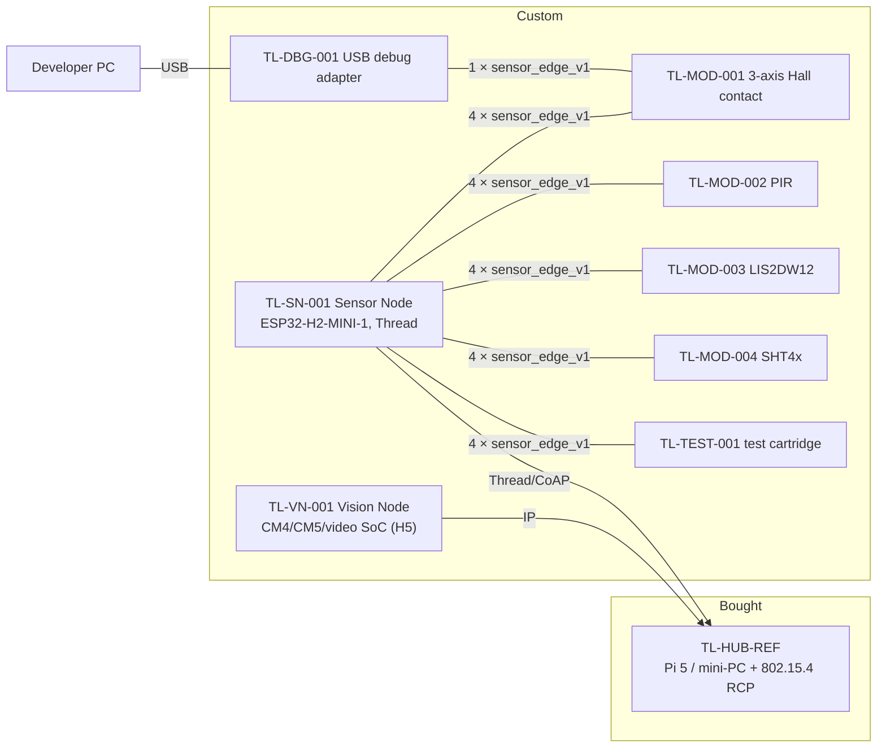
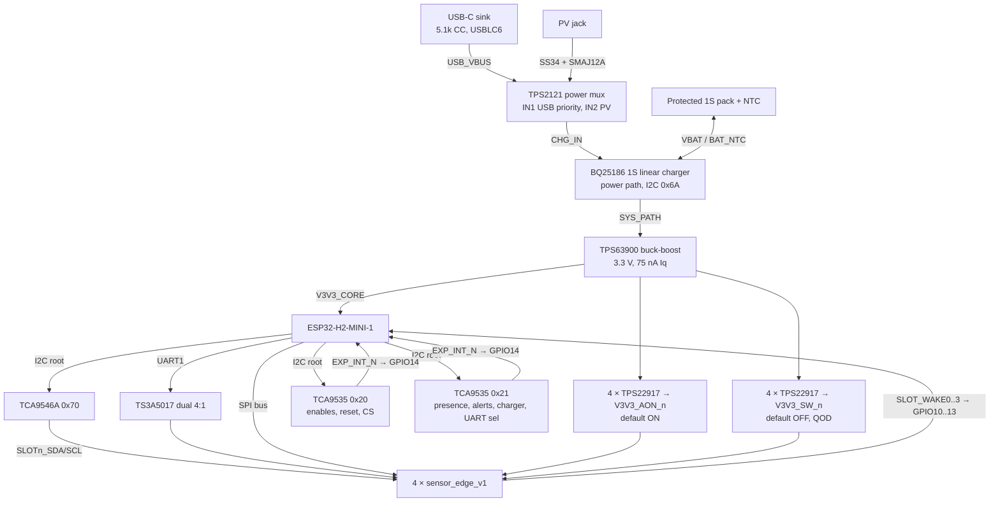

# Talos hardware overview (H0–H3)

Status: **provisional engineering draft, 2026-11-16.** It turns the hardware handoff into concrete, checkable choices. Every IC listed below has a datasheet entry in [`../requirements/datasheet-register.md`](../requirements/datasheet-register.md). Numbers marked *(src)* come from that datasheet. Numbers marked *(est)* are estimates that a bench must confirm.

## 1. Board family

The hub is bought, and the camera is its own board ([HW-0001](decisions/0001-hardware-family.md)). The only bespoke PCBs in the first batch are the Sensor Node, the four cards and the test cartridge.

## 2. TL-SN-001 block diagram (as drawn in the H3 schematic)

The KiCad schematic is flat, one sheet per board, in Rev A. Section labels in the sheet follow the handoff's sheets A–F. Hierarchical sheets can come after review, once the net list is stable.

## 3. MCU and pins

**Module:** ESP32-H2-MINI-1-H4S (4 MB flash), with MINI-1U as the alternate for external-antenna enclosures. The module exposes 19 GPIOs *(src: MINI-1 datasheet v1.6, Table 3)*. **All 19 are allocated.** The pad-by-pad ledger is [`../pins/esp32h2_mini1_pin_ledger.csv`](../pins/esp32h2_mini1_pin_ledger.csv). These are the decisions that matter:

| Need | Pins | Why |
|---|---|---|
| Four slot wake lines | GPIO10, 11, 12, 13 | Only GPIO8–14 are LP pins usable in every chip mode, deep sleep included *(src: ESP32-H2 Series datasheet v1.3 §2.2 "LP pins (GPIO8 ~ GPIO14): are able to work in any chip mode")*. The old placeholders 0/1/4/5 cannot wake from deep sleep. |
| Aggregated wake (alerts, presence, charger) | GPIO14 ← expander INT | GPIO14 is also LP. The two TCA9535 INT outputs are wired-OR. |
| Boot button / strap | GPIO9 | GPIO9 is a strap, weak pull-up, SPI boot = 1 *(src: Table 4, 6)*. Gets a 10 k pull-up and a BOOT button. |
| Status LED | GPIO8 | GPIO8 is a strap (floating default). A 10 k pull-up keeps it high so joint download (GPIO8=1, GPIO9=0) stays possible. |
| No 32 kHz crystal | GPIO13, 14 | Using GPIO13/14 as wake lines gives up the XTAL_32K pins. Thread SED timing then uses the internal RC: **HD-018, bench item.** |
| USB Serial/JTAG | GPIO26/27 | Factory flash and debug over the same USB-C used for power. |
| Factory UART | GPIO23/24 (U0RXD/U0TXD) | Test pads only. |
| Root I²C | GPIO2 (SDA), GPIO3 (SCL) | Pad JTAG (MTMS/MTDO) is not used. USB-JTAG covers debug. |
| Shared SPI | GPIO4 SCK, GPIO5 MOSI, GPIO0 MISO | Per-slot CS comes from the expander. Low-rate smart cards only. |
| Card UART | GPIO22 TX, GPIO25 RX via a 4:1 mux | GPIO25 is the JTAG-source strap. It only matters if EFUSE_JTAG_SEL_ENABLE is burnt, which we never do. |
| Battery voltage | GPIO1 (ADC1_CH0) | 4.7 MΩ/4.7 MΩ divider with a 100 nF hold capacitor, about 0.45 µA leakage *(est)*. |

**Wake polarity:** every card drives WAKE push-pull and idle-low. The main board holds each WAKE line low with 1 MΩ so an empty slot never wakes the node. The contact card (TMAG5273, HW-0006) raises WAKE only while a latched threshold interrupt is pending, in either door direction; the host clears it over I²C and re-arms, so WAKE always idles low. PIR and IMU cards follow the same rising-edge convention, so firmware only needs a high-level wake per pin. Whether ESP-IDF ext1 on the H2 supports per-pin levels is **HD-004 and must be confirmed on a dev kit**. The fallback is GPIO wake from light sleep.

## 4. Root I²C address map (reserved; branch devices must avoid these)

| Address | Device |
|---|---|
| 0x20 | TCA9535 EXP_A |
| 0x21 | TCA9535 EXP_B |
| 0x6A | BQ25186 *(src: SLUSF69 §6.3.16)* |
| 0x70 | TCA9546A |

A TCA9546A joins an enabled branch to the root bus, so branch devices share the root address space. The manifest validator rejects cards that use a reserved root address (`kI2cRootConflict`). Card addresses: ID EEPROM 0x50, SHT4x 0x44, LIS2DW12 0x19 (SA0 tied high, because its internal pull-up cannot be disabled; *src: LIS2DW12 Table 1, §6*), test-card expander 0x27.

## 5. Expanders

| Pin | EXP_A (0x20) | EXP_B (0x21) |
|---|---|---|
| P00–P03 | SLOT_SW_EN0–3 (1 MΩ pull-down: default off) | SLOT_PRESENT_N0–3 (in) |
| P04–P07 | SLOT_AON_EN0–3 (100 k pull-up: default on) | SLOT_ALERT_N0–3 (in) |
| P10–P13 | SLOT_RESET_N0–3 (100 k pull-up) | UART_SEL0, UART_SEL1, UART_MUX_EN_N, PRESENT_PROBE |
| P14–P17 | SLOT_CS_N0–3 (100 k pull-up) | CHG_INT_N, CHG_PG_N, PMUX_ST, spare (test pad) |

TCA9535 ports power up as inputs, so every output's safe default comes from a resistor, not from firmware. Presence pull-ups hang off `PRESENT_PROBE`, which firmware drives high only while it reads presence. That keeps four 100 k pull-ups out of the sleep budget.

## 6. Power

See [`../power/power-tree.md`](../power/power-tree.md) for the mode matrix and [`../results/power-budget.md`](../results/power-budget.md) for the numbers. In short:
- **Source arbitration:** TPS2121 power mux. USB (IN1) has priority and PV (IN2) is the fallback, 2.8–22 V *(src)*. This replaces "ORing" with a part that blocks reverse current and has an abs max of 24 V.
- **Charger:** BQ25186 linear charger with power path. VIN operates 3.6–18 V, OVP 18.5 V, and SYS runs from IN with an empty or absent battery *(src: §6.1)*. IQ_BAT is 3 µA typ *(src)*. Because it is linear, PV charge current must be limited to keep dissipation in check (see the power study).
- **Regulator:** TPS63900 buck-boost, 1.8–5.5 V in, 3.3 V out, 75 nA Iq *(src)*. It is set by CFG3 = 16.2 kΩ (SEL low) and CFG1 = 36.5 kΩ / CFG2 = 0 Ω (SEL high), so both settings give 3.3 V *(src: Tables 7-2, 7-3)*.
- **Slot rails:** each slot gets AON and SW load switches (TPS22917: 0.5 µA on, 10 nA off *(src)*). The SW switches enable quick output discharge, so an "off" card is really off.
- **No 5 V in Rev A.** Contact 5 is reserved and left unconnected ([HW-0003](decisions/0003-integrated-power.md)).

## 7. What is not here yet
- **Layout:** no PCB layout or footprint-verified BOM yet. That is H4, after EE review.
- **Vision Node:** no TL-VN-001 schematic. H5 is a compute and video trade study.
- **Measurements:** nothing has been measured. The sleep budget is a calculation.
